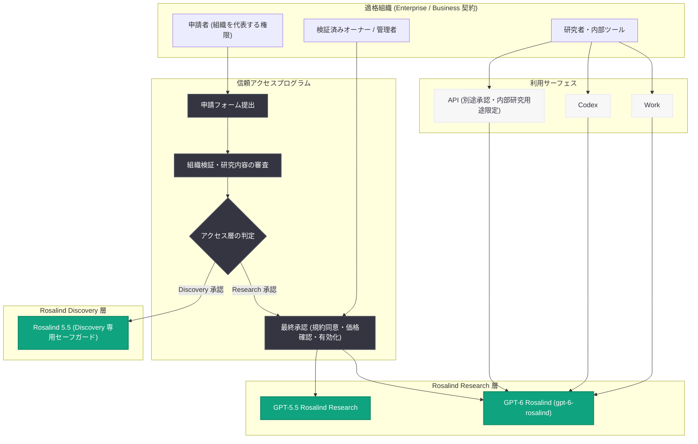

# GPT-6 Rosalind を API でリリース: 生命科学研究向けの生物学的推論特化モデル

## メタデータ

| 項目 | 内容 |
|------|------|
| 発表日 | 2026-10-30 |
| ソース | OpenAI API Changelog |
| カテゴリ | API 更新 / 新モデル |
| 公式リンク | https://developers.openai.com/api/docs/changelog |

## 概要

OpenAI は 2026 年 10 月 30 日、API Changelog にて新モデル「GPT-6 Rosalind」(モデル ID: `gpt-6-rosalind`) のリリースを発表した。Changelog では「複雑なライフサイエンス研究に向けて、科学ツール利用を伴う専門的な生物学的推論をもたらす (Released GPT-6 Rosalind, bringing specialized biological reasoning with scientific tool use to complex life sciences research)」と説明されている。

本モデルへのアクセスは一般公開ではなく、信頼アクセスプログラム (trusted access program) を通じて Rosalind Research 層に承認された組織に限定される。2026 年 4 月の GPT-Rosalind 初公開、同年 10 月 15 日の Rosalind Academic Plan 発表に続く、OpenAI のライフサイエンス特化モデル路線の最新アップデートであり、Rosalind ファミリーのフラッグシップが GPT-6 世代に更新された形となる。

## 主な内容

### Changelog エントリの内容

2026 年 10 月 30 日付のエントリは「Feature · Model: `gpt-6-rosalind`」として掲載されており、以下が確認できる。

- **モデル ID**: `gpt-6-rosalind`
- **位置づけ**: 複雑なライフサイエンス研究向けに、科学ツール利用を伴う専門的な生物学的推論を提供するモデル
- **アクセス条件**: 信頼アクセスプログラムで Rosalind Research に承認された組織のみ利用可能
- **リンク先**: 料金ページの Life sciences models セクションと、ヘルプセンターの trusted access program 解説記事

### 信頼アクセスプログラムと 2 つのアクセス階層

ヘルプセンターの記事によると、Enterprise または Business 契約を持つ適格組織が信頼アクセスプログラムを通じて GPT-Rosalind を申請できる。OpenAI が申請を審査し、以下のいずれのアクセス層に適格かを判定する。

| アクセス層 | 対象 | 利用モデル |
|-----------|------|-----------|
| Rosalind Research | フロンティア生物学研究 | GPT-6 Rosalind Research、GPT-5.5 Rosalind Research |
| Rosalind Discovery | 文献レビュー、データ解析、科学コード作成、実験計画などの日常的研究 | 既存の Rosalind 5.5 モデル (より厳格な監視と Discovery 専用セーフガードが適用) |

Discovery 承認は Research アクセスを付与せず、Research への移行には追加審査が必要となる。なお、米国大学の学術ラボは別枠の Rosalind Academic Plan で申請するが、同プランには API アクセスは含まれない。

申請手順 (機関向け) は以下の通りである。

1. 組織に紐づくアカウントでサインインし、アクセス申請フォームを開く
2. 組織を選択し、組織検証を完了する
3. 研究内容・利用目的の情報を提出し、データ取扱オプションと提出声明を確認する
4. 申請を送信し、表示される次のステップに従う

申請者には組織を代表する権限が必要 (ワークスペースのオーナー / 管理者である必要はない)。最終承認は検証済みのオーナー / 管理者が別途行い、規約への同意、価格の確認、有効化の承認を完了させる必要がある。

### 提供範囲と利用形態

ヘルプセンターの記事では、GPT-6 Rosalind Research の提供範囲について以下が記載されている。

- 承認済み Research 組織の限定セットで、**Work と Codex、および別途承認された API** で利用可能
- **Chat タブでは利用不可**
- Enterprise ワークスペースでは **2 週間の Admin Preview** から開始し、その期間中はデフォルトでオフ
- API アクセスは別途承認が必要で、**承認済みの内部研究ツール・ワークフロー・アプリケーションに限定**される
- 顧客向け製品や外部商用アプリケーションでの API 利用は現時点で不可
- 認証情報の共有や、外部ユーザーへのモデルアクセス提供は禁止
- Amazon Bedrock (AWS) では現在利用不可
- API 組織へのメンバー追加は API Platform → Settings → People から行う (手動管理の場合)

## 技術的な詳細

### 料金

料金ページの Life sciences models セクションには、`gpt-6-rosalind` を含む Rosalind ファミリーの Standard 料金 (1M トークンあたり) が掲載されている。短コンテキストは 272K 入力トークン以下、長コンテキストは 272K 入力トークン超と定義される。

**gpt-6-rosalind:**

| 項目 | 短コンテキスト (≤272K) | 長コンテキスト (>272K) |
|------|----------------------|----------------------|
| 入力 | $15.00 | $30.00 |
| キャッシュ済み入力 | $1.50 | $3.00 |
| 出力 | $75.00 | $112.50 |
| キャッシュ書き込み (30 分) | $18.75 | $37.50 |
| キャッシュ書き込み (12 時間) | $37.50 | $75.00 |

**既存の Rosalind モデルとの比較 (短コンテキストのみ提供):**

| モデル ID | 入力 | キャッシュ済み入力 | 出力 |
|----------|------|------------------|------|
| `gpt-rosalind-research` | $5.00 | $0.50 | $25.00 |
| `gpt-rosalind-discovery` | $5.00 | $0.50 | $25.00 |

GPT-6 Rosalind は既存 Rosalind モデルの 3 倍の基本料金に加え、既存モデルにはない長コンテキスト (272K 超) のサポートが料金表上で確認できる。なお、料金ページには「対象組織は最新の GPT-Rosalind モデルへのアクセスを継続的に得られる」こと、および 2026 年 3 月 5 日以降にリリースされたデータレジデンシー対象モデルの地域処理エンドポイントには 10% の上乗せ料金が適用されることが注記されている。

### コードサンプル

承認済みの API 組織では、モデル ID `gpt-6-rosalind` を指定して利用する。以下は基本的な呼び出し例である。

```python
from openai import OpenAI

# 承認済みの API 組織のキーを使用する
client = OpenAI()

response = client.chat.completions.create(
    model="gpt-6-rosalind",
    messages=[
        {
            "role": "system",
            "content": (
                "You are a life sciences research assistant specializing in "
                "biological reasoning for complex research questions. "
                "Provide evidence-based analysis."
            ),
        },
        {
            "role": "user",
            "content": (
                "Compare the mechanisms of mRNA degradation pathways in "
                "mammalian cells and outline an experimental design to "
                "distinguish their relative contributions for a given transcript."
            ),
        },
    ],
)

print(response.choices[0].message.content)
```

> **注:** 上記は承認済み組織での一般的な API 利用パターンを示す例であり、`gpt-6-rosalind` 固有の追加パラメータや科学ツール利用のインターフェース仕様は公式ドキュメントでは確認できていない。実際の仕様は信頼アクセスプログラム承認後に提供される情報を参照すること。

## アーキテクチャ

信頼アクセスプログラム経由で GPT-6 Rosalind を利用するまでのフローを以下に示す。



## 開発者への影響

- **API 経由の自動化が可能に**: Rosalind Academic Plan では API アクセスが含まれなかったのに対し、Rosalind Research 承認組織は別途承認を得たうえで `gpt-6-rosalind` を API から呼び出せるため、内部研究ツールや解析パイプラインへの組み込みが可能になる
- **用途は内部研究に限定**: API 利用は承認済みの内部研究ツール・ワークフロー・アプリケーションに限られ、顧客向け製品や外部商用アプリケーションへの組み込みは現時点で認められていない
- **コスト設計への注意**: 入力 $15.00 / 出力 $75.00 (短コンテキスト、1M トークンあたり) と既存 Rosalind モデルの 3 倍の料金設定であり、272K 入力トークンを超える長コンテキスト利用ではさらに 2 倍 (入力) / 1.5 倍 (出力) になる。キャッシュ済み入力 ($1.50) やキャッシュ書き込みオプションの活用がコスト最適化の鍵となる
- **段階的なロールアウト**: Enterprise ワークスペースでは 2 週間の Admin Preview (デフォルトオフ) から始まるため、組織内での利用開始には管理者による有効化作業が必要
- **アクセス層の違いを理解する必要**: Discovery 承認では GPT-6 Rosalind は利用できず、Research への移行には追加審査が必要となる

## 関連リンク

- [OpenAI API Changelog](https://developers.openai.com/api/docs/changelog)
- [料金ページ: Life sciences models](https://developers.openai.com/api/docs/pricing#life-sciences-models)
- [ヘルプセンター: GPT-Rosalind for life sciences research](https://help.openai.com/en/articles/20001193-gpt-rosalind-for-life-sciences-research)
- [関連レポート: GPT-Rosalind の発表 (2026-04-16)](./2026-04-16-introducing-gpt-rosalind.md)
- [関連レポート: Rosalind Academic Plan (2026-10-15)](./2026-10-15-rosalind-academic-plan.md)

## まとめ

GPT-6 Rosalind (`gpt-6-rosalind`) は、複雑なライフサイエンス研究向けに科学ツール利用を伴う生物学的推論を提供する、Rosalind ファミリーの最新フラッグシップモデルである。信頼アクセスプログラムで Rosalind Research 層に承認された組織のみが、Work、Codex、および別途承認された API (内部研究用途限定) を通じて利用できる。料金は既存 Rosalind モデルの 3 倍 (入力 $15.00 / 出力 $75.00、1M トークンあたり) に設定され、272K 入力トークン超の長コンテキストにも対応する。機微な生物学的能力を持つモデルを、組織検証・アクセス層の審査・利用サーフェスの限定という多層的な管理のもとで段階的に提供する、OpenAI の「trusted access」戦略を体現したリリースと言える。
