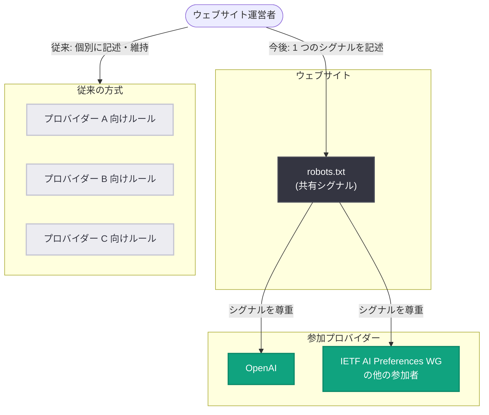

# ウェブサイトによる AI 学習設定の表明を容易に: OpenAI が robots.txt の共有シグナルを尊重へ

## メタデータ

| 項目 | 内容 |
|------|------|
| 発表日 | 2026-10-30 |
| ソース | OpenAI News |
| カテゴリ | 企業情報 (Company) |
| 公式リンク | https://openai.com/index/helping-websites-express-ai-training-preferences |

## 概要

OpenAI は、ウェブサイト運営者が基盤的な生成 AI の学習へのコンテンツ利用に関する意向を表明できる、robots.txt における共有シグナルを尊重すると発表した。これは自主的な取り組みであり、パブリッシャーやサイト運営者が同じ意向を複数の参加プロバイダーに一度に伝えることを容易にする仕組みである。

この取り組みは IETF (Internet Engineering Task Force) の AI Preferences ワーキンググループにおける進行中の作業に基づいており、OpenAI はワーキンググループの他の参加者とともにこの共有シグナルの発表に加わった。OpenAI は今後数か月以内のシグナル実装を目指しており、実装時に詳細を含む続報を共有する予定としている。

## 主な内容

### 共有シグナルの仕組みと意義

従来、サイト運営者が AI 学習へのコンテンツ利用に関する意向を伝えるには、各プロバイダーのクローラーを個別に特定し、プロバイダーごとに別々のルールを robots.txt に維持する必要があった。今回発表された共有シグナルにより、複数の参加プロバイダーに対して単一の記述で意向を伝えられるようになり、運営者の作業負担が軽減される。

なお、この新シグナルは OpenAI が既に提供している robots.txt 経由の既存コントロールを置き換えるものではなく、既存のクローラー制御は引き続き適用・尊重される。

### IETF での標準化との関係

この取り組みは IETF の AI Preferences ワーキンググループの進行中の作業に基づいている。OpenAI は、今回の発表を IETF での標準化議論への継続的な参加を強化するものと位置づけており、議論と状況の進展に応じて、適切なコントロールと公平性の観点から自社の慣行を適応させ続けるとしている。

### オープンなウェブに向けたビジョン

OpenAI はこの取り組みを、人々が情報を公開・発見でき、サイト所有者がコンテンツ利用についての選択をより明確かつ簡単に伝えられる、オープンなウェブに向けた実践的な一歩と位置づけている。また、他の AI プロバイダーにもこのシグナルの尊重を呼びかけている。

## 技術的な詳細

共有シグナルの具体的な構文は記事では公開されておらず、実装時に詳細が共有される予定である。参考として、OpenAI が既に提供している robots.txt 経由の既存コントロール (こちらは引き続き有効) では、以下のようにクローラーごとにルールを記述する。

### robots.txt の記述例 (既存のプロバイダー別コントロール)

```text
# 従来の方式: プロバイダーごとにクローラーを個別指定する必要がある
User-agent: GPTBot
Disallow: /

# 他のプロバイダーのクローラーにも、それぞれ別のルールが必要
User-agent: SomeOtherAICrawler
Disallow: /
```

今回の共有シグナルが実装されると、このようなプロバイダー別の記述を個別に管理しなくても、単一のシグナルで複数の参加プロバイダーに AI 学習に関する意向を伝えられるようになる。

## アーキテクチャ

robots.txt の共有シグナルによる意向伝達のフローを以下に示す。



## ウェブサイト運営者・開発者への影響

- 複数の参加プロバイダーに対し、単一の共有シグナルで AI 学習に関する意向を伝えられるようになり、robots.txt の管理負担が軽減される
- OpenAI の既存の robots.txt 経由のクローラー制御は置き換えられず、引き続き適用・尊重されるため、現在の設定を変更する必要はない
- 共有シグナルの実装は今後数か月以内に予定されており、具体的な構文や設定方法は実装時の続報を待つ必要がある
- IETF の AI Preferences ワーキンググループでの標準化議論の進展によって、今後の慣行が適応・変更される可能性がある

## 関連リンク

- [公式発表: Making it easier for websites to express AI training preferences](https://openai.com/index/helping-websites-express-ai-training-preferences)
- [IETF AI Preferences ワーキンググループ](https://datatracker.ietf.org/wg/aipref/about/)
- [OpenAI News](https://openai.com/news)

## まとめ

OpenAI は、ウェブサイト運営者が生成 AI の学習へのコンテンツ利用に関する意向を表明できる robots.txt の共有シグナルを尊重すると発表した。IETF の AI Preferences ワーキンググループの作業に基づく自主的な取り組みであり、従来のようにプロバイダーごとに個別のルールを維持する必要がなくなり、単一のシグナルで複数の参加プロバイダーに意向を伝えられるようになる。既存の OpenAI クローラー制御は引き続き有効であり、共有シグナルの実装は今後数か月以内に予定されている。OpenAI は他の AI プロバイダーにもシグナルの尊重を呼びかけており、オープンなウェブに向けた実践的な一歩と位置づけている。
