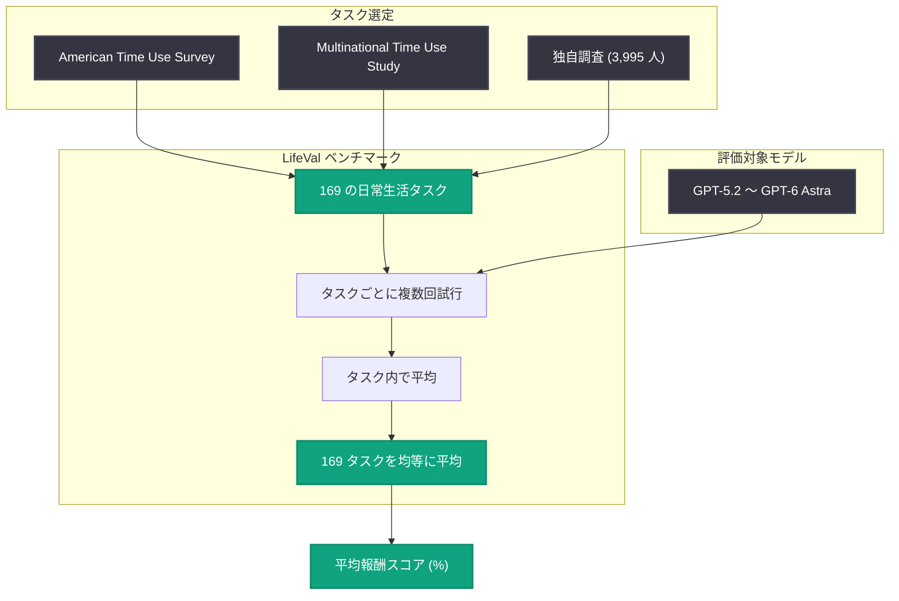

# LifeVal: 日常生活のタスクで AI の実用性を測定する新ベンチマーク

## メタデータ

| 項目 | 内容 |
|------|------|
| 発表日 | 2026-11-02 |
| ソース | OpenAI Research |
| カテゴリ | 研究成果 (Publication) |
| 公式リンク | https://openai.com/index/lifeval |

## 概要

OpenAI は、AI が日常生活の実用的なタスクをどれだけうまく支援できるかを測定するベンチマーク「LifeVal」を発表した。保育園探し、家計管理、行政手続きなど、毎週 10 億人以上が利用する ChatGPT のユーザーが実際に直面する課題を評価対象とし、「チャットの応答」ではなく「実際に物事を完了させる能力」を測定する点が特徴である。

LifeVal は、米国の生活時間調査 (American Time Use Survey) と多国間生活時間調査 (Multinational Time Use Study) を出発点に、3,995 人を対象とした人口統計学的に代表性のある独自調査を組み合わせて設計された。OpenAI はこの評価を過去 1 年間のモデル改善の追跡と推進に活用しており、GPT-5.2 の平均報酬 49.3% から GPT-6 Astra の 80.6% まで、日常タスク遂行能力が大幅に向上したことが示されている。

## 主な内容

### ベンチマークの目的と背景

OpenAI のミッションは「AGI が全人類に利益をもたらすこと」であり、そのためには学術的な知識評価を超えて、普通の人々の生活で重要なタスクに対するモデルの進歩を測定・改善する必要があるとしている。LifeVal がカバーする領域は以下のとおり。

- 育児・介護 (caregiving)
- 健康 (health)
- 教育 (education)
- 家庭内の事務作業 (household administration)
- 個人の家計 (personal finances)
- 買い物 (shopping)
- 行政サービスの利用 (accessing government services)

### タスク選定の方法

タスクは次の 3 つのデータソースから特定された。

1. **American Time Use Survey**: 米国における人々の時間の使い方を追跡する大規模調査
2. **Multinational Time Use Study**: 国際的な生活時間調査
3. **独自調査**: 3,995 人の回答者による人口統計学的に代表性のあるアンケート。各タスクについて「パーソナルアシスタントに最も助けてほしい領域」を特定する質問を実施

この結果、デモグラフィック・時間帯・季節を横断する日常生活タスクのカタログから、人々が最も支援を求める 169 タスクが評価セットとして構築された。

### 個別タスクの例と達成率

記事では、現行モデルが実際の日常ワークフローでどの程度のスコアを達成しているかの例が示されている。

| タスク例 | 内容 | スコア |
|---------|------|--------|
| 引っ越し後の幼稚園入園 | 新居近くの幼稚園を比較し、最適な候補をリストアップ | 93.1% |
| 洪水に備えたボランティア管理 | 床上浸水対策が必要な近隣 4 世帯を支援する地域ボランティアの組織化 | 98.0% |
| 家族の新居探し | 予算・独立した居住ユニット・通勤時間の条件に合う住宅を検索し、権利証書をカートに追加 | 100% |
| 遠方の祖母と一緒にスポーツ観戦 | リモートで一緒に試合を観られる簡単なセットアップを構築 | 96.3% |
| 糖尿病と診断された親の食事準備 | 新しい診断に合わせた実践的なケア・食事プランの作成 | 90.4% |

### エージェント能力の進化

過去 1 年間で、OpenAI はブラウザ操作 (browser use)、コンピュータ操作 (computer use)、コネクタ (connectors) タスクにおいてモデルをより高速・高性能・高整合にトレーニングしてきた。これらの能力を ChatGPT で有効化することで、ChatGPT は単なるチャットツールから、実際に行動して物事を完了させる「エージェント型パーソナルアシスタント」へと進化しつつあるとしている。

## 技術的な詳細

### 評価方法

- 各タスクについて複数回の試行 (attempts) を実施し、タスク内で平均を取る
- その後、169 タスクの平均値を均等に平均する (支払意思額 (WTP) による重み付けは行わない)
- スコアは報酬 (reward) を 100 倍したパーセント値で表示

### モデル別スコアの推移 (169 タスクの平均報酬)

| モデル | リリース日 | 平均報酬 |
|--------|-----------|---------|
| GPT-5.2 | 2025-12-11 | 49.3% |
| GPT-5.4 | 2026-03-05 | 73.0% |
| GPT-5.5 | 2026-04-23 | 77.4% |
| GPT-5.6 | 2026-07-09 | 80.0% |
| GPT-6 Astra | 2026-09-03 | 80.6% |

※ GPT-6 Astra はローンチブログの xhigh 設定での値。

### 推論努力 (reasoning effort) 別の性能・コスト比較

記事内のインタラクティブチャートには、推論努力レベルごとの報酬・トークン数・レイテンシ・API コストのデータが含まれている。主要な値は以下のとおり (報酬は概数)。

| モデル | low | medium | high | xhigh | max |
|--------|-----|--------|------|-------|-----|
| GPT-5.2 | 27.7% | 37.2% | 45.2% | 49.3% | - |
| GPT-5.4 | 62.8% | 70.1% | 72.0% | 73.0% | - |
| GPT-5.5 | 57.1% | 71.3% | 75.6% | 77.4% | - |
| GPT-5.6 | 63.9% | 75.0% | 78.8% | 80.0% | 82.6% |
| GPT-6 Astra | 66.6% | 77.6% | 80.7% | 80.6% | 82.5% |

効率面では世代を追うごとに大きく改善している。たとえば GPT-5.2 (xhigh) は約 202,000 トークン・レイテンシ約 121 秒で報酬 49.3% だったのに対し、GPT-6 Astra (xhigh) は約 14,500 トークン・約 15 秒で 80.6% を達成しており、少ない計算量でより高い成果を出せるようになっている。

### 評価フロー

## 開発者への影響

- **エージェント指向の評価基準**: 学術ベンチマークではなく「実タスクの完遂率」がモデル選定の新しい判断軸となる。ブラウザ操作・コンピュータ操作・コネクタを組み合わせたエージェントアプリケーションの実用性を測る参考指標になる
- **推論努力とコストのトレードオフの可視化**: reasoning effort 別の報酬・トークン数・レイテンシ・API コストのデータが示されており、用途に応じた推論努力レベルの選択 (例: 低コストで 7 割の成功率か、高コストで 8 割超か) の設計判断に役立つ
- **効率改善の恩恵**: 新しい世代のモデルほど少ないトークン・短いレイテンシで高い報酬を達成しているため、日常タスク系のエージェント実装ではモデル更新によるコスト削減効果が大きい
- **ユーザー調査に基づくタスク設計**: 生活時間調査と大規模アンケートからタスクを導出する手法は、コンシューマー向け AI アシスタントの機能優先順位付けの参考になる

## 関連リンク

- [LifeVal (OpenAI 公式)](https://openai.com/index/lifeval)
- [American Time Use Survey](https://www.bls.gov/tus/)
- [OpenAI Research](https://openai.com/research)
- [OpenAI News](https://openai.com/news)

## まとめ

LifeVal は、保育園探しから行政手続きまで、人々が実際に AI の支援を求める 169 の日常生活タスクでモデルの実用性を測定するベンチマークである。生活時間調査と 3,995 人の独自調査に基づくタスク設計により、学術的な知識評価では捉えられない「実生活での役立ち度」を定量化する。過去 1 年間で平均報酬は GPT-5.2 の 49.3% から GPT-6 Astra の 80.6% へと大幅に向上し、トークン効率・レイテンシも劇的に改善した。ChatGPT をチャットツールから「実際に行動するエージェント型パーソナルアシスタント」へと進化させる OpenAI の方向性を示す発表であり、AGI の利益を日常生活レベルで測定する試みの第一歩と位置づけられる。
