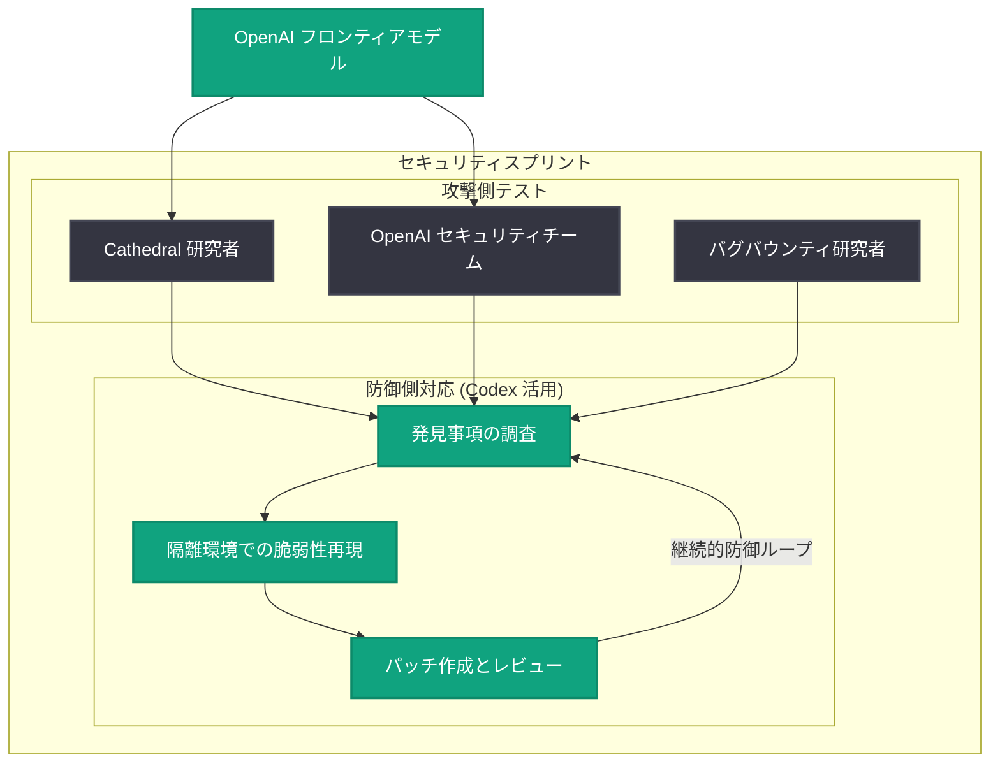

# OpenAI を強化する次期セキュリティスプリントの準備

## メタデータ

| 項目 | 内容 |
|------|------|
| 発表日 | 2026-11-02 |
| ソース | OpenAI News |
| カテゴリ | Security |
| 公式リンク | https://openai.com/index/preparing-our-next-security-sprint-to-harden-openai |

## 概要

OpenAI は、自社システムの防御を AI でテストし強化するための次期社内セキュリティスプリントを準備していると発表した。今回のスプリントでは、セキュリティ企業 Cathedral と提携し、外部の研究者とセキュリティパートナーを OpenAI 自身のチームと組み合わせ、OpenAI のモデルを活用して防御への挑戦 (攻撃的テスト) を行う。Cathedral の研究者は独自の専門知識とアプローチを持ち込み、弱点の発見とプラットフォーム保護を支援する。

あわせて、セキュリティバグバウンティプログラムの改善も発表され、重大 (クリティカル) な発見に対する報奨金は 4 倍以上に引き上げられる。これは「攻撃者より先に弱点を見つけて修正する」継続的な防御ループを構築するという、OpenAI の一連の取り組み (The Defender's Window 構想) の一環である。

## 主な内容

### Cathedral との提携による次期セキュリティスプリント

OpenAI は新しい研究者とセキュリティパートナーを自社チームと連携させ、OpenAI のモデルを使ってシステムのテストと強化を行う社内セキュリティスプリントを計画している。提携先である Cathedral の研究者は、OpenAI のモデルを OpenAI のチームと並行して使用し、防御に挑戦する役割を担う。

Cathedral の CEO 兼共同創業者である Gavin Kliger 氏は次のように述べている。

> 「OpenAI は、外部のセキュリティ企業と提携し、自社モデルを使って防御を継続的にテスト・強化するという重要な模範を示しています。すべての企業がこうした能力の活用方法を考えるべきです。OpenAI のモデルとセキュリティの専門知識を私たちの研究と組み合わせ、弱点の発見、修正のテスト、そしてこの継続的防御アプローチの強化に協力できることを楽しみにしています」

### バグバウンティプログラムの強化

セキュリティバグバウンティプログラムの改善も実施され、重大な発見に対する報奨金が 4 倍以上に増額される。OpenAI は、研究者が同社の前提 (仮定) に挑戦し、システムそのものと防御手法の両方を強化することを期待している。

### 前回スプリントの成果

今回の取り組みは、AI を使ってシステムの弱点を継続的に発見・修正するという継続的な活動の一部である。前回のスプリントでは以下の成果が示された。

- プロダクトエンジニアの 25% を、システムの弱点の発見と修正に専従させた
- エンジニアは Codex を使用して発見事項を調査し、隔離環境で脆弱性を再現し、レビュー用のパッチを準備した

### 「防御者の窓」を開き続けるために

OpenAI は、従来型のサイバー防御だけではもはや不十分だと指摘している。業界全体での最近のインシデントは、脅威がいかに迅速に出現するか、そして攻撃者より先に弱点を発見・修正する継続的な防御ループの構築がいかに重要かを示している。

「防御者の窓 (The Defender's Window)」を開き続けるには、組織がフロンティアレベルのサイバー能力を使ってシステムを強化する必要がある。OpenAI は以下を実施している。

- 最も高性能なモデルを自社防御の強化に使用し、Daybreak の顧客にも提供
- 重要サービスとデジタルインフラを守る最前線の防御者向けに、6 か月間で 10 億ドルの補助付きアクセスをコミット
- 前回スプリントのアーキテクチャと教訓、および産業界・政府全体のサイバー防御者を支援するためのブループリントを公開

## アーキテクチャ

前回スプリントで実証された、AI を活用した継続的防御ループの概念図。

## 開発者への影響

- **バグバウンティ報奨金の大幅増額**: 重大な脆弱性の発見に対する報奨金が 4 倍以上になるため、セキュリティ研究者にとって OpenAI プラットフォームの調査に参加するインセンティブが大きく高まる
- **AI 活用型防御のベストプラクティス**: Codex を使った脆弱性の調査・再現・パッチ作成というワークフローは、自組織のセキュリティ運用に AI を組み込む際の参考モデルになる
- **アーキテクチャと教訓の公開**: 前回スプリントのアーキテクチャやブループリントが共有されており、継続的防御ループを自社に導入する際の指針として利用できる
- **Daybreak による支援**: 重要インフラを守る防御者向けに 10 億ドル規模の補助付きアクセスが提供されるため、対象組織はフロンティアモデルをセキュリティ用途で活用しやすくなる

## 関連リンク

- [Preparing our next security sprint to harden OpenAI (公式記事)](https://openai.com/index/preparing-our-next-security-sprint-to-harden-openai)
- [The Defender's Window](https://openai.com/index/the-defenders-window/)
- [OpenAI News](https://openai.com/news)
- [OpenAI Security & Privacy](https://openai.com/security-and-privacy/)

## まとめ

OpenAI は、Cathedral との提携による次期セキュリティスプリントの準備を発表した。外部研究者と自社チームが OpenAI のモデルを使って防御に挑戦し、弱点の発見と修正を行う。バグバウンティの重大発見への報奨金は 4 倍以上に増額される。前回スプリントではプロダクトエンジニアの 25% を投入し、Codex による脆弱性の調査・再現・パッチ作成を実践した。従来型防御だけでは不十分という認識のもと、「防御者の窓」を開き続けるため、フロンティアモデルの自社防御への活用、Daybreak 経由での 6 か月 10 億ドルの補助付きアクセス提供、アーキテクチャと教訓の共有を進めており、業界全体での継続的防御ループの構築を呼びかけている。
