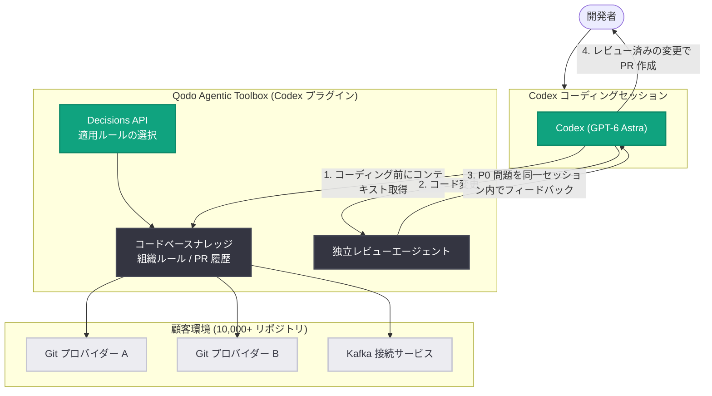

# Qodo が Codex プラグインで AI コードレビューに組織コンテキストを組み込む

## メタデータ

| 項目 | 内容 |
|------|------|
| 発表日 | 2026-11-02 |
| ソース | OpenAI News |
| カテゴリ | Startup (事例) |
| 公式リンク | https://openai.com/index/qodo-codex-plugin |

## 概要

OpenAI は、コードレビューとソフトウェア品質の AI ツールを開発するスタートアップ Qodo の事例を公開した。Qodo は、コーディングエージェントが変更するコードを正しく理解できるように、組織のナレッジを提供することを使命としており、共同創業者兼 CEO の Itamar Friedman 氏は自社を「コーディングエージェントの最良の友 (the coding agent's best friend)」と表現している。Qodo は GPT‑6 Astra を含む OpenAI モデルを使用してエンジニアリングナレッジの収集、コードレビュー、ソフトウェア品質のモニタリングを行っている。

今回の中心となるのは、Codex マーケットプレイスで公開された Qodo のプラグインである。このプラグインは、コードベースのナレッジ、組織のルール、独立したレビューを Codex のコーディングセッションに直接持ち込み、開発者がプルリクエストを開く前に、リポジトリ横断の P0 (最優先度) バグを検出できるようにする。

## 主な内容

### リポジトリ横断で P0 バグを発見する

Friedman 氏によれば、顧客環境は 10,000 以上のリポジトリに及ぶことがあり、ローカルなコード変更がそれ自体は正しく見えても、下流のサービスを壊す可能性がある。「Codex はローカルなタスクを効率的に完遂することに非常に優れている」と同氏は述べる一方、こうした環境では単一リポジトリの視点だけでは不十分だと指摘する。

Qodo のプラグインは、Qodo の Agentic Toolbox を通じて、コードベースのナレッジ、組織のルール、独立したレビューへのアクセスを Codex に提供する。このコンテキストにより、Codex は異なる Git プロバイダーでホストされているリポジトリや、Kafka で接続されたサービスを含む、リポジトリをまたいだ依存関係を考慮できるようになる。「Qodo がその接続を作り、Codex がソフトウェア全体を見渡して P0 バグを見逃さないよう支援する」と Friedman 氏は語る。

### レビューの自動化と人間の判断の両立

ワークフローは次のように進む。Codex がコードを書き始める前に、プラグインを通じて関連するコードベースのルール、プルリクエストの履歴やパターンを取得する。Codex が変更を加えた後、Qodo がそれをレビューし、開発者がプルリクエストを開く前に、同一セッション内で Codex に直接フィードバックを返す。

Qodo の AI Developer Relations Lead である Nnenna Ndukwe 氏は、開発者がこのワークフローを使い、Codex 上の GPT‑6 モデルで機能開発や技術的負債の解消に取り組んでいると述べる。Codex のコーディング作業と Qodo の独立レビューの間のハンドオフが自動化されている点が特徴である。

Friedman 氏は、コーディングエージェントとレビューエージェントを「陰と陽 (yin and yang)」に例える。一方がコードを作り、もう一方がそれに異議を唱える。それぞれの役割には固有のセットアップとコンテキストが必要で、複数のエージェントが関与することもある。同氏のビジョンは、エージェント同士が発見事項を議論し、「合意に至らなかったものだけを表面化」させて人間のレビューに委ねることである。開発者はプランナーおよびレビュアーとなり、未解決の問題をエージェントの議論、コンテキスト、過去の開発者の判断とともに検査できるようになる。「それが信頼を生む方法だ」と Friedman 氏は述べ、Ndukwe 氏も「プロセス全体がより効率的になり、私たちは自分の専門性の最良の部分を活かせる」と付け加えている。

### Codex を日常業務で活用する

Qodo 社内では、Ndukwe 氏が GPT‑6 Astra の Extra High および Ultra effort 設定を、自動化された開発ワークフローやナレッジワークに活用している。具体的には以下のような使い方を挙げている。

- 1 週間の成果と、次に注力・改善すべき領域をレポートするよう Codex をスケジュール実行
- ソーシャルプラットフォーム上のエージェンティックエンジニアリングに関する議論をリサーチし、開発者向けコンテンツのアイデアを提案
- 自身のコード変更を分析させ、作成・改良すべきエージェントスキルを提案

### Decisions API で適用すべきコーディングルールを選択する

Friedman 氏は、OpenAI が最近リリースした Decisions API を使い、開発の各段階でどのルールとエージェントスキルを適用するかを、すべて言語モデルに頼るのではなく選択させる機会があると見ている。たとえば 200 のルールのうちどれをチェックすべきかを Decisions API が選択し、その後に言語モデルが関連するルールについて推論するという構成により、選択を高速かつ低コストにしながらレビューの品質を向上できるという。「Decisions API は、プロセスにより多くの信頼をもたらす計り知れない機会だ」と同氏は述べている。

### 顧客が所有できる「ソフトウェアファクトリー」の構築

Qodo のアプローチは「人工知能の最良の側面と、伝統的なソフトウェアエンジニアリングおよびスクリプティングの最良の側面」を組み合わせたものだと Ndukwe 氏は語る。企業のナレッジがコーディングエージェントを導き、独立したレビューがその成果を検証し、残った問いを人間の専門性が解決する。

これは Friedman 氏が「ソフトウェアファクトリー」と呼ぶものの基盤となる。顧客自身が組み立てて所有できるシステムであり、コーディングエージェントとレビューエージェントを、本番環境でソフトウェアがどう変化するかの理解とともに統合するものである。

## 技術的な詳細

Qodo の Codex プラグインが提供する主な機能は以下のとおり。

| 機能 | 内容 |
|------|------|
| コードベースナレッジ | リポジトリ横断の依存関係 (異なる Git プロバイダー、Kafka 接続サービスを含む) の把握 |
| 組織ルールの取得 | コーディング前に関連するコードベースルール、PR 履歴・パターンを Codex に提供 |
| 独立レビュー | Codex の変更を Qodo がレビューし、同一セッション内で結果を返却 |
| Agentic Toolbox | 上記機能へのアクセスを提供する Qodo の基盤 |
| Decisions API 活用 (構想) | 多数のルールから適用対象を選択し、LLM の推論対象を絞り込むことで高速・低コスト・高品質なレビューを実現 |

使用されている OpenAI 製品・モデル: API、Codex、GPT‑6 Astra (Extra High / Ultra effort 設定を含む)、Decisions API (活用構想)。

## アーキテクチャ

## 開発者への影響

- **PR 前の品質ゲート**: プルリクエストを開く前の同一 Codex セッション内でレビュー結果が返るため、レビューサイクルの手戻りを削減できる
- **リポジトリ横断の安全性**: ローカルには正しく見える変更が下流サービスを壊すリスクを、クロスリポジトリの依存関係コンテキストによって低減できる
- **組織標準の自動適用**: コーディング規約や PR パターンなどの組織ナレッジがエージェントのコーディング段階から反映される
- **役割の変化**: 開発者はコードの詳細な検査者から、エージェント間で合意に至らなかった問題を裁定するプランナー・レビュアーへと役割が移行していく
- **エコシステムの示唆**: Codex マーケットプレイスのプラグインとして提供されており、サードパーティツールを Codex セッションに統合するパターンの参考になる

## 関連リンク

- [Qodo builds context into AI code review with Codex (OpenAI 公式)](https://openai.com/index/qodo-codex-plugin)
- [Qodo 公式サイト](https://www.qodo.ai/)
- [Codex](https://openai.com/codex/)
- [OpenAI News](https://openai.com/news)

## まとめ

Qodo は、Codex マーケットプレイスのプラグインを通じて、組織のナレッジ・コーディング標準・独立レビューを Codex のコーディングセッションに統合した。これにより、10,000 以上のリポジトリに及ぶ環境でも、プルリクエスト前にリポジトリ横断の P0 バグを検出できる。コーディングエージェントとレビューエージェントを「陰と陽」として対峙させ、合意できない問題のみを人間に委ねるというビジョンは、Decisions API によるルール選択の高速化・低コスト化とあわせて、顧客が所有できる「ソフトウェアファクトリー」の構想へとつながっている。コーディングエージェントの出力品質を組織コンテキストで高めるアプローチの代表的な事例といえる。
