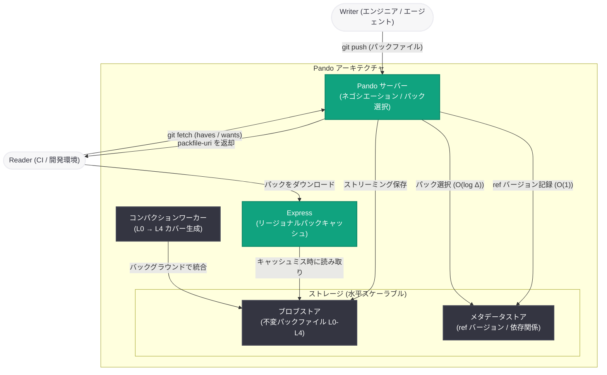

# Scaling Git at OpenAI: Codex 時代の開発規模に対応する Git 互換バックエンド「Pando」

## メタデータ

| 項目 | 内容 |
|------|------|
| 発表日 | 2026-11-02 |
| ソース | OpenAI News |
| カテゴリ | Engineering |
| 公式リンク | https://openai.com/index/scaling-git-at-openai |

## 概要

OpenAI は、Codex がもたらす大規模な並行開発に対応するために構築した Git 互換のソースコントロールバックエンド「Pando」の技術詳細を公開した。Pando は、(1) 多数のブランチへの同時プッシュに最適化された水平スケーラブルな書き込みと、(2) クライアントのネットワーク帯域を飽和させるほどの読み取りスループットの最大化、という 2 つの目標を掲げて設計されている。Git プロトコルおよびクライアントとの互換性を維持したまま、既存のワークフローを変更することなく移行を実現した。

本番環境では、プッシュのメディアンレイテンシを約 5 分の 1 (約 80% 削減) に短縮し、1 日あたり約 1 ペタバイトの Git データを配信している。現在、Pando は OpenAI のモノレポにおけるすべての開発を支えている。

## 主な内容

### 新しいソースコントロールシステムが必要になった背景

Codex の登場により、OpenAI におけるエンジニアリングの規模とペースは劇的に変化した。1 人のエンジニアが複数の変更を並行して進められるようになり、ブランチ、プッシュ、マージ、そして開発環境・研究ジョブ・CI からのフェッチとクローンが急増した。2025 年末頃から、モノレポを支える既存システムは限界に達し、フェッチやプッシュの遅延、マージの失敗が頻発し、信頼性は一時 90% を下回った。

OpenAI は Git そのものを捨てるのではなく、Git を基盤として維持しながらバックエンドを再構築する道を選んだ。これにより、エンジニアとエージェントは既存のワークフローをそのまま使い続けられ、クライアント側の改善は上流の Git プロジェクトに還元できる。

### 既存の分散 Git サービスパターンとの比較

Pando の設計にあたり、従来の 2 つのアプローチが評価された。

- **3 フェーズコミット (3PC)**: 複数レプリカに完全なコピーを保持し、参照 (ref) 更新を多数決で合意する方式。全参照の一貫したビューを提供できるが、参照は 1 つずつ更新され、プッシュのたびに複数回のラウンドトリップが必要。書き込み量が増えるとレプリカのディスク性能がボトルネックになる
- **ライトアヘッドログ (WAL)**: ブロブストレージ上の共有マニフェストで更新を順序付ける方式。パックファイルのアップロードは並列化できるが、無関係なブランチへのプッシュでも同一マニフェストの compare-and-swap 更新で競合する

1,000 クライアントが別々のブランチへ同時にプッシュするシミュレーションでは、3PC はディスク飽和により書き込みレイテンシが増大し、WAL はジャーナルの読み取りが追いつかず読み取りレイテンシが増大した。Pando は数千のクライアントが同時にプッシュしても性能が劣化しないことが、シミュレーションと実際のモノレポの両方で確認されている。

### Pando のアーキテクチャ: 因果一貫性による制約の再考

Pando は、多くの Git システムが前提とする 2 つの要件を緩和した。

1. **リポジトリ全体の一貫性**: 全 ref の特定時点のスナップショットを提供するには全体の調整が必要で、無関係なブランチへのプッシュが単一の調整ポイントで競合する
2. **クライアントごとの固有パックファイル生成**: クライアントごとに異なるパックファイルを生成すると CPU とディスク I/O を消費し、大量の読み取りにスケールしない

代わりに Pando は**因果一貫性 (Causal Consistency)** という緩和された一貫性モデルを採用した。プッシュ時に受信パックファイルを不変ブロブとしてブロブストアに保存し、ブランチが動くたびに新しいチップ、対応するパック、依存する過去の ref バージョンをメタデータストアに記録する。個々の ref の更新には直列化可能性 (serializability) を保証し、「read-your-own-write」一貫性を提供する一方、複数ブランチをまたいだ単一時点のビューは保証しない。実際には、ユーザーもエージェントも ref 更新のグローバルな順序には依存せず、単一の参照に対する更新順序のみに依存するため、この妥協は実用上問題にならない。

### プッシュのスケーリング

従来の Git サーバーはすべての ref をクライアントに広告するが、数百万のブランチがあると広告だけで 100 MiB を超える可能性がある。Pando はデフォルトで指定されたトランクブランチのみを広告する。これによりブランチ数が増えても広告サイズは一定に保たれ、クライアントが生成するパックファイルはサーバーが明示的に許可した履歴のみに依存するため、プッシュで受け取ったパックをそのまま後続のフェッチへの応答として再利用できる。

モノレポにおけるこの方式のパックファイルサイズは、メディアンで 20 KiB 未満、99 パーセンタイルで 3 MiB 未満だった。プッシュの書き込み操作に必要なメタデータの読み書きは O(1) で、競合するキーは ref ポインタのみ (アトミックな compare-and-swap 相当の操作で保護) であるため、Pando サーバー、メタデータストア、ブロブストアを追加することで書き込みスループットを水平にスケールできる。

### ラインレートのフェッチ・クローン性能

フェッチ時には、クライアントの haves と wants を ref バージョンの集合に解決し、必要なオブジェクトをカバーする保存済みパックファイルを選択する。必要なメタデータ読み取りは O(log Δ) (Δ はクライアントの状態と要求の間の ref バージョン距離) に抑えられている。

Git プロトコルの packfile-uri 機能を活用し、サーバーはインラインでは空のパックファイルを返し、実データは URI 経由で別途ダウンロードさせる。地理的に分散した各リージョンに Pando クラスタとローカルキャッシュを配置し、パック配信サービス「Express」がブロブストアをキャッシュする。コンシステントハッシングによるルーティングでキャッシュヒット率は 99% を超え、標準的なクラウド VM のみで 10 Gbps のネットワークリンクを飽和させるクローン・フェッチ性能を実証した。

### コンパクション

変化の速いリポジトリでは、プッシュごとのパックファイル (L0) を毎回送ると 1 日で数万ファイルのダウンロードが必要になる。Pando は LSM ツリー (log-structured merge-tree) のコンパクションに似た設計を採用し、バックグラウンドワーカーが L0 パックを幾何級数的にスケールする「カバー」にまとめる (現在モノレポでは最大 L4 まで使用)。カバーは圧縮率を改善するだけでなく、ref バージョンに対するスキップリストとして機能し、フェッチ計画を対数時間で解決できるようにする。全レベルのパックファイルは破棄されず、クライアントの haves/wants に応じて継続的に配信に使われる。

## 技術的な詳細

### 開発プロセス: Codex による 10 週間での構築

Pando 自体が Codex を活用して構築された点も注目に値する。

- キックオフから本番投入まで **10 週間**
- コア設計は **1 人のエンジニア**、実装は**エージェントのチーム**、デプロイは少数のエンジニアが担当
- グリーンフィールドプロジェクトとして **Rust** で実装し、レガシー依存を排除
- エージェントが標準 Git の挙動と照合できる適合性テストスイートと、決定論的シミュレーションテストハーネスを整備し、レースコンディションや回帰を検出
- GPT-6 Astra を使い、エージェントが **Lean と TLA+** で「Pando の理論」を形式化してバグの発見・修正とシステム特性の証明を実施
- 数百時間に及ぶ継続セッションでエッジケースを修正し、Daybreak 水準のモデルで Git と Pando のレッドチーミングを常時実行

### 本番環境での実績

| 指標 | 実績 |
|------|------|
| プッシュのメディアンレイテンシ | 約 5 分の 1 に短縮 (約 80% 削減) |
| Git データ配信量 | 1 日あたり約 1 ペタバイト (少数の CPU コアで実現) |
| ピーク配信量 | 1 時間で 57 テラバイト超の Git パックを配信 |
| キャッシュヒット率 | 99% 超 (ローカルディスクキャッシュから配信) |
| クローン・フェッチ速度 | 10 Gbps ネットワークリンクを飽和 |
| 本番稼働開始 | 2026 年 4 月 |

### デプロイ戦略

初期デプロイでは、既存ソースコントロールシステムへの読み書きスルー型プロキシとして Pando を配置し、両システムを同期させながらダウンタイムなしでトラフィックを移行した。開発者マシンと ChatGPT デスクトップアプリには OpenAI の公開 Git ディストリビューションを配布し、Git CLI の内部ラッパーで段階的にクライアントを移行。レガシー API、Webhook、リポジトリダウンロードに依存する数百のインテグレーションも移行された。Codex 自身が移行を支援し、開発者は Codex に依頼するだけで開発環境とサービスを移行できた。

## アーキテクチャ

## 開発者への影響

- **Git ワークフローの継続性**: Pando は Git プロトコル・クライアント互換であるため、エージェント大規模開発でも既存の Git ワークフロー (push、fetch、clone、`--force-with-lease` など) をそのまま使える設計思想が示された
- **上流 Git への貢献**: 並行ダウンロード・中断された転送のクリーンアップ・再開処理の修正、packfile-uri のトレーシング改善、「explicit haves」の概念の追加など、複数の改善がすでに上流 Git に取り込まれている。OpenAI の公開 Git リポジトリとパッチトラッカーで進捗を追跡できる
- **エージェント時代のインフラ指針**: 多数のエージェントが共有リポジトリで協働するワークロードは今後「新しい標準」になるとされ、因果一貫性やパックファイル再利用といった設計パターンは、同様のスケール課題に直面する組織への参考になる
- **技術共有の可能性**: OpenAI は Pando を支える技術をユーザーに共有する方法を模索中であり、将来的に外部でも利用可能になる可能性がある

## 関連リンク

- [Scaling Git at OpenAI (公式記事)](https://openai.com/index/scaling-git-at-openai)
- [OpenAI の Git フォーク (GitHub)](https://github.com/openai/git)
- [Codex](https://openai.com/codex/)
- [OpenAI News](https://openai.com/news)

## まとめ

Pando は、Codex が可能にした並行開発の爆発的な増加に対応するため、OpenAI が構築した Git 互換のソースコントロールバックエンドである。リポジトリ全体の一貫性を因果一貫性に緩和して書き込みを水平スケールさせ、パックファイルの再利用と多層キャッシュ (Express) で読み取りをネットワーク帯域の限界までスケールさせた。本番環境ではプッシュのメディアンレイテンシを約 5 分の 1 に短縮し、1 日約 1 ペタバイトの Git データを配信している。Codex とエージェント群によって 10 週間で構築・本番投入された点、Lean / TLA+ による形式検証や決定論的シミュレーションテストを活用した点、そして改善を上流 Git コミュニティに還元している点は、エージェント時代のソフトウェアエンジニアリングのあり方を示す事例といえる。
