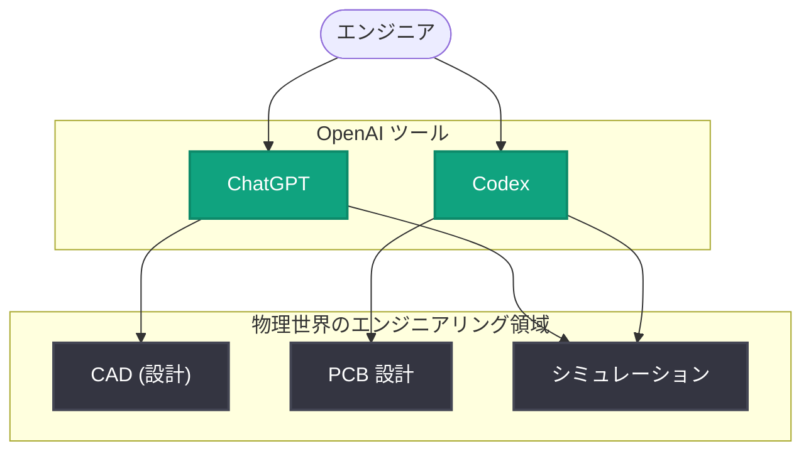

# 物理世界のエンジニアリングを加速する ChatGPT と Codex

## メタデータ

| 項目 | 内容 |
|------|------|
| 発表日 | 2026-11-03 |
| ソース | OpenAI News |
| カテゴリ | 事例紹介 |
| 公式リンク | https://openai.com/index/accelerating-engineering-for-the-physical-world |

## 概要

OpenAI は、ChatGPT と Codex が物理世界のエンジニアリング業務を高速化している事例を紹介する記事を公開した。対象となる業務には、CAD (コンピュータ支援設計)、PCB (プリント基板) 設計、シミュレーションなどが含まれる。

ソフトウェア開発の支援ツールとして広く知られる AI が、ハードウェアや物理製品の設計・検証といった領域にも活用範囲を広げていることを示す発表である。

## 主な内容

### 物理世界のエンジニアリングへの AI 活用

本記事では、ChatGPT と Codex が以下のような物理世界のエンジニアリング業務に活用されている事例が紹介されている。

- **CAD**: コンピュータ支援設計の業務支援
- **PCB 設計**: プリント基板設計の効率化
- **シミュレーション**: 物理的な挙動の検証作業の高速化

### ChatGPT と Codex の役割

ソフトウェアコード生成を得意とする Codex と、対話型アシスタントである ChatGPT が、設計・検証といったエンジニアリングワークフローの中で活用され、作業の高速化に寄与していることが示されている。

## 技術的な詳細

本発表は事例紹介であり、API 固有の新機能やパラメータ変更に関する情報は含まれていない。

## アーキテクチャ

記事で紹介されている活用領域の全体像を以下に示す。

## 開発者への影響

- AI 活用の対象がソフトウェア開発にとどまらず、CAD や PCB 設計、シミュレーションといったハードウェア・物理製品のエンジニアリング領域に広がっていることが示された
- ハードウェア設計や製造業に関わるエンジニアにとって、ChatGPT や Codex を自身のワークフローに組み込む際の参考事例となる

## 関連リンク

- [Accelerating engineering for the physical world (公式記事)](https://openai.com/index/accelerating-engineering-for-the-physical-world)
- [OpenAI News](https://openai.com/news)
- [OpenAI 公式ドキュメント](https://platform.openai.com/docs)

## まとめ

OpenAI は、ChatGPT と Codex が CAD、PCB 設計、シミュレーションといった物理世界のエンジニアリング業務を高速化している事例を紹介した。AI による生産性向上の対象が、ソフトウェア開発から物理製品の設計・検証領域へと拡大していることを示す発表である。
