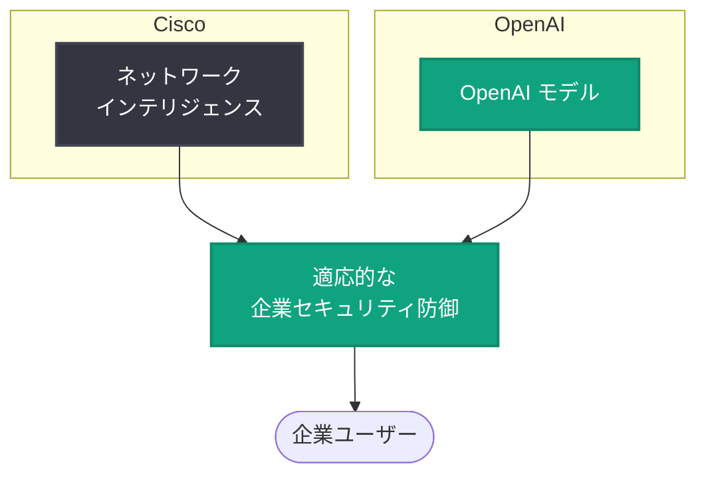

# How Cisco defends at machine speed with OpenAI: Cisco と OpenAI によるマシンスピードの企業セキュリティ防御

## メタデータ

| 項目 | 内容 |
|------|------|
| 発表日 | 2026-11-03 |
| ソース | OpenAI News |
| カテゴリ | 導入事例 (セキュリティ) |
| 公式リンク | https://openai.com/index/cisco-cyber |

> **注記**: 本レポート作成時点で記事本文の取得ができなかったため (HTTP 403)、OpenAI News に掲載された概要情報のみに基づいて作成している。詳細は公式リンクを参照のこと。

## 概要

Cisco が、自社のネットワークインテリジェンスと OpenAI のモデルを組み合わせ、より適応的な企業セキュリティ防御を構築した事例が OpenAI News で紹介された。タイトルの「defends at machine speed (マシンスピードで防御する)」が示すとおり、人手による対応速度を超えるスピードでの脅威対応を目指す取り組みである。

本記事は OpenAI の顧客導入事例 (ストーリー) として公開されており、エンタープライズセキュリティ領域における AI 活用の具体例として位置づけられる。

## 主な内容

### 確認できている事実

公開されている概要から確認できる内容は以下のとおり。

- **発表主体**: OpenAI News に掲載された Cisco の導入事例
- **組み合わせ**: Cisco のネットワークインテリジェンスと OpenAI のモデル
- **目的**: より適応的 (adaptive) な企業セキュリティ防御の構築
- **キーワード**: マシンスピードでの防御 (machine speed)

### 概要から読み取れる構図

概要情報に基づくと、本事例の基本的な構図は「Cisco が保有するネットワークレベルの知見 (ネットワークインテリジェンス) 」と「OpenAI のモデル」を組み合わせ、企業向けのセキュリティ防御を適応的に行うというものである。

※ 上図は概要情報に基づく概念図であり、実際のシステム構成を示すものではない。

## 技術的な詳細

記事本文を取得できていないため、使用モデル、API、アーキテクチャの詳細など、API 固有の技術情報は本レポートでは記載しない。詳細は [公式記事](https://openai.com/index/cisco-cyber) を参照のこと。

## 開発者への影響

概要情報の範囲で考えられるポイントは以下のとおり。

- セキュリティ領域における OpenAI モデルのエンタープライズ導入事例が増えており、同様のユースケースを検討する際の参考事例となる
- ドメイン固有のデータ (本事例ではネットワークインテリジェンス) と汎用モデルの組み合わせという構図は、他業種への応用を考えるうえでの示唆となる
- 具体的な実装方法や使用モデルについては、公式記事での確認が必要

## 関連リンク

- [How Cisco defends at machine speed with OpenAI (公式記事)](https://openai.com/index/cisco-cyber)
- [OpenAI News](https://openai.com/news)
- [OpenAI 公式ドキュメント](https://platform.openai.com/docs)

## まとめ

Cisco がネットワークインテリジェンスと OpenAI のモデルを組み合わせ、マシンスピードで動作する適応的な企業セキュリティ防御を構築した事例が 2026 年 11 月 3 日に OpenAI News で公開された。本レポートは記事本文を取得できなかったため概要情報のみに基づいており、技術的詳細は公式記事での確認を推奨する。
