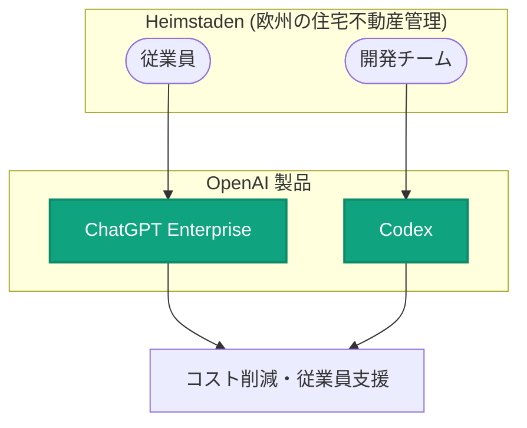

# Heimstaden が AI で住宅不動産管理を変革

## メタデータ

| 項目 | 内容 |
|------|------|
| 発表日 | 2026-11-03 |
| ソース | OpenAI News |
| カテゴリ | 導入事例 |
| 公式リンク | https://openai.com/index/heimstaden |

> **注記**: 本レポート作成時点で記事ページの全文取得ができなかったため (HTTP 403)、OpenAI News に掲載された概要情報のみに基づいて作成しています。詳細は上記の公式リンクを参照してください。

## 概要

欧州で住宅不動産事業を展開する Heimstaden が、ChatGPT Enterprise と Codex を活用して不動産管理業務を変革している事例が OpenAI News で紹介されました。同社は AI の導入により、欧州全体でコスト削減と従業員支援を実現しています。

本件は新しい API や製品の発表ではなく、企業による OpenAI 製品の導入事例 (カスタマーストーリー) です。

## 主な内容

### ChatGPT Enterprise と Codex の活用

概要情報によると、Heimstaden は以下の 2 つの OpenAI 製品を活用しています。

- **ChatGPT Enterprise**: 企業向けのセキュリティ・管理機能を備えた ChatGPT。従業員の日常業務の支援に利用
- **Codex**: ソフトウェア開発を支援する OpenAI のコーディングエージェント

### 導入による成果

概要として挙げられている成果は以下のとおりです。

- 欧州全体でのコスト削減
- 従業員支援 (業務効率化による従業員のサポート)

具体的な数値や導入プロセスの詳細は、記事全文が取得できなかったため本レポートには含めていません。公式記事を参照してください。

## アーキテクチャ

概要情報に基づく、Heimstaden における OpenAI 製品活用の全体像です。

## 開発者・企業への影響

- 不動産管理のような伝統的な業界でも、ChatGPT Enterprise と Codex を組み合わせた AI 活用が進んでいることを示す事例
- 全社的な従業員支援 (ChatGPT Enterprise) と開発業務の効率化 (Codex) を並行して進めるアプローチの参考になる
- 欧州企業における大規模な AI 導入事例として、同様の業界・地域での導入検討の材料となる

## 関連リンク

- [Heimstaden 導入事例 (公式記事)](https://openai.com/index/heimstaden)
- [ChatGPT Enterprise](https://openai.com/chatgpt/enterprise/)
- [Codex](https://openai.com/codex/)
- [OpenAI News](https://openai.com/news)

## まとめ

Heimstaden は ChatGPT Enterprise と Codex を活用して住宅不動産管理業務を変革し、欧州全体でコスト削減と従業員支援を実現しています。伝統的な不動産業界における全社的な AI 導入事例として注目される発表です。詳細な導入プロセスや成果の数値については、公式記事を参照してください。
