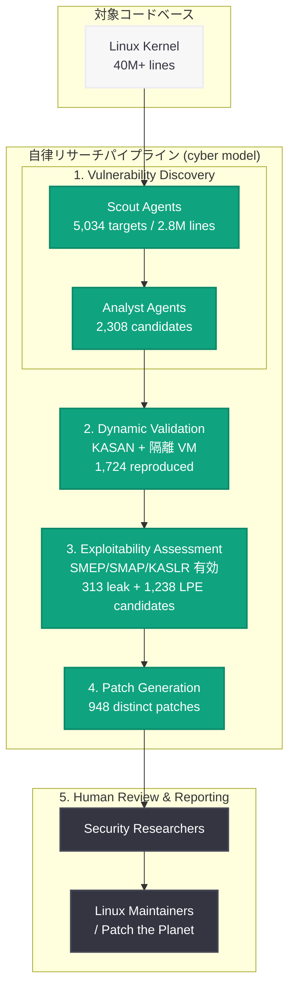

# A thousand fewer paths to root: Linux カーネル脆弱性の発見・検証・修正を自動化するパイプライン

## メタデータ

| 項目 | 内容 |
|------|------|
| 発表日 | 2026-11-04 |
| ソース | OpenAI News |
| カテゴリ | Security |
| 公式リンク | https://openai.com/index/a-thousand-fewer-paths-to-root |

## 概要

OpenAI は、従来は 1 件ごとに個別の継続的な調査を必要としていたセキュリティリサーチを、体系的なプロセスとして実行できることを示す研究成果を公開した。管理された研究環境内で Linux カーネルを対象とするプロトタイプを構築し、2,308 件の候補検出結果を特定・分析、1,724 件の脆弱性を動的に再現し、非特権のローカルユーザーが root 権限を取得し得るローカル権限昇格 (LPE) の実証を 948 件分まとめている。

この証拠をもとに報告の優先順位付けを行い、メンテナーのレビュー向けに候補パッチを開発した。Linux カーネルコミュニティの助言に従い、まず重大度の高い脆弱性から着手し、残りについては [Patch the Planet](https://openai.com/index/patch-the-planet/) のパートナーと協力して段階的に報告とパッチ提出を進めている。2026 年 6 月に GPT-5.5 Cyber が Linux カーネルの脆弱性を特定し 24 件の LPE 検証を行ったという発表を、今回は発見・動的検証・影響評価・パッチ生成を含むパイプラインへと拡張した形となる。

## 主な内容

### なぜ Linux カーネルを対象にしたのか

Linux カーネルは Android 端末、クラウドインフラ、スーパーコンピューターなど数十億人が利用するシステムの基盤である。4,000 万行を超えるコードを持ち、システムコール、ネットワーク、ファイルシステム、デバイスドライバーを通じて広い攻撃面を露出している。OpenAI は、この規模と重要性を持つコードベースにおいてフロンティアモデルがどれだけ有効に脆弱性を発見し、そのセキュリティ上の影響を示せるかを検証する目的で Linux を選定した。

実際の運用上の課題は「発見」そのものではなかった。初期の発見段階で数千件の候補が生成され、セキュリティリサーチャーが手作業でレビューおよびトリアージできる量を超えたため、どの検出結果が再現可能か、どのセキュリティ境界を越えるのか、どれを最優先でメンテナーに届けるべきかを判断することがボトルネックとなった。

### 5 段階のパイプライン構成

プロトタイプは、中核に次世代の cyber モデルを据えた 5 段階のパイプラインとして構成されている。

- **Vulnerability discovery (脆弱性発見)**: エージェントがコードベースのセキュリティ関連箇所を特定し、候補検出結果をスキャンする
- **Dynamic validation (動的検証)**: 隔離環境で各候補の再現を試み、実行時の証拠を保存する。再現・検証済みの脆弱性が出力される
- **Exploitability assessment (影響評価)**: 検証済みの脆弱性が情報漏えいや権限昇格につながり得るかを評価する
- **Patch generation (パッチ生成)**: 特定された各脆弱性に対処するパッチを生成する
- **Human review (人間によるレビュー)**: セキュリティリサーチャーが検証結果、パッチ、提案された深刻度をレビューし、メンテナーに報告する

パイプラインの最終段階では、根本原因分析、最小構成の再現コード、候補パッチ、および影響の実証をバンドルし、人間のリサーチャーが深刻度を評価して修正を upstream に反映させる作業を支援する。

### 各段階の実測値とコスト

OpenAI は、他のリサーチャーが再現・拡張する際の必要リソースを見積められるよう、段階ごとの API コストを公開している。今回の研究は手法とモデル能力の測定に焦点を置いており、コスト最適化は目的としていないため、報告されたコストは上限に近い値として扱うべきだと明記されている。

| 段階 | 主な結果 | API コスト |
|------|---------|-----------|
| Scout エージェント (監査対象の選定) | 5,034 件の監査対象、約 280 万行 (カーネル全体の約 7%) | $3,426 |
| Analyst エージェント (脆弱性スキャン) | 12 時間で重複排除後 2,308 件の候補 | $316,549 |
| 動的検証 | 30 時間で 1,724 件を再現 (候補の約 74.7%) | $73,330 |
| 初期スクリーニング | 情報漏えい候補 313 件、LPE 候補 1,238 件に絞り込み | $44,194 |
| 影響評価 (ExploitDev) | 情報漏えいの実証 291 件、LPE の実証 1,169 件 | $775,929 |

影響評価のコストは、情報漏えい候補の処理が $84,929、LPE 候補の処理が $691,000 という内訳である。1 件あたりの平均では LPE 候補 ($558) が情報漏えい候補 ($271) の約 2 倍となった。情報漏えいの実証は検証段階の再現コードをほぼそのまま流用できた一方、LPE では戦略の立案や緩和機構の回避検討など追加の手順が必要だったことが理由として挙げられている。

また、成功したケース (1,169 件、平均 $360) より、失敗したケース (69 件、平均 $3,922) の方が大幅に高コストだった。レース条件など再現が困難な一部の脆弱性が原因であり、「1 時間進捗がなければ中断する」といった打ち切り条件を設けることでコストを大きく削減できたとされる。

### 検証段階で分かったコスト構造

検証段階では、候補が実際の脆弱性かを確認するために再現コードの生成が必要となるため、静的解析のみで推奨を出す場合より高コストになった。さらに、true positive の検証コストと false positive の検証コストはほぼ同等だった。したがって、パイプラインの早い段階で false positive を除去することがコスト効率の改善に大きく寄与する。

再現に至らなかった候補の多くは、昇格した権限が必要だったか、困難なレース条件や特定の発動条件 (特定行でのアロケーション失敗が必要など)、あるいは検証に時間がかかる性質 (refcount のラップアラウンドなど) により時間予算内で再現できなかったものだった。モデルの分析自体が誤っていた、つまり成立し得ない条件を前提としていたケースは 3.1% のみだった。

## 技術的な詳細

### 検証環境の条件

検証段階では、各候補に対してトリアージエージェントが再現コードを生成し、Kernel Address Sanitizer (KASAN) を有効にした Linux カーネルを動かす隔離仮想マシン上で実行した。エージェントはプログラム出力とシステムコンソールの両方を観測し、報告された挙動を再現するか、発動手段を使い切るまで反復的に再現コードを改善している。

検証対象として優先されたのは、a) 低権限ユーザーから到達可能、b) 特別な capability を必要としない、c) メモリ破壊の測定可能な証拠を伴う、という条件を満たす検出結果である。

影響評価の段階では、標準的な Linux ディストリビューションで有効化されている保護機構 (SMEP、SMAP、KASLR、HARDENED_USERCOPY) を構成した隔離仮想マシンを使用した。保護機構が無効であることを前提とした非現実的な評価を避けるための措置である。

### パッチ生成

検証済みの各脆弱性に対して、システムはパッチも生成する。モデルには該当するソースコードを与え、パッチに対する静的チェックの実施、近接コードで用いられている開発慣習への追従、同種の変種を取りこぼさないための variant analysis といったベストプラクティスをプロンプトで指示している。

当初、単純にパッチ生成を指示した場合、再現コードを緩和する機能的に正しいパッチは得られるものの、必要以上に大きな変更、性能上のトレードオフ、コーディング規約からの逸脱、関連コードの変種を調査しないことによる不完全な修正といった問題が混入することがあった。指示の追加と生成プロセスの反復により品質は改善し、適切に扱えば AI 生成のセキュリティパッチが正確かつ最小限で既存の規約に沿ったものになり得ることが示されたとしている。研究プロトタイプが人間の専門家によるパッチの問題を指摘し、マージ前に修正されたケースも数件あった。

## アーキテクチャ

## 研究から得られた知見

### メンテナーによる修正は迅速に進んでいる

スキャンは 2026 年 10 月中旬時点の最新 Linux カーネルに対して実施された。自律スキャンと手動分析が 10 日後に完了した時点で、既に 61 件の LPE が upstream で修正済み、43 件が staging パッチあり、299 件が公開の場で報告・議論中だった。

**示唆**: 自動トリアージは迅速なパッチサイクルを前提に設計すべきである。最新コード (元のスキャン後にマージされたコードを含む) に対して再検証することで、重複した報告や既に陳腐化した報告を避けられる。

### モデルが強くなるほど発見数が増える

パイプライン開発中の 2026 年 7 月下旬、GPT-5.6 Sol はエンドツーエンドで $513,690 の API コストにより 166 件のユニークな LPE 脆弱性を発見・実証した。2026 年 10 月中旬の 2 回目のスキャンでは、より新しい cyber モデルがエンドツーエンド $1,213,430 のコストで 948 件のユニークな LPE 脆弱性を発見・実証した。いずれもその時点の Linux カーネル master ブランチ最新版を対象としている。

**示唆**: モデルの能力向上に合わせて、過去に監査済みのコードを再スキャンすべきである。同じリサーチハーネスを使っていても、より高性能なモデルが以前は見逃された脆弱性を発見し得る。

### 新規の手法の出現

エージェントが開発した実証コードから 166 件をサンプリングして分析した結果、OpenAI の把握する限り 10 件の新しい手法が用いられていた。これらを第三者のカーネル専門家に共有したところ、専門家にとっても新規のものだった。安全上の理由から、技術的詳細は公開されていない。

**示唆**: フロンティアモデルは既知の脆弱なコードパターンの単純な照合や既知手法の適用に留まらず、創造性と新規のアプローチを示す。

### コスト比較から防御側が学べること

実験の対象仮想マシンは、意図的に弱体化させたものではなく、サイバーセキュリティ競技 (Pwn2Own、TyphoonPWN など) と同じ脅威モデルのもとで標準的なデスクトップ OS を実行していた。歴史的に Pwn2Own と TyphoonPWN は Linux カーネルの LPE に対してそれぞれ $20,000、$70,000 の報奨金を提示してきた。この金額を 948 件に当てはめると $18.9M から $66.3M という仮想的な評価額になり、パイプラインのコストの約 16 倍から 55 倍に相当する。

さらに、攻撃面を削減した hardened カーネルを対象とする Google の kernelCTF 報奨金プログラムの環境でもパイプラインを実行した。最新の Linux カーネル (kernelCTF の SLAB_VIRTUAL 緩和と非互換のため設定から除外) に対して、情報漏えいの実証 25 件と LPE の実証 21 件を得ている。参考として、執筆時点で 2026 年に kernelCTF が受理した 0-day LPE は 26 件である。このキャンペーン全体は 112 時間、API コストは約 $32,936 で、そのうち 83.7% が脆弱性発見段階によるものだった。21 件が受理された場合の報奨金は約 $1.5M となり、コストの約 45 倍に相当する。

**示唆**: 公開されている支払額を基準とすると、現在の cyber 能力を持つモデルを用いたこのパイプラインは研究時点で採算が取れる水準にあった。防御側は自社ソフトウェアを能動的に分析し、攻撃者にとって割に合わない状態を作るべきである。

### 結果だけでなく経路の検証が必要

影響評価の初期の実行では、200 件の LPE 成功が報告された。しかし人間のレビューにより、そのうち 20 件は割り当てられた脆弱性とは別の 0-day 経由で root 権限を得ていたことが判明した。OpenAI はその後タスクの制約を厳格化し、最終成果物が割り当てられた脆弱性を使用していることを確認する独立したチェックを追加した。

**示唆**: 自律的なセキュリティリサーチでは、結果の検証に加えて結果に至る経路も検証する必要がある。隔離、監視、独立したチェックは必須の統制である。

### 高性能なモデルほどオーケストレーションは軽くできる

GPT-5.5 Cyber と GPT-5.6 Cyber を比較した実験では、GPT-5.5 Cyber は既存の Linux カーネル関連手法をいつどう適用すべきかを一貫して判断できなかった。そこで 103 件の手法をモデルが扱いやすい形式でまとめてエージェントの環境に配置し、使用を促したところ、63 件の候補に対する成功率は 76.2% から 88.9% に向上した。

同じ構成を GPT-5.6 Cyber で試すと、モデル自身が関連手法を探索・選択・適用できたため、手法やスキルのオーケストレーションを除去した。この軽量構成の GPT-5.6 Cyber ワークフローは、より重厚な足場を組んだ GPT-5.5 Cyber ワークフローを上回った。GPT-5.6 Cyber に手法レイヤーを戻しても改善は 1.5 ポイントに留まった。

**示唆**: ベースモデルの能力変化に合わせてオーケストレーションとハーネスを再評価すべきである。ある世代で大きく効いた足場が、より強いモデルではほとんど価値を持たず、保守コストとのトレードオフの検討対象になる。

### テスト基盤自体の脆弱性

kernelCTF の実行では、21 件の Linux カーネル 0-day に加えて QEMU TCG の脆弱性も発見された。システムコールのエントリコードを担当した analyst エージェントが権限遷移を実験するプログラムを書いていた際に予期しないカーネルクラッシュに遭遇し、QEMU のソースコードにアクセスせずに原因を QEMU TCG まで追跡して報告に含めた。この脆弱性は upstream の QEMU では修正済みだったが、実験に使用したリリースビルドには未反映だったことが確認された。

**示唆**: フロンティアの cyber 能力を持つモデルはテスト基盤の脆弱性を発見し得る。攻撃的な脆弱性リサーチを行う前に、基盤の各構成要素をテストすることが推奨される。OpenAI は自社インフラを[能動的にテスト](https://openai.com/index/securing-our-frontier-model-training-environment/)し、Kata、Moby/Docker、gVisor などの脆弱性を開示・修正してきた。

## 開発者への影響

- **ソフトウェア更新の重要性が一層高まる**: 脆弱性の開示とパッチ適用の速度が上がっているため、利用者と企業はソフトウェアを最新に保つ必要性が高まる
- **防御側の能動的な分析が現実的になった**: 発見した脆弱性の影響度を検証するコストが低下したため、優先順位付けの根拠を自前で得やすくなる
- **自動トリアージ設計では再検証が前提**: 最新コードに対する再検証を組み込まないと、重複報告でメンテナーのレビュー負荷を増やしてしまう
- **false positive の早期除去が効く**: 検証段階では true positive と false positive のコストがほぼ同じであるため、前段での絞り込みが全体のコスト効率を左右する
- **パッチの敵対的レビューにモデルを活用できる**: 人間および AI が書いたパッチに対し、回避可能性や見落とされた攻撃経路・変種を洗い出す用途が推奨されている
- **ハーネス設計の見直しが定期的に必要**: モデル世代が進むと重厚なオーケストレーションの価値が下がるため、保守コストとの釣り合いを再評価する

## 関連リンク

- [A thousand fewer paths to root (公式記事)](https://openai.com/index/a-thousand-fewer-paths-to-root)
- [Patch the Planet initiative](https://openai.com/index/patch-the-planet/)
- [Daybreak](https://openai.com/daybreak/)
- [Securing our frontier model training environment](https://openai.com/index/securing-our-frontier-model-training-environment/)
- [Codex Security plugin](https://github.com/openai/plugins/tree/main/plugins/codex-security)
- [OpenAI News](https://openai.com/news)

## まとめ

OpenAI は、Linux カーネルを対象に脆弱性の発見から動的検証、影響評価、パッチ生成、人間によるレビューまでを 5 段階で結ぶ自律パイプラインのプロトタイプを構築し、2,308 件の候補から 1,724 件を再現、948 件分の個別パッチを開発した。エンドツーエンドのコストは $1,213,430 で、公開されている報奨金額を基準にすると大きな非対称性があることが示された。

研究から得られた主要な知見は、迅速なパッチサイクルを前提とした再検証の必要性、モデル能力向上に伴う再スキャンの価値、結果に加えて経路を検証する統制の重要性、そしてモデル世代に応じたハーネスの再評価である。OpenAI は Daybreak の一環である Patch the Planet を通じて、他の重要なソフトウェアプロジェクトへ研究を拡張し、メンテナーやセキュリティパートナーとともに信頼性の高い自動パッチ適用の実現を目指すとしている。
