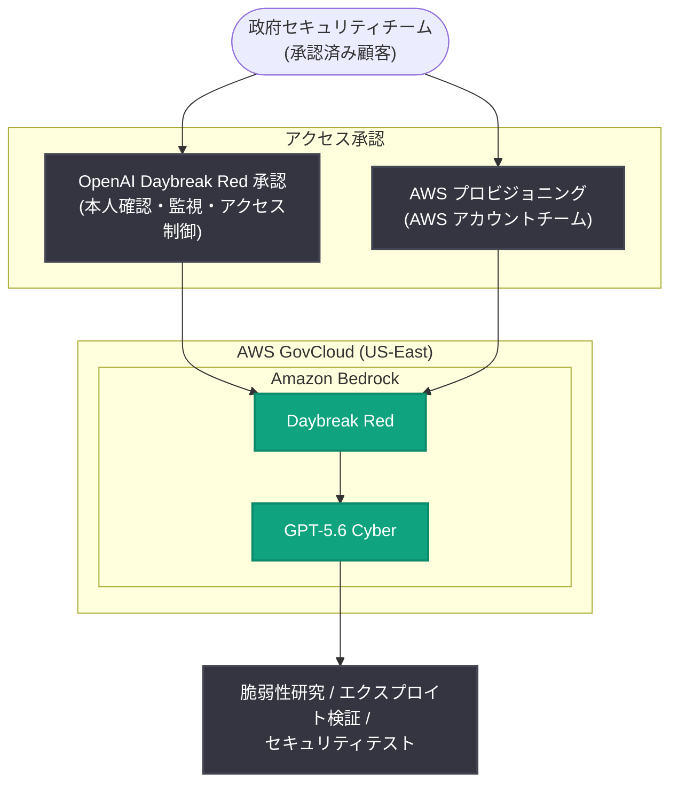

# Daybreak Red is now available in AWS GovCloud (US-East): GPT-5.6 Cyber が AWS GovCloud (US-East) で利用可能に

## メタデータ

| 項目 | 内容 |
|------|------|
| 発表日 | 2026-11-04 |
| ソース | OpenAI News |
| カテゴリ | Product (製品 / サイバーセキュリティ) |
| 公式リンク | https://openai.com/index/daybreak-red-aws-govcloud |

## 概要

OpenAI は、Amazon Bedrock 上での Daybreak モデル提供を拡大し、Daybreak Red を通じて GPT-5.6 Cyber を AWS GovCloud (US-East) の承認済み顧客に提供開始したと発表した。この拡大により、政府のセキュリティチームは、重要任務 (critical missions) を支える既存の AWS 環境内で、高度なサイバーセキュリティ機能を適用する新たな手段を得ることになる。

Daybreak Red は、認可された脆弱性研究、エクスプロイト検証、セキュリティテストのために、OpenAI の専用トレーニング済みサイバーセキュリティモデルへのアクセスを提供するものである。GPT-5.6 Cyber は、防御側 (defenders) が複雑なソフトウェアの弱点を調査し、管理された環境で脆弱性を再現し、緩和策を開発することを支援する。

## 主な内容

### GPT-5.6 Cyber と Daybreak Red の提供内容

- **提供モデル**: GPT-5.6 Cyber (OpenAI の専用トレーニング済みサイバーセキュリティモデル)
- **提供経路**: Amazon Bedrock 経由の Daybreak Red
- **提供リージョン**: AWS GovCloud (US-East)
- **対象**: 承認済み顧客 (approved customers)
- **想定用途**: 認可された脆弱性研究、エクスプロイト検証、セキュリティテスト

GPT-5.6 Cyber は、複雑なソフトウェアの弱点の調査、管理された環境での脆弱性の再現、緩和策の開発に活用できる。なお、記事では、資格を持つセキュリティ実務者 (qualified security practitioners) が、調査結果や提案された修正を実装前にレビューすべきであるとしている。

### 政府チームへのフロンティアサイバーセキュリティ機能の提供

政府組織が高度なサイバーセキュリティ機能を採用するには、モデルの性能だけでは不十分であり、確立されたセキュリティ、ガバナンス、運用要件の中で業務を行う必要がある。

AWS GovCloud (US-East) での提供により、対象となるチームは Amazon Bedrock を通じて GPT-5.6 Cyber をそれらのワークフローに組み込む道筋を得る。防御側は、セキュリティ上の発見事項について推論し、その影響を評価し、修正を評価するためにモデルを活用でき、脆弱性研究を防御の実践的な改善につなげる助けとなる。

### Daybreak Red のアクセス制御とデータ保護

Daybreak Red は、検証済みの防御者 (verified defenders) に対して、認可されたサイバーセキュリティ業務のためのより大きな裁量を与える。具体的には以下のとおりである。

- **拒否の削減**: 認可されたサイバーセキュリティタスクに対する拒否 (refusals) を削減
- **強化された管理**: より強力な本人確認 (identity verification)、監視 (monitoring)、アクセス制御 (access controls) を併用
- **データ保護**: Amazon Bedrock 上の Daybreak Red では、推論データはモデルのトレーニングに使用されず、顧客が Daybreak Red のデータを OpenAI と共有する必要もない

## 技術的な詳細

### 利用開始の手順

アクセスには OpenAI の Daybreak Red 承認と AWS のプロビジョニングの両方が必要である。記事に記載された手順は以下のとおり。

1. [Daybreak 申請フォーム](https://openai.com/form/enterprise-trusted-access-for-cyber/) を提出するか、OpenAI または AWS のアカウントチームに適格性 (eligibility) について問い合わせる
2. 承認後、AWS アカウントチームと連携してアクセスを有効化する

なお、Daybreak Red の承認だけでは AWS 上のモデルアクセスは自動的に有効化されない点に注意が必要である。

## アーキテクチャ

記事の内容に基づく提供構成の概念図を以下に示す。

※ 上図は記事の記述に基づく概念図であり、実際のシステム構成の詳細を示すものではない。

## 開発者への影響

- 政府機関のセキュリティチームは、既存の AWS GovCloud (US-East) 環境を離れることなく、Amazon Bedrock 経由で GPT-5.6 Cyber を脆弱性研究や防御改善のワークフローに組み込める
- 推論データがモデルのトレーニングに使用されず、Daybreak Red のデータを OpenAI と共有する必要がないため、データ主権やガバナンス要件が厳しい組織でも採用を検討しやすい
- アクセスには OpenAI の Daybreak Red 承認と AWS のプロビジョニングの両方が必要であり、承認プロセス (申請フォームの提出またはアカウントチームへの問い合わせ) を事前に計画する必要がある
- モデルの出力 (発見事項や修正案) は、資格を持つセキュリティ実務者によるレビューを経てから実装することが推奨されている

## 関連リンク

- [Daybreak Red is now available in AWS GovCloud (US-East) (公式記事)](https://openai.com/index/daybreak-red-aws-govcloud)
- [AWS What's New: OpenAI Daybreak Red in GovCloud (US-East)](https://aws.amazon.com/about-aws/whats-new/2026/10/openai-daybreak-red-govcloud-east/)
- [Daybreak 申請フォーム (Enterprise Trusted Access for Cyber)](https://openai.com/form/enterprise-trusted-access-for-cyber/)
- [OpenAI News](https://openai.com/news)

## まとめ

OpenAI は 2026 年 11 月 4 日、Daybreak Red を通じて GPT-5.6 Cyber を AWS GovCloud (US-East) の承認済み顧客に Amazon Bedrock 経由で提供開始したと発表した。政府のセキュリティチームは、既存の AWS 環境内で、認可された脆弱性研究、エクスプロイト検証、セキュリティテストに専用トレーニング済みモデルを活用できる。検証済みの防御者には拒否の少ない応答と、強化された本人確認・監視・アクセス制御が提供され、推論データはトレーニングに使用されない。利用には OpenAI の承認と AWS のプロビジョニングの両方が必要である。
