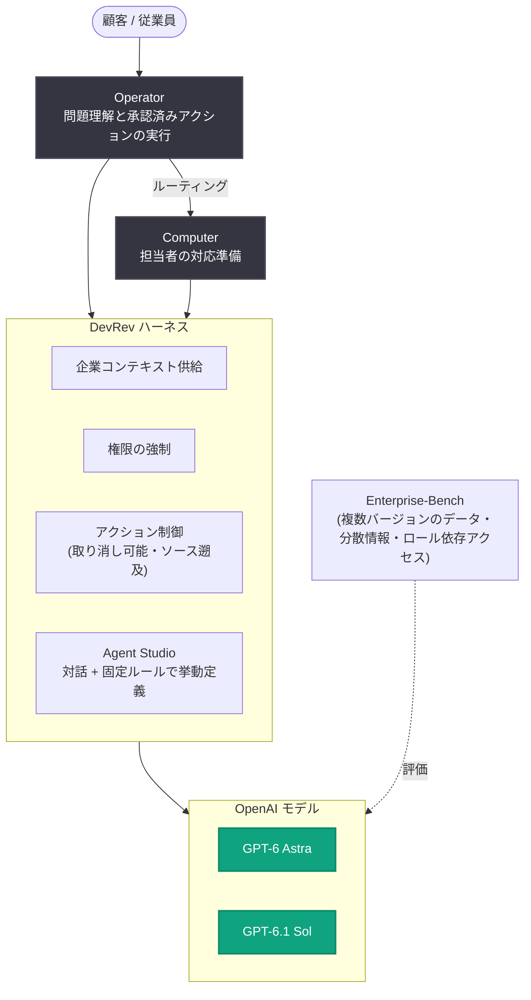

# DevRev が GPT-6.1 Sol で自律的なセルフサービスを実現

## メタデータ

| 項目 | 内容 |
|------|------|
| 発表日 | 2026-11-04 |
| ソース | OpenAI News |
| カテゴリ | Startup (導入事例) |
| 公式リンク | https://openai.com/index/devrev-enterprise-self-service |

## 概要

DevRev は、サービスチームやオペレーションチームが顧客・従業員からの難易度の高いリクエストを完了まで遂行できるよう支援するプロダクト「Computer」と「Operator」を構築した。両プロダクトはライブデータを横断して推論するよう設計されており、アクションは取り消し可能で、回答は情報ソースへ遡れるようになっている (CTO の Ahmed Bashir 氏)。

DevRev は GPT-6 Astra や GPT-6.1 Sol を含む OpenAI モデルを、企業ナレッジへの接続とエージェントが実行できるアクションの制御を担う自社ハーネスと組み合わせている。OpenAI モデルは、顧客・従業員へのサービス提供に求められる速度とコストを維持しつつ、推論能力と信頼性を提供するものと位置づけられている。

> 「適切な推論能力を持ち、信頼でき、高度にアラインされていること。そして最も重要なのは、レイテンシの観点で機能しなければならないことです」— Ahmed Bashir 氏 (DevRev CTO)

## 主な内容

### 企業コンテキストと連携する AI

OpenAI モデルは、Computer と Operator の両方で推論・プランニング・ツール選択を担っている。DevRev の Agent Studio では、ユーザーが AI との対話を通じてツールの振る舞いを記述し、一部の挙動を固定ルールで定義できる。

DevRev は、企業コンテキストの供給・権限の強制・アクションの制御を行うソフトウェアとモデルを組み合わせてテストしている。独自ベンチマーク「Enterprise-Bench」では、データに複数のバージョンが存在する、情報が異なるシステムに分散している、アクセス権がロールに依存するといった状況での性能を評価している。

Bashir 氏によれば、GPT-6.1 Sol はこれらの評価で良好な結果を示している。顧客や従業員が AI エージェントとやり取りする際、モデルはリクエストのニュアンスを理解し、事業として持続可能なコストで迅速に応答する必要がある。同氏は「完璧にバランスが取れていると思います」と述べている。

### Codex によるソフトウェア開発とセールスデモの構築

DevRev 社内では、エンジニアリングチーム全員が Codex を使用している。複数のコーディングツールを検討した結果、採用は自然発生的に広がり、インタビュー時点で DevRev は完全に Codex へ移行し、Cursor のライセンスを解約していた。

Bashir 氏は「開発者は本当に最高のツールだけを求めており、彼らを欺くことはできません」と述べ、エンジニアたちは Codex の継続利用を明確に望んだという。

> 「Codex は圧倒的に最高の体験だと考えています」— Ahmed Bashir 氏 (DevRev CTO)

また、DevRev のセールスエンジニアは、国際カンファレンスのブース向けデモの作成に GPT-6 Astra を活用している。

### 顧客・従業員への迅速な対応

顧客や従業員が支援を求めた際、リクエストによっては Operator が問題を理解し、承認済みのアクションを実行するか、適切な担当者が対応できるよう Computer にルーティングする。Bashir 氏は、Decisions API や Ultrafast が、各ステップで深い推論を必要とせずにこうしたワークフローを迅速に完了させる助けになると見ている。

こうした判断の中には、依存する情報が変化し続けるため、固定ルールで定義するのが困難かつ高コストなものがある。Bashir 氏は、ビルダーがそうしたロジックの多くを対話的に記述し、タスクごとに適切な種類のインテリジェンスを選択できるようにしたいと考えている。「これらは数分ではなく数秒で実行・完了できなければなりません」と同氏は語る。

### セルフサービスの約束を実現する

DevRev の次の目標は、アクションの追跡可能性・権限管理・取り消し可能性を維持したまま、Operator がより長く要求の厳しい顧客・従業員リクエストを担えるようにすることである。

Bashir 氏は、ナレッジベースの回答検索、プランのアップグレード、返金対応といった定番のサポートタスクは始まりに過ぎないと見ており、「セルフサービスの約束を本当に実現したい」と述べている。OpenAI のフロンティアインテリジェンスを活用し、DevRev は Computer と Operator が企業ナレッジと制御機構を備えて本人に代わって行動し、より複雑なリクエストを解決まで遂行できる姿を目指している。

## 技術的な詳細

- **使用モデル**: GPT-6 Astra、GPT-6.1 Sol を含む OpenAI モデル群。推論・プランニング・ツール選択を担当
- **自社ハーネス**: 企業ナレッジへの接続と、エージェントが実行可能なアクションの制御を提供
- **Agent Studio**: AI との対話によるツール挙動の記述と、固定ルールによる挙動定義を組み合わせ可能
- **Enterprise-Bench**: データの複数バージョン、システム間に分散した情報、ロールベースのアクセス制御といった実企業環境を想定した独自ベンチマーク
- **設計原則**: アクションの取り消し可能性 (reversible)、回答のソース遡及性 (traceable)、権限管理 (permissioned)
- **開発ツール**: エンジニアリングチーム全体で Codex を採用 (Cursor から全面移行)
- **今後の活用候補**: Decisions API、Ultrafast による低レイテンシなワークフロー完了

## アーキテクチャ

## 開発者への影響

- エンタープライズ向け AI エージェントでは、モデル単体の性能だけでなく、企業コンテキストの供給・権限の強制・アクション制御を行うハーネスとの組み合わせでの評価 (DevRev の Enterprise-Bench のような実環境ベンチマーク) が重要になる
- GPT-6.1 Sol は、推論能力・レイテンシ・コストのバランスが求められる顧客・従業員対応ユースケースでの選択肢となる
- アクションの取り消し可能性、ソースへの遡及性、ロールベースの権限管理は、本人に代わって行動するエージェントを企業に導入する際の設計原則として参考になる
- すべてのステップで深い推論を使うのではなく、タスクごとに適切な種類のインテリジェンス (Decisions API、Ultrafast など) を使い分ける設計が、秒単位でのワークフロー完了につながる

## 関連リンク

- [記事原文: DevRev delivers autonomous self-service with GPT-6.1 Sol](https://openai.com/index/devrev-enterprise-self-service)
- [DevRev 公式サイト](https://devrev.ai/)
- [OpenAI News](https://openai.com/news)
- [OpenAI 公式ドキュメント](https://platform.openai.com/docs)

## まとめ

DevRev は、GPT-6 Astra と GPT-6.1 Sol を自社ハーネスと組み合わせ、ライブデータを横断して推論し、取り消し可能かつソースに遡れるアクションを実行する「Computer」と「Operator」を構築した。GPT-6.1 Sol は、独自ベンチマーク Enterprise-Bench の評価で、リクエストのニュアンス理解・応答速度・持続可能なコストのバランスに優れると評価されている。社内開発では Codex を全面採用し、今後は Decisions API や Ultrafast を活用して、より長く複雑な顧客・従業員リクエストを数秒で完了するセルフサービスの実現を目指している。
