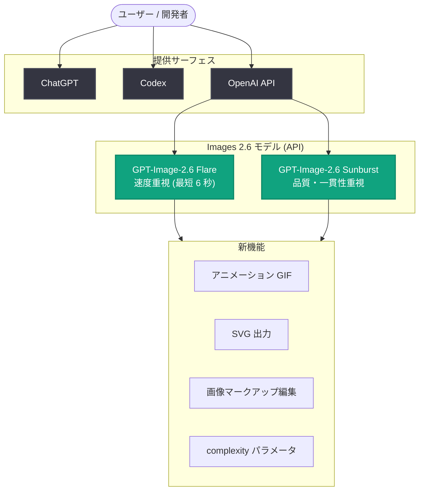

# Images 2.6 発表: ChatGPT・Codex・API 全体で高速画像生成、GIF 作成、精密編集に対応

## メタデータ

| 項目 | 内容 |
|------|------|
| 発表日 | 2026-11-04 |
| ソース | OpenAI News / API Changelog |
| カテゴリ | Product (新機能 / API 更新) |
| 公式リンク | https://openai.com/index/introducing-images-2-6 |
| API Changelog | https://developers.openai.com/api/docs/changelog |

## 概要

OpenAI は 2026 年 11 月 4 日、ChatGPT、Codex、API 全体で利用できる画像生成機能の新バージョン「Images 2.6」を発表した。従来比 50% 高速な画像生成に加え、アニメーション GIF の作成、キャラクターや製品、ブランド要素の一貫性を保ったままの精密な編集が可能になった。現在、ChatGPT、Codex、API 全体で週 40 億枚 (1 日平均 5 億枚以上) の画像が生成されているという。

API 向けには 2 つのモデル「GPT-Image-2.6 Flare」(速度重視) と「GPT-Image-2.6 Sunburst」(品質・一貫性重視) が提供される。同日の API Changelog では、complexity (複雑さ) コントロール、SVG 出力、アニメーション GIF 対応、マークアップ誘導編集 (markup-guided editing) の追加が告知された。

## 主な内容

### 高速なイテレーションとプロフェッショナルなビジュアル

Images 2.6 は従来より 50% 高速に画像を生成する。API では用途に応じて 2 つのモデルを選択できる。

- **GPT-Image-2.6 Flare**: 速度重視のモデル。quality を low に設定した場合、最短 6 秒で画像を生成できる。ポスターや製品画像などプロフェッショナルなビジュアルのレイアウト品質も向上している
- **GPT-Image-2.6 Sunburst**: 高精細・高精度な作業向けのモデル。quality を medium または high に設定した場合、より高品質な画像生成と、編集をまたいだより高い画像の一貫性を実現する

### GIF でアイデアをアニメーション化

動きが必要な場面では、GIF によってアイデアに新たな次元を加えられる。活用例として以下が挙げられている。

- キャンペーン用のブランドマスコットのアニメーション化
- SNS 向けのリアクションやミームの作成
- 動画制作前にキャラクターの動きを検討するアニメーション絵コンテ

公式記事では、シームレスにループする GIF 用のスプライトシート (3 列 x 2 行の 6 フレーム構成) を生成する詳細なプロンプト例 (OpenArt 制作) が紹介されている。また、ペンで描いた簡単なスケッチ (例: 罫線入りの紙に描いたフクロウ) からでも、動画やゲームなどで使える表情豊かなアニメーションキャラクターを作成できるとしている。

AI ワークアシスタントを開発するスタートアップの Town は、API 経由で Images 2.6 を利用し、アニメーションキャラクターによって職場の日常的なやり取りに個性を加える方法を模索した。

### API での作成・編集手段の拡充

開発者は、画像の作成・編集方法と、プロジェクトの次の工程への引き継ぎ方について、より細かい制御が可能になった。

- **画像マークアップ**: ChatGPT で先行提供されていた機能が API にも登場。変更したい箇所を正確に指定して編集できる
- **SVG 出力**: デザインを Web サイト、アプリ、印刷物でそのまま利用できる形式でエクスポート
- **complexity パラメータ**: リクエストに応えるためにモデルが行う計画 (プランニング) の量を調整できる新パラメータ。低い設定はクイックな編集に適する

### 料金と提供状況

- Images 2.6 は本日より、ChatGPT と Codex の全サブスクリプションプランで、デスクトップ、モバイル、Web にてグローバルに利用可能
- GPT-Image-2.6 Sunburst と GPT-Image-2.6 Flare は API で利用可能。料金の詳細は [料金ページ](https://developers.openai.com/api/docs/pricing#image-generation) を参照
- 安全性評価とセーフガードの詳細は [システムカード](https://deploymentsafety.openai.com/chatgpt-images-2-6) に記載

## 技術的な詳細

### 新モデル

| モデル | 特徴 | 推奨 quality 設定 |
|--------|------|------------------|
| GPT-Image-2.6 Flare | 速度重視。quality が low の場合最短 6 秒で生成。ポスター・製品画像などのレイアウト品質も向上 | low |
| GPT-Image-2.6 Sunburst | 高品質な画像生成と、編集をまたいだ高い一貫性 | medium / high |

### 新パラメータ・新機能 (API Changelog 2026-11-04 より)

| 項目 | 内容 |
|------|------|
| complexity | モデルが行う計画の量を調整する新パラメータ。quality が視覚的なディテールと忠実度を制御するのに対し、complexity はシーンにどれだけの要素を盛り込むかを導く |
| SVG 出力 | デザインを SVG 形式でエクスポート可能 |
| アニメーション GIF | GIF 形式のアニメーション生成に対応 |
| マークアップ誘導編集 | 対応する GPT Image 2.5/2.6 モデルで、画像上のマークアップにより編集箇所を指定可能 |

### 推奨設定

公式記事では、以下の使い分けが推奨されている。

- **ほとんどの編集タスク**: 高速に編集できる low complexity と、ワークフローに必要な image quality の組み合わせ
- **要素や制約の多いシーン**: medium または high の complexity

## アーキテクチャ

## 開発者への影響

- **速度と品質の使い分けが可能に**: Flare と Sunburst の 2 モデル体制により、クイックなイテレーションと高品質な成果物を用途別に選択できる。quality を low にした Flare では最短 6 秒で生成できるため、プロトタイピングやリアルタイム性が求められる用途に適する
- **complexity パラメータによるコントロールの細分化**: quality (視覚的なディテール・忠実度) と complexity (シーンの構成量) を独立して調整でき、編集タスクでは low complexity による高速化が推奨される
- **GIF 対応による表現の拡大**: マスコットのアニメーション化、SNS 向けコンテンツ、アニメーション絵コンテなど、静止画では難しかったユースケースを API で実現できる
- **マークアップ誘導編集の API 対応**: ChatGPT で提供されていた画像マークアップが API でも利用可能になり、編集箇所をピンポイントで指定するワークフローをアプリケーションに組み込める
- **SVG 出力によるデザイン連携**: 生成したデザインを Web、アプリ、印刷物にベクター形式で展開でき、デザインワークフローとの統合が容易になる

## 関連リンク

- [Introducing Images 2.6 (OpenAI 公式)](https://openai.com/index/introducing-images-2-6)
- [OpenAI API Changelog](https://developers.openai.com/api/docs/changelog)
- [画像生成の料金詳細](https://developers.openai.com/api/docs/pricing#image-generation)
- [Images 2.6 システムカード](https://deploymentsafety.openai.com/chatgpt-images-2-6)
- [OpenAI News](https://openai.com/news)

## まとめ

Images 2.6 は、50% の生成高速化、アニメーション GIF 対応、精密な編集コントロールを柱とするメジャーアップデートである。API では速度重視の GPT-Image-2.6 Flare と品質重視の GPT-Image-2.6 Sunburst の 2 モデルが提供され、complexity パラメータ、SVG 出力、マークアップ誘導編集といった新しいコントロールが追加された。週 40 億枚という画像生成規模を背景に、個人のクリエイティブ用途からブランド・製品ビジュアルの制作まで、幅広いワークフローの高速化と精密化を狙ったリリースといえる。
