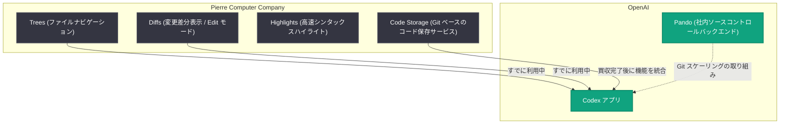

# OpenAI が Pierre Computer Company, Inc. を買収へ

## メタデータ

| 項目 | 内容 |
|------|------|
| 発表日 | 2026-11-04 |
| ソース | OpenAI News |
| カテゴリ | 企業 (Company) |
| 公式リンク | https://openai.com/index/openai-to-acquire-pierre |

## 概要

OpenAI は、Code Storage や優れたオープンソース開発者ツール群を手がける Pierre Computer Company, Inc. (以下「Pierre」) を買収することを発表した。Codex アプリでファイルの閲覧や変更のレビューを行ったことがあるユーザーは、すでに Pierre の Trees および Diffs ライブラリを利用している。OpenAI は Pierre チームとともに、開発者がすでに依存している Git ワークフローを土台とし、コーディングエージェントとチームが協働する時代に適応させていくとしている。

OpenAI は同週に、エンジニアとエージェント向けの社内ソースコントロールバックエンド「Pando」による [Git のスケーリングの取り組み](https://openai.com/index/scaling-git-at-openai/) を公開しており、今回の買収はその流れに位置づけられる。エージェントが最初のブランチを作成する瞬間から、コードが世界にデプロイされる瞬間まで、モダンなソフトウェア開発の標準を Pierre チームとともに確立し、Codex を開発者とエージェントが最も野心的なプロジェクトに取り組む場にすることを目指す。

## 主な内容

### エージェント時代に向けた「職人技とスケール」の融合

OpenAI は、Pierre が Git を扱うもう 1 つの領域であるコードレビューにもたらす丁寧な作り込みを高く評価している。その品質は、現在 Codex で使用されているライブラリにも表れている。

- **Trees**: プロジェクトのファイルを素早くナビゲートできるライブラリ
- **Diffs**: 何が変更されたかを簡単に確認できるライブラリ

いずれも、大量のコードのレビューとナビゲーションを妥協のないパフォーマンスで実現する。

また、Pierre の他の成果にも同様のこだわりが貫かれている。

- **Diffs の Edit モード**: レビュアーが問題を見つけたその場でコード行を修正できる
- **Highlights**: 開発者のタイピングやエージェントのコードストリーミングに合わせてリアルタイムに更新される、非常に高速なシンタックスハイライター
- **Code Storage**: アプリケーションが Git を使ってコードを保存し履歴を追跡できるサービス。diff の中にエディタを組み込んだ同じ少人数チームがその API を設計した

### Codex への統合

Pierre は開発者に愛されるツールを構築してきた。両社は共同で、すべての人に利益をもたらす新しいプロダクトとプラットフォームを提供していく。買収完了後は、業界全体でソースコントロールの未来を前進させることを目標とし、企業が出荷するコードとその組織の人々が下す意思決定を、将来求められるスケールで結びつける Codex を目指す。

### オープンソースと既存顧客への対応

- Pierre のオープンソースプロジェクトは引き続きオープンソースのまま維持され、OpenAI もコントリビュートを継続する
- Code Storage の顧客は買収完了後も利用を継続でき、その間に OpenAI は Code Storage の機能を Codex に統合する作業を進める

### 買収完了の条件

買収の完了は、規制当局の承認取得を含む通常のクロージング条件の充足を前提とする。クロージングまでは、OpenAI と Pierre は別個の独立した企業として存続する。

## 技術的な詳細

本発表は企業買収に関するものであり、API の変更や新しいエンドポイントの追加は含まれない。記事で言及されている Pierre の技術要素と Codex の関係は以下の通り。

## 開発者への影響

- **Codex の UI/UX 強化**: Codex アプリのファイル閲覧 (Trees) や差分レビュー (Diffs) はすでに Pierre 製であり、今後も Git ワークフローを基盤としたコーディングエージェント向けの体験改善が期待できる
- **オープンソースの継続**: Pierre のオープンソースプロジェクトはオープンソースのまま維持され、OpenAI がコントリビュートを継続するため、既存の利用者は引き続き利用できる
- **Code Storage ユーザー**: 買収完了後も Code Storage の利用を継続でき、機能は段階的に Codex へ統合される
- **ソースコントロールの進化**: エージェントによる並列作業の増加に合わせて Git 周辺のシステムが進化する流れ (Pando の取り組みを含む) が、業界標準の策定に向けて加速する可能性がある

## 関連リンク

- [OpenAI to acquire Pierre Computer Company, Inc. (公式発表)](https://openai.com/index/openai-to-acquire-pierre)
- [Pierre Computer Company](https://pierre.computer/)
- [Code Storage](https://code.storage/)
- [Scaling Git at OpenAI (Pando)](https://openai.com/index/scaling-git-at-openai/)
- [OpenAI News](https://openai.com/news)

## まとめ

OpenAI は、Codex で既に採用している Trees / Diffs ライブラリや Code Storage を手がける Pierre Computer Company, Inc. の買収を発表した。エージェントによる並列開発が増える中で、Git ワークフローをコーディングエージェント時代に適応させ、ソースコントロールの業界標準を確立することが狙い。Pierre のオープンソースプロジェクトは維持され、Code Storage は買収完了後も利用可能なまま Codex への統合が進められる。買収完了は規制当局の承認を含む通常のクロージング条件の充足が前提となる。
