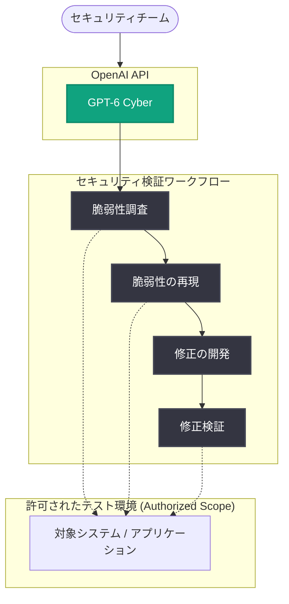

# GPT-6 Cyber: アラインされたサイバーセキュリティエージェントの最前線

## メタデータ

| 項目 | 内容 |
|------|------|
| 発表日 | 2026-11-05 |
| ソース | OpenAI News / API Changelog |
| カテゴリ | 新機能 (Product) |
| 公式リンク | https://openai.com/index/introducing-gpt-6-cyber |

> **注記**: 本レポート作成時点で記事ページの本文全文は取得できなかった (アクセス制限のため)。以下の内容は、OpenAI の公式発表の概要および同日の API Changelog で確認できた情報に基づいて作成している。

## 概要

OpenAI は 2026 年 11 月 5 日、サイバーセキュリティに特化したモデル「GPT-6 Cyber」を発表した。GPT-6 Cyber は、悪用可能な脆弱性の発見と修正の開発を目的としたモデルであり、許可されたスコープ内に留まるようにトレーニングされている点が特徴である。

同日の API Changelog では、GPT-6-Cyber のリリースが告知されており、許可されたテスト環境での脆弱性調査・再現・修正検証に利用可能であることが示されている。攻撃的セキュリティ (オフェンシブセキュリティ) の能力を持つモデルを、アラインメント (許可された範囲の遵守) を前提に提供するという位置づけである。

## 主な内容

### GPT-6 Cyber とは

公式発表の概要によると、GPT-6 Cyber は以下を目的とした OpenAI のサイバーセキュリティモデルである。

- **脆弱性の発見**: 悪用可能な脆弱性 (exploitable vulnerabilities) を見つける
- **修正の開発**: 発見した脆弱性に対する修正 (フィックス) を開発する
- **許可されたスコープの遵守**: 許可された範囲内 (authorized scope) に留まるようにトレーニングされている

### API での提供 (API Changelog 2026-11-05)

同日付の API Changelog では、以下の内容が確認できた。

> GPT-6-Cyber をリリース。許可されたテスト環境での脆弱性調査・再現・修正検証に利用可能

つまり、API 経由で GPT-6-Cyber を利用でき、ユースケースとして次の 3 点が明示されている。

1. **脆弱性調査**: 許可されたテスト環境における脆弱性の調査
2. **再現**: 発見された脆弱性の再現 (リプロダクション)
3. **修正検証**: 修正パッチが有効かどうかの検証

### アラインメントへの焦点

発表タイトルの「Advancing the frontier of aligned cybersecurity agents (アラインされたサイバーセキュリティエージェントの最前線を前進させる)」が示すとおり、本発表の中心テーマは、高いサイバー能力を持つエージェントを「許可されたスコープ内に留まる」ように訓練するという安全性・アラインメントの取り組みである。脆弱性を発見できる能力は攻撃にも転用され得るため、許可された環境・範囲での利用に限定する設計が強調されている。

## 技術的な詳細

API Changelog により GPT-6-Cyber が API 経由で利用可能になったことが確認できている。ただし、本レポート作成時点では、正確なモデル ID、料金、コンテキストウィンドウ、利用条件 (アクセス審査の有無など) の詳細は確認できていない。利用前に公式ドキュメントで確認することを推奨する。

### コードサンプル

以下は OpenAI API の標準的な呼び出し形式に基づくイメージ例である (実際のモデル ID やパラメータは公式ドキュメントで要確認)。

```python
from openai import OpenAI

client = OpenAI()

response = client.chat.completions.create(
    model="gpt-6-cyber",  # 実際のモデル ID は公式ドキュメントで確認すること
    messages=[
        {
            "role": "user",
            "content": "許可されたテスト環境内の対象アプリケーションについて、"
                       "脆弱性調査の手順を提案してください。"
        }
    ]
)
print(response.choices[0].message.content)
```

## アーキテクチャ

GPT-6 Cyber を利用したセキュリティ検証ワークフローの概念図 (API Changelog に示されたユースケースに基づく)。



## 開発者への影響

- **セキュリティ検証の自動化**: 許可されたテスト環境での脆弱性調査から修正検証までのワークフローを、API 経由でエージェントとして組み込める可能性がある
- **ディフェンシブ用途の強化**: 自社プロダクトの脆弱性の発見・再現・修正検証のサイクルを高速化できる可能性がある
- **利用範囲の制約**: モデルは許可されたスコープ内に留まるようにトレーニングされており、利用は許可されたテスト環境に限定される。無許可の対象への利用は想定されていない
- **詳細の確認が必要**: モデル ID、料金、アクセス条件などの詳細は本レポート作成時点で未確認のため、公式ドキュメント・Changelog での確認が必要

## 関連リンク

- [GPT-6 Cyber 発表記事 (OpenAI)](https://openai.com/index/introducing-gpt-6-cyber)
- [OpenAI API Changelog](https://platform.openai.com/docs/changelog)
- [OpenAI 公式ドキュメント](https://platform.openai.com/docs)
- [OpenAI News](https://openai.com/news)

## まとめ

GPT-6 Cyber は、脆弱性の発見と修正開発に特化した OpenAI のサイバーセキュリティモデルであり、「許可されたスコープ内に留まる」ことを前提にトレーニングされている点が最大の特徴である。API でも同日リリースされ、許可されたテスト環境での脆弱性調査・再現・修正検証に利用できる。攻撃的能力を持つ AI エージェントを安全に提供するというアラインメント面の取り組みとして注目される。モデル ID や料金などの詳細は、公式ドキュメントでの確認を推奨する。
