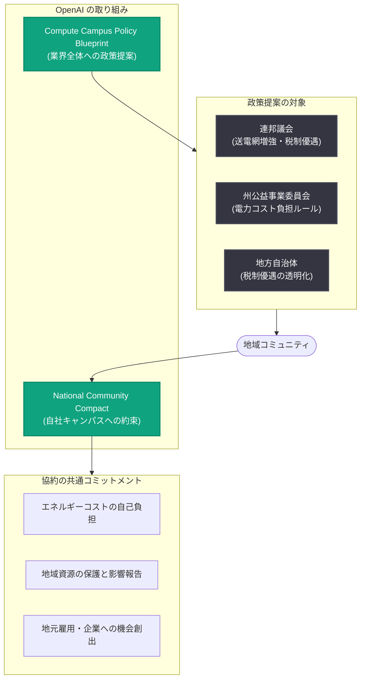

# 責任ある AI インフラの新基準: National Community Compact と Compute Campus Policy Blueprint の発表

## メタデータ

| 項目 | 内容 |
|------|------|
| 発表日 | 2026-11-05 |
| ソース | OpenAI News |
| カテゴリ | Global Affairs (企業・政策) |
| 公式リンク | https://openai.com/index/setting-new-standard-responsible-ai-infrastructure |

## 概要

OpenAI は 2026 年 11 月 5 日、AI インフラ (コンピュートキャンパス) の責任ある開発に向けた 2 つの文書「National Community Compact (全国コミュニティ協約)」と「Compute Campus Policy Blueprint (コンピュートキャンパス政策ブループリント)」を公表した。前者は OpenAI が所有・運営する将来のキャンパスにおいて地域社会が OpenAI に期待できる約束事項を定めるものであり、後者は連邦・州・地方の政策立案者に対し、コミュニティの発言権の確保、住民の新たなコスト負担からの保護、AI がもたらす経済的利益の広範な共有を実現するための政策を提案するものである。

OpenAI は、米国内のコンピューティングインフラ容量の拡大が AI の提供コストを下げ、より多くの人々にツールを届け、米国の技術的優位を維持するうえで重要だとしたうえで、「これらのキャンパスをどのように建設するかは、AI の恩恵が広く共有されるかどうかの最初の試金石の一つである」と位置づけている。本発表は、2026 年 1 月に発表した Stargate Community コミットメント、およびジョージア州・オハイオ州での個別コミットメントに続く取り組みの次のステップである。

## 主な内容

### National Community Compact: 建設地コミュニティへの約束

OpenAI が所有・運営する将来のすべてのコンピュートキャンパスには、それぞれ地域ごとの協約 (ローカルコンパクト) が設けられる。住民の意見が計画に反映されるよう早期に対話を開始し、キャンパスの稼働期間を通じて地域の窓口担当者を置き、毎年の進捗を公開報告する。各協約は地域の優先事項を反映しつつ、共通して以下のコミットメントを含む。

1. **エネルギーとインフラのコストを自己負担する**: 使用する電力とそれを供給するためのインフラの全コストを OpenAI が負担する。大規模な支出が始まる前に財務保証を提供し、プロジェクトが遅延・縮小・中止された場合でも他の電力利用者が保護されるようにする。

2. **地域資源を保護し、影響を報告する**: キャンパスごとに水利用計画を策定し、閉ループ型または低水量の冷却方式を優先し、サイト単位の水・電力使用量を公開する。稼働開始前と稼働後は毎年、建設計画と独立した騒音調査を公表する。また、公職者との秘密保持契約 (NDA) は使用せず、正当なセキュリティ情報、営業秘密、競争上の機微情報のみを対象とする限定的な保護にとどめる。

3. **地元の労働者と企業に機会を創出する**: 創出が見込まれる雇用を公表し、労働組合や訓練機関と連携して住民の就業準備を支援し、採用と見習い制度 (アプレンティスシップ) の実績を毎年報告する。さらに、住民が選定に関与した優先分野へ継続的に投資する。

地域ごとの優先事項の実例として、ジョージア州エフィンガム郡では住民の意見を反映し、郡内の全生徒 14,000 人に無料給食を提供する 480 万ドルの助成が行われた。オハイオ州パイク郡では保育が優先課題として挙げられ、OpenAI と SB Energy による共同で 600 万ドルのコミットメントにつながった。

### Compute Campus Policy Blueprint: 業界全体への政策提案

企業の自主的なコミットメントは重要な出発点だが、誰がキャンパスを建設する場合でも住民が基本的な保護を受けられるべきだとして、ブループリントは連邦・州・地方の政策立案者に対し、業界の建設方法に関する明確なルールの確立を求めている。主な提案は以下のとおり。

- **電力コストの負担ルール**: 州の公益事業委員会は、大口電力需要家に対し、送電網に追加するコストの負担と、プロジェクト中止時の他の利用者の保護を義務付けるべきである。また、電力逼迫時に需要を安全に削減できるキャンパスについては、電力会社が系統接続を容易にすべきとしている。実例として、エフィンガム郡の計画中キャンパスでは、Georgia Power との契約により、需要が高い期間には最大 1,000 メガワットの供給削減を電力会社が行えるようになっている。さらに連邦議会には、送電網増強の迅速化とクリーン電力への税制優遇の回復・拡充を求めている。

- **開発者への説明責任**: 水、エネルギー、騒音、雇用に関する公開報告の義務化と、開発者が公職者に NDA を要求できる場面の厳格な制限を提案。州や地方自治体が税制優遇を提供する場合は、その条件を公開し、測定可能なコミットメントと、開発者が約束を果たせなかった場合に利益を回収する仕組みを設けるべきとしている。

- **地元への経済効果の還元**: 開発者が購買計画を早期に共有することで、地元サプライヤーが契約獲得を競えるようにする。雇用主、建設業労働組合、コミュニティカレッジは雇用予測を活用し、建設時の電気工事から稼働後の電力・冷却システムの保守まで、確実に生まれる職種に向けて住民を訓練できる。

### 背景: Stargate Community からの継続的な取り組み

今回の発表は、2026 年 1 月に発表された Stargate Community コミットメント (エネルギーコストの自己負担、地域の優先事項に基づく計画策定) を基盤としている。その後、ジョージア州とオハイオ州で、エネルギーコスト、水利用、地域投資、説明責任を対象とする個別のコミットメントを発表した。OpenAI はこの過程で住民、地域リーダー、学校、企業の声を聞き取っており、今回の 2 文書はその継続的な取り組みの次の段階と位置づけられている。

## 全体構造

## 影響と意義

本発表は API や製品の変更ではなく、AI インフラ建設をめぐる企業ポリシーと公共政策に関するものである。想定される影響は以下のとおり。

- **業界標準の形成**: OpenAI が自社キャンパスでの自主的コミットメントにとどまらず、法制化を求めることで、データセンター開発業界全体に対する規制・透明性の基準づくりを主導する姿勢を示した
- **電力コスト問題への対応**: データセンターの電力需要増が一般家庭の電気料金を押し上げるという懸念に対し、「大口需要家が自らのコストを負担する」原則の制度化を提案しており、州の公益事業規制の議論に影響を与える可能性がある
- **透明性の向上**: 水・電力使用量のサイト単位での公開、独立騒音調査の公表、公職者への NDA 不使用など、これまで不透明とされがちだったデータセンター開発の情報公開水準を引き上げる
- **地域経済への波及**: 購買計画の早期共有や雇用予測の公開により、地元企業・労働者・教育機関がインフラ投資の恩恵を受けやすくなる

## 関連リンク

- [公式発表: Setting a new standard for responsible AI infrastructure](https://openai.com/index/setting-new-standard-responsible-ai-infrastructure)
- [OpenAI News](https://openai.com/news)
- [OpenAI Global Affairs](https://openai.com/global-affairs)

## まとめ

OpenAI は、AI インフラ建設の恩恵を地域社会と広く共有するための 2 つの枠組みを発表した。National Community Compact は、自社が所有・運営する将来のキャンパスにおいて、エネルギーコストの自己負担、水・電力・騒音に関する透明な報告、地元雇用と投資を約束するものである。Compute Campus Policy Blueprint は、これらの保護を企業の自主性に依存させず、連邦・州・地方の政策として制度化することを提案する。ジョージア州 (給食支援 480 万ドル、最大 1,000 メガワットの需要削減契約) やオハイオ州 (保育支援 600 万ドル) での先行事例を踏まえ、「コミュニティから積み上げる」インフラ開発モデルを業界標準にすることを目指す内容となっている。
