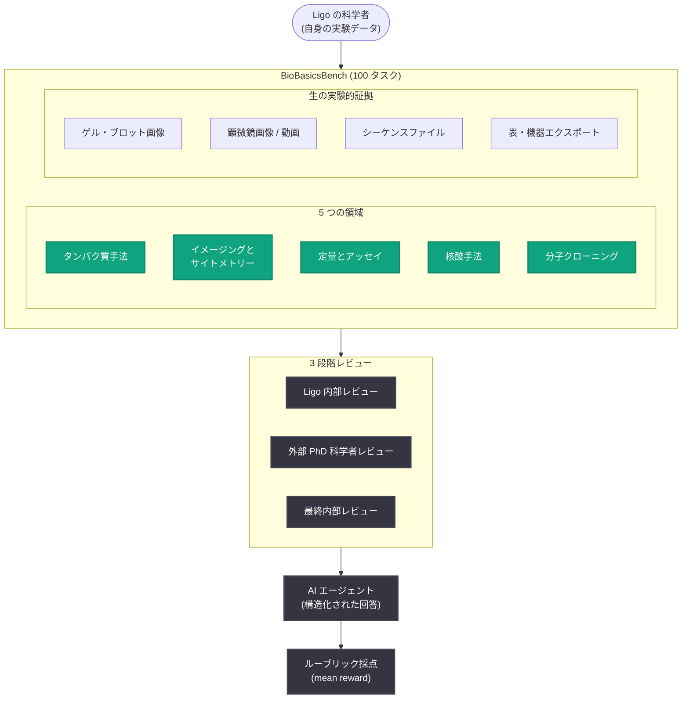

# BioBasicsBench: AI エージェントの日常的なウェットラボ科学への対応力を測定

## メタデータ

| 項目 | 内容 |
|------|------|
| 発表日 | 2026-11-06 |
| ソース | OpenAI Research |
| カテゴリ | 研究成果 / ベンチマーク |
| 公式リンク | https://openai.com/index/measuring-how-ai-agents-handle-wet-lab-science |

## 概要

OpenAI は、酵素設計に特化したバイオテック企業 Ligo と共同開発した新しいベンチマーク **BioBasicsBench** を発表した。これは、AI エージェントが日常的なウェットラボ (生物学的サンプルを用いて実験を行う研究室) の分析作業をどの程度正しく処理できるかを測定するものである。日常のウェットラボ作業には、失敗した実験、曖昧な画像、矛盾する観察結果が含まれるが、既存のベンチマークは科学論文向けに選別されたチャートや画像を中心に構築されており、こうした曖昧さやトラブルシューティングの必要性を見逃す可能性がある。

ベンチマークは 100 タスクで構成され、エージェントが生の実験データを解釈し、エラーを特定し、証拠が結論を支持できない場合にそれを認識できるかをテストする。最高推論努力設定 (xhigh) において、GPT-6 Astra は利用可能なクレジットの平均 66.7% を獲得し、GPT-5.6 Sol の 43.8% を大きく上回った。日常的なラボ分析での進歩を示す一方、画像の解釈、コントロール (対照実験) の確認、実験コンテキストの適用にはさらなる改善の余地がある。

## 主な内容

### BioBasicsBench の構成

BioBasicsBench は、ゲル画像やコロニープレートから顕微鏡画像、機器の読み取り値まで、生の実験的証拠を使用する。100 タスクは、日常的なウェットラボ作業の 5 つの領域にわたる。

- タンパク質手法 (protein methods)
- イメージングとサイトメトリー (imaging and cytometry)
- 定量とアッセイ (quantification and assays)
- 核酸手法 (nucleic acid methods)
- 分子クローニング (molecular cloning)

タスクは、ゲル中の DNA サンプルの分子量を読み取るといった単純な依頼から、詳細なアッセイ分析まで多岐にわたるが、いずれもウェットラボの科学者が確実にこなせるべき日常業務である。多くのタスクは、生物学的知識、画像やその他のデータの解釈、エラー検出、プロトコル理解など、複数のスキルを同時にテストする。

### タスクの作成とレビュープロセス

科学者が自身の実験データを用いてタスクを作成し、各質問に専門家が書いた採点基準 (ルーブリック) を組み合わせた。各タスクは次の 3 段階のレビューを経ている。

1. **内部レビュー**: タスクを書いていない Ligo の科学者によるレビュー
2. **外部レビュー**: ウェットラボで働く PhD レベルの科学者によるレビュー
3. **最終内部レビュー**

レビュアーは、プロンプト、実験的証拠、ルーブリック、作成者ノート、採点済みのモデル回答例を確認した。回答はルーブリックの個別基準に対してクレジットが与えられ、正しい結論と部分的に正しい分析を区別できる。

### エージェントに与えられるデータ

入力は、科学者が実際に扱う証拠の形式を保持している。

| データの種類 | タスク数 | 含まれる内容 |
| --- | --- | --- |
| ゲルとブロット | 31 | アガロース DNA ゲル、SDS-PAGE ゲル、ウェスタンブロット |
| プロトコル・ノート・仕様 | 27 | プロトコルと SOP、ラボノート、手書きメモの写真、カタログ、機器仕様、公開された手法 |
| 表と機器エクスポート | 20 | CSV・Excel エクスポート、レーンレイアウトと在庫、生のフローサイトメトリー (FCS) ファイル |
| ベンチ・装置・試薬の写真 | 18 | ベンチ、ゲル装置、試薬・培養チューブ、PCR プレート、チューブラック、pH 試験紙、濃縮器、冷凍庫、リキッドハンドラーデッキ |
| 顕微鏡画像 | 14 | 生の明視野・蛍光画像、マルチチャンネルセット、z スタック、タイムラプス動画 |
| 機器画面とプロット | 13 | フローサイトメーター、顕微鏡、NanoDrop、プレートリーダー、天秤の画面写真; エクスポートされた標準曲線、クロマトグラム、プロット |
| シーケンスファイル | 12 | 生のロングリード FASTQ、FASTA 配列、GenBank マップ |
| プロトコル動画 | 7 | 画線培養、植菌、段階希釈、SDS-PAGE タンクとインキュベーターのセットアップ、天秤での計量 |
| 寒天プレートとコロニー | 7 | 形質転換プレート、ブルー/ホワイトスクリーニング、抗生物質ディスクプレート |
| 参照シート | 21 | ラダーチャート、プラスミドマップ、pH チャート (補助資料) |

カテゴリは重複しており、1 つのタスクに複数種類のデータが含まれることがある。

## 技術的な詳細

### 評価方法と結果

7 つのモデル (GPT-5.2、GPT-5.4、GPT-5.5、GPT-5.6 Sol、GPT-6.1 Sol、GPT-6 Luna、GPT-6 Astra) を評価した。評価は 37 のモデル・推論努力設定をカバーし、各設定で 100 タスクそれぞれに 5 回の試行を行い、合計 18,500 件の結果を得た。報告指標は **mean reward** (平均タスクスコアを利用可能なクレジットに対する割合で表したもの) で、95% 信頼区間はタスク単位のリサンプリングで算出されている。

**xhigh 推論努力設定での性能:**

| モデル | Mean reward | 95% CI | 出力トークン / タスク |
| --- | --- | --- | --- |
| GPT-6 Astra | 66.7% | 60.3–73.1% | 4,704 |
| GPT-6.1 Sol | 62.0% | 55.6–68.4% | 5,238 |
| GPT-5.6 Sol | 43.8% | 37.6–50.0% | 9,099 |
| GPT-6 Luna | 38.3% | 32.3–44.5% | 13,120 |
| GPT-5.5 | 35.4% | 29.7–41.0% | 11,135 |
| GPT-5.4 | 33.2% | 28.3–38.4% | 13,717 |
| GPT-5.2 | 31.2% | 26.2–36.3% | 27,620 |

GPT-6 Astra は低い推論努力設定でも GPT-5.6 Sol を大幅に上回っており、この結果は**ネイティブなマルチモーダル能力の強化が、日常的なウェットラボ分析の性能向上の鍵になり得る**ことを示唆している。

### GPT-6 Astra が GPT-5.6 Sol から改善した点

1. **データが示せる限界の認識**: 死細胞検出用の色素シグナルについて、検出器が別の色素の光も拾い得るケースで、GPT-5.6 Sol は輝度のみに基づいて細胞を死細胞と分類したが、Astra はこの曖昧さを認識し、シグナルを分離するためのより良いコントロールを求めた。
2. **マルチモーダル処理の向上**: DNA クローニング実験のタスクで、GPT-5.6 Sol はネガティブコントロールプレートにコロニーがないことを根拠に結論を出したが、Astra はプレートのラベルが誤った抗生物質 ("LB Kan50" = カナマイシン、実験で使用されたアンピシリンとは別物) を示していることに気づき、信頼できるコントロールとして正しく棄却した。
3. **実験コンテキストの保持**: 顕微鏡画像のシリーズで細胞がフォーカスに出入りするタスクにおいて、GPT-5.6 Sol は細胞の見かけ上の消失に生物学的説明を探したが、Astra は異なる深度で撮影された画像シリーズである z スタックだと正しく認識した。

### モデルがまだ不十分な点

ベンチマークスコアの向上は、モデルがラボで信頼できる判断を下せることをまだ意味しない。Astra の失敗例として以下が挙げられている。

- **思い込みがコントロールを上書きする**: コロニー PCR ゲルの解析で、2 つのバンドグループを視覚的には区別できたものの、「大きな PCR 産物がクローニング成功を示す」という思い込みに基づきレーン 4、6、7、8 を選択。リファレンスのコントロール比較ではレーン 5、9、10 が正解であり、誤ったプラスミドの精製につながる選択だった。
- **好みの解釈に反するデータの軽視**: 同一画像内に明るく見える液胞もあるにもかかわらず、液胞は一般に周囲より暗いと結論付けた。フォーカスの変更でコントラストは反転し得るため、暗い例だけでは一般則を確立できない。Astra はコントラストがフォーカスで変わることにコメントしながらも、矛盾する明るい領域を最終結論に反映しなかった。
- **ルーチンのコロニー計数での誤り**: 近接するコロニーを分離できず、見えているコロニーを見逃し、空の寒天をコロニーとしてマークした。このプレートでは参照値に対して約 12% の過大カウントとなった。コロニー数の不正確さは、DNA 導入効率の推定値を同じ割合で押し上げる。

## アーキテクチャ

BioBasicsBench の構成と評価フローの概要。

## 開発者への影響

- **ライフサイエンス分野での AI 活用の現在地が明確に**: 生の実験データ (ゲル画像、顕微鏡画像、FCS ファイルなど) を扱うアプリケーションを構築する際、最新モデルでも xhigh 設定で 66.7% にとどまることを踏まえ、人間の確認を組み込んだ設計が必要
- **マルチモーダル能力の重要性**: GPT-6 Astra の改善は、ネイティブなマルチモーダル能力の強化が実世界の視覚的データ解釈に効くことを示唆しており、モデル選定の参考になる
- **ルーブリックベースの評価手法**: 正しい結論と部分的に正しい分析を区別する専門家作成ルーブリックと多段階レビューは、ドメイン特化型ベンチマークを構築する際の参考になる設計
- **既知の失敗モードへの注意**: 思い込みによるコントロールの上書き、矛盾するデータの軽視、画像内オブジェクトの計数誤りは、科学分析ワークフローに AI を組み込む際に特に検証すべきポイント

## 関連リンク

- [BioBasicsBench 公式記事 (OpenAI)](https://openai.com/index/measuring-how-ai-agents-handle-wet-lab-science)
- [OpenAI Research](https://openai.com/research)
- [OpenAI News](https://openai.com/news)

## まとめ

BioBasicsBench は、OpenAI が Ligo と共同開発した、AI エージェントの日常的なウェットラボ分析能力を測定する 100 タスクのベンチマークである。論文向けに選別されたデータではなく、失敗した実験や曖昧な画像を含む生の実験的証拠を用いる点が特徴で、タスクは科学者自身の実験データから作成され、3 段階のレビューを経ている。GPT-6 Astra は xhigh 設定で mean reward 66.7% を記録し GPT-5.6 Sol (43.8%) から大きく改善したが、思い込みによる誤判断やコロニー計数の誤りなど、ラボでの信頼できる判断にはまだ課題が残る。OpenAI は、これらの能力の追跡がバイオセーフティ・バイオセキュリティへの影響の理解にも役立つとしている。
