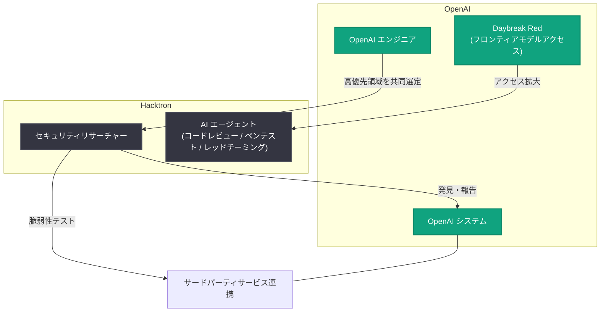

# OpenAI が Hacktron と提携し、自社システムの脆弱性発見を強化

## メタデータ

| 項目 | 内容 |
|------|------|
| 発表日 | 2026-11-06 |
| ソース | OpenAI News |
| カテゴリ | セキュリティ / パートナーシップ |
| 公式リンク | https://openai.com/index/partnering-with-hacktron |

## 概要

OpenAI は、自社システムの脆弱性を発見するため、セキュリティ企業 Hacktron とのパートナーシップを発表した。OpenAI のエンジニアと Hacktron のセキュリティリサーチャーが協力して優先度の高い領域を選定し、特に OpenAI のシステムとサードパーティサービスとの連携部分に焦点を当ててテストを行う。パートナーシップの一環として、OpenAI は Daybreak Red を通じて Hacktron のフロンティアモデルへのアクセスを拡大する。

本提携は、フロンティア AI によるサイバー防御の加速に取り組む OpenAI が、自社システムの脆弱性の発見と修正にも同じ緊急性をもって臨むという一連の取り組みの一環である。同じ週には、Cathedral のリサーチャーが次回のセキュリティスプリントに参加することや、バグバウンティ報奨金の引き上げも発表されている。

## 主な内容

### パートナーシップの内容

- **共同テスト**: OpenAI のエンジニアと Hacktron のセキュリティリサーチャーが、優先度の高い領域を共同で選定してテストを実施する
- **重点領域**: OpenAI のシステムがサードパーティサービスとどのように連携するかに焦点を当てる
- **モデルアクセスの拡大**: [Daybreak Red](https://openai.com/index/expanding-daybreak-as-the-cyber-defense-window-narrows/) を通じて、Hacktron の OpenAI フロンティアモデルへのアクセスを拡大する

### Hacktron とは

OpenAI は自社の Security Bug Bounty プログラムを通じて Hacktron を知り、同社のリサーチャーが発見・報告してきた脆弱性のインパクトに強い印象を受けたとしている。

- **事業内容**: コードレビュー、ペネトレーションテスト、レッドチーミングのための AI エージェントを構築
- **研究実績**: アプリケーション、クラウドインフラ、アイデンティティシステムが相互作用する部分の脆弱性を[研究](https://www.hacktron.ai/blog)により発見してきた
- **評価ポイント**: セキュリティエンジニアが AI を軸に開発を行うことで、より迅速に、より野心的な研究に取り組めることを示している

### 一連のセキュリティ強化施策との関係

今回の発表は、OpenAI が同時期に進めている複数のセキュリティ施策の一部である。

1. **Cathedral との協業**: [Cathedral のリサーチャーが次回のセキュリティスプリントで OpenAI のチームと協働](https://openai.com/index/preparing-our-next-security-sprint-to-harden-openai/)することを同週に発表
2. **バグバウンティ報奨金の引き上げ**: 自社テストで見逃された可能性のある脆弱性を独立系リサーチャーが追求する動機を高めるため、[報奨金を引き上げ](https://openai.com/index/rewarding-defenders-with-bigger-bug-bounties/)
3. **Hacktron との提携**: 本発表 (サードパーティ連携部分の深掘りテスト)

### 背景: AI エージェント時代のセキュリティ

AI エージェントがサービス同士を新しい方法で接続するようになるにつれ、アプリケーション・クラウドインフラ・アイデンティティシステムの相互作用を検証できるスキルの組み合わせの価値はさらに高まる。OpenAI は Hacktron と協働することで、こうした接続部分をより深くテストし、そこから得た知見を自社の防御強化に活用するとしている。

## アーキテクチャ

パートナーシップの構造を以下に示す。

## 開発者への影響

- **プラットフォームの信頼性向上**: OpenAI のシステム、特にサードパーティサービスとの連携部分のセキュリティ検証が強化されることで、OpenAI の API やサービスを利用する開発者にとってプラットフォームの安全性が高まる
- **バグバウンティへの参加機会**: 対象システムの確認や脆弱性の報告は、[Security Bug Bounty プログラム](https://bugcrowd.com/engagements/openai)から行える。報奨金も引き上げられており、独立系リサーチャーの参加インセンティブが高まっている
- **AI エージェント連携の検証例**: AI エージェントがサービスを接続する際のセキュリティ検証のあり方として、AI を活用したセキュリティ研究 (コードレビュー、ペンテスト、レッドチーミングの AI エージェント化) の方向性を示す事例となる

## 関連リンク

- [公式発表: Partnering with Hacktron](https://openai.com/index/partnering-with-hacktron)
- [Daybreak Red の拡大に関する発表](https://openai.com/index/expanding-daybreak-as-the-cyber-defense-window-narrows/)
- [次回セキュリティスプリントの準備 (Cathedral との協業)](https://openai.com/index/preparing-our-next-security-sprint-to-harden-openai/)
- [バグバウンティ報奨金の引き上げ](https://openai.com/index/rewarding-defenders-with-bigger-bug-bounties/)
- [Hacktron の研究ブログ](https://www.hacktron.ai/blog)
- [OpenAI Security Bug Bounty プログラム](https://bugcrowd.com/engagements/openai)

## まとめ

OpenAI は Hacktron との提携により、サードパーティサービスとの連携部分を中心に自社システムの脆弱性テストを強化する。Hacktron はコードレビュー・ペネトレーションテスト・レッドチーミング用の AI エージェントを構築する企業であり、OpenAI の Bug Bounty プログラムでの実績が評価された。Daybreak Red によるフロンティアモデルアクセスの拡大、Cathedral とのセキュリティスプリント、バグバウンティ報奨金の引き上げと合わせ、フロンティア AI でサイバー防御を加速しつつ自社の防御も同じ緊急性で固めるという OpenAI の姿勢を示す発表である。
