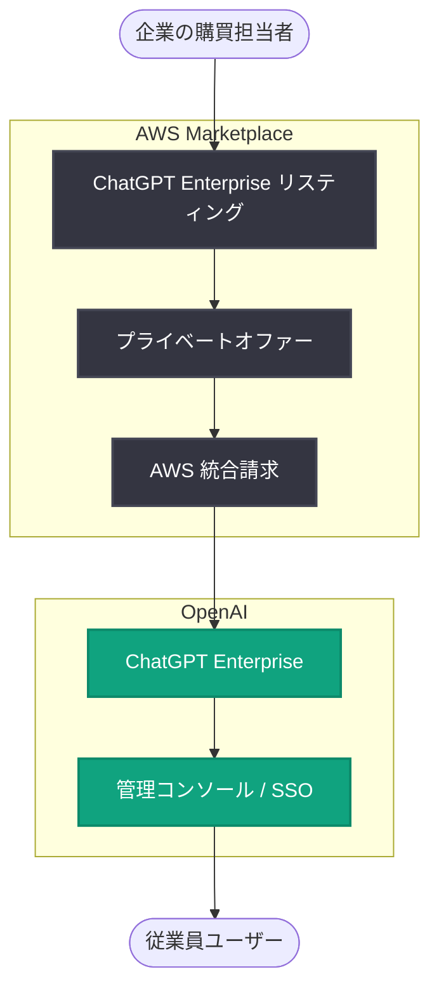

# ChatGPT Enterprise が AWS Marketplace で提供開始

## メタデータ

| 項目 | 内容 |
|------|------|
| 発表日 | 2026-11-09 |
| ソース | OpenAI News |
| カテゴリ | 新機能 (エンタープライズ / 調達) |
| 公式リンク | https://openai.com/index/chatgpt-enterprise-aws-marketplace |

> **注**: 記事ページの取得が制限されていたため (HTTP 403)、本レポートは公開されているサマリー情報および既知の背景情報に基づいて作成しています。最新かつ正確な詳細は上記の公式リンクを参照してください。

## 概要

OpenAI は、ChatGPT Enterprise を AWS Marketplace で提供開始したことを発表しました。これにより、AWS を利用する企業は、既存の AWS アカウントおよび購買・請求関係を通じて ChatGPT Enterprise を調達できるようになります。

企業向け AI 導入における最大の障壁の 1 つは、新規ベンダーとの契約・調達プロセスの煩雑さです。AWS Marketplace 経由での提供により、ベンダー登録、セキュリティ審査、支払い条件の交渉といった調達プロセスが大幅に簡素化され、企業はより迅速に ChatGPT Enterprise を導入できます。

## 主な内容

### AWS Marketplace での提供

ChatGPT Enterprise が AWS Marketplace のラインナップに加わりました。AWS Marketplace は、AWS 顧客がソフトウェアやサービスを検索・購入・管理できるデジタルカタログであり、世界中の多数の企業が調達チャネルとして利用しています。

### 調達プロセスの簡素化

AWS Marketplace 経由での購入には、以下のようなメリットがあります。

- **既存の請求関係の活用**: ChatGPT Enterprise の利用料金が AWS の請求に統合され、支払い管理が一元化される
- **調達手続きの短縮**: 新規ベンダー登録や個別契約の交渉が不要となり、導入までのリードタイムが短縮される
- **プライベートオファーへの対応**: 企業ごとの価格条件や契約条件を AWS Marketplace のプライベートオファー機能を通じて柔軟に設定可能
- **コミットメントへの充当**: AWS との既存の支出コミットメント (EDP: Enterprise Discount Program など) の消化対象にできる場合があり、予算活用の効率が向上する

### ChatGPT Enterprise について

ChatGPT Enterprise は、企業向けに設計された ChatGPT の最上位プランであり、以下の特徴を備えています。

- エンタープライズグレードのセキュリティとプライバシー (ビジネスデータは学習に使用されない)
- 管理コンソール、SSO、ドメイン検証、利用分析などの管理機能
- 高度なモデルへのアクセスと拡張されたコンテキストウィンドウ
- コンプライアンス対応 (SOC 2 準拠など)

## 調達フロー

## 企業・開発者への影響

- **導入スピードの向上**: 調達・契約プロセスの簡素化により、企業は数週間から数か月かかっていたベンダー審査を省略し、より早く全社的な AI 活用を開始できる
- **予算管理の一元化**: AWS の請求に統合されるため、IT 部門はクラウド支出と AI ツール支出をまとめて管理できる
- **既存コミットメントの活用**: AWS との支出コミットメントを ChatGPT Enterprise の購入に充当できる可能性があり、追加予算の確保が不要になるケースがある
- **競合環境への影響**: Amazon 自身が Amazon Q や Amazon Bedrock を提供する中で、AWS Marketplace に ChatGPT Enterprise が並ぶことは、企業向け AI 市場におけるマルチベンダー化の進展を示している
- **OpenAI と AWS の関係深化**: 2025 年以降の OpenAI と AWS の提携拡大 (コンピュート契約など) の流れに沿った動きであり、今後のさらなる統合が期待される

## 関連リンク

- [公式発表 (OpenAI News)](https://openai.com/index/chatgpt-enterprise-aws-marketplace)
- [ChatGPT Enterprise](https://openai.com/chatgpt/enterprise/)
- [AWS Marketplace](https://aws.amazon.com/marketplace)
- [OpenAI News](https://openai.com/news)

## まとめ

ChatGPT Enterprise の AWS Marketplace 提供開始は、技術的な新機能ではなく、企業の AI 導入における「調達」という実務的な障壁を取り除く発表です。既存の AWS 購買・請求関係を活用できることで、特に大企業や規制産業の組織にとって ChatGPT Enterprise の導入ハードルが大きく下がります。企業向け AI の普及フェーズにおいて、販売チャネルの拡大が重要な競争軸になっていることを示す動きと言えます。
