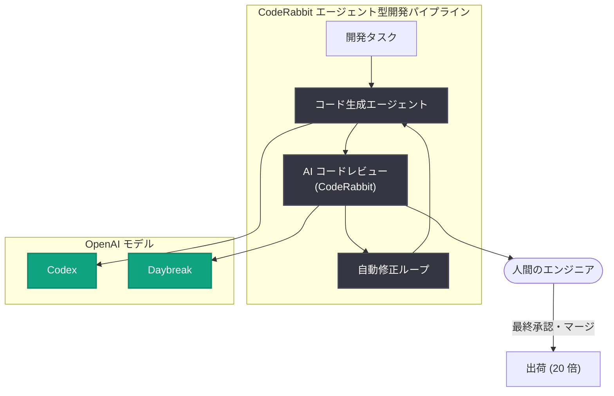

# CodeRabbit、エージェント型ソフトウェア開発をスケールさせ 20 倍の出荷量を実現

## メタデータ

| 項目 | 内容 |
|------|------|
| 発表日 | 2026-11-09 |
| ソース | OpenAI News |
| カテゴリ | 導入事例 (Customer story) |
| 公式リンク | https://openai.com/index/coderabbit-codex-daybreak |

> **注**: 記事本文の取得時にアクセス制限 (HTTP 403) が発生したため、本レポートは公開されているサマリー情報に基づいて作成しています。詳細は上記の公式リンクを参照してください。

## 概要

AI コードレビュープラットフォームを提供する CodeRabbit が、OpenAI のモデル (Codex、Daybreak) を活用してエージェント型ソフトウェア開発をスケールさせ、同じ人員規模のまま 20 倍のソフトウェアを出荷したことが、OpenAI の導入事例として紹介されました。

AI によるコード生成が普及する中で課題となるのは、生成されたコードの品質管理とレビューのスループットです。CodeRabbit は OpenAI モデルを組み込んだエージェント型ワークフローにより、AI 生成コードの管理とレビューを自動化し、人間のエンジニアが増えなくても出荷量を大幅に拡大できることを示しました。

## 主な内容

### AI 生成コードの管理という課題

エージェント型開発では、人間が書くコードよりもはるかに速いペースでコードが生成されます。生成量が増えるほど、レビュー・品質保証・マージ判断がボトルネックになります。CodeRabbit はこのボトルネックを解消するため、コードレビュー自体を AI エージェントで自動化するアプローチを採用しています。

### Codex と Daybreak の活用

CodeRabbit は OpenAI のコーディング特化モデルである Codex と、Daybreak を組み合わせて利用しています。これにより次のような開発サイクルを実現しています。

- **コード生成**: エージェントがタスクを受け取り、Codex でコードを生成
- **自動レビュー**: 生成されたコードを AI レビューエージェントが解析し、バグ・セキュリティ・スタイルの問題を指摘
- **反復改善**: レビュー結果をもとにエージェントが修正を繰り返し、人間は最終判断に集中

### 成果: 同じ人員で 20 倍の出荷量

このエージェント型パイプラインにより、CodeRabbit はエンジニアの人数を増やすことなく、従来比 20 倍のソフトウェアを出荷できるようになったと報告されています。人間の役割は「コードを書く」ことから「エージェントの成果物を監督・判断する」ことへとシフトしています。

## アーキテクチャ

## 開発者への影響

- **レビューの自動化が前提に**: AI 生成コードの増加に伴い、人間によるレビューだけではスループットが追いつかなくなるため、AI レビューエージェントの導入が現実的な選択肢になります
- **人間の役割の変化**: エンジニアの仕事は実装そのものから、エージェントの成果物の監督・アーキテクチャ判断・最終承認へとシフトします
- **モデルの使い分け**: コード生成には Codex、レビューや管理には Daybreak といった形で、タスク特性に応じて複数の OpenAI モデルを組み合わせる設計パターンが有効です
- **スケーラビリティの再定義**: チームの出荷量が人員数ではなく、エージェントパイプラインの設計品質で決まる時代への移行を示す事例です

## 関連リンク

- [CodeRabbit 導入事例 (OpenAI 公式)](https://openai.com/index/coderabbit-codex-daybreak)
- [CodeRabbit 公式サイト](https://www.coderabbit.ai/)
- [OpenAI Codex](https://openai.com/codex/)
- [OpenAI News](https://openai.com/news)

## まとめ

CodeRabbit の事例は、AI によるコード生成とコードレビューの両方をエージェント化することで、人員を増やさずに出荷量を 20 倍にできることを示しました。Codex と Daybreak という OpenAI モデルの組み合わせにより、「生成 → レビュー → 修正 → 承認」の開発ループを自動化し、人間は監督と最終判断に集中する — これがエージェント型ソフトウェア開発の実践的なモデルケースとなっています。
