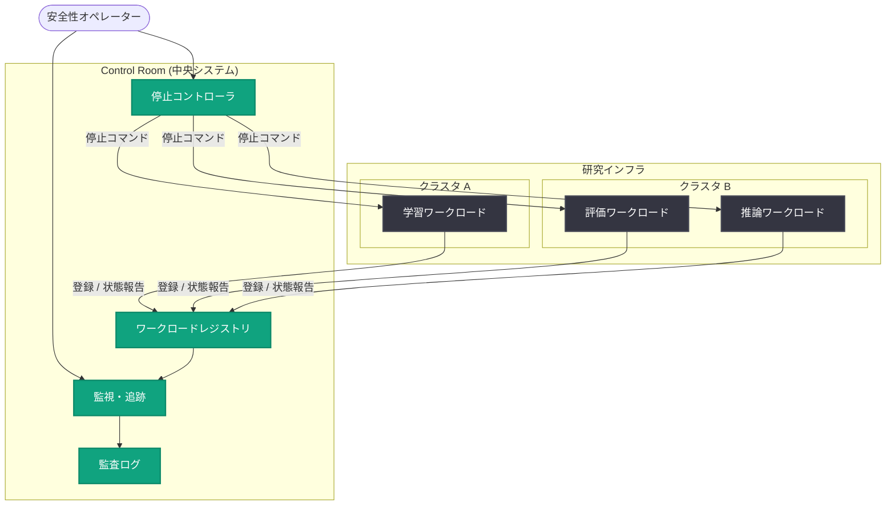

# Control Room: 研究インフラ全体のモデルワークロードを追跡・停止する中央システム

## メタデータ

| 項目 | 内容 |
|------|------|
| 発表日 | 2026-11-09 |
| ソース | OpenAI News / Research |
| カテゴリ | 研究 / 安全性インフラ |
| 公式リンク | https://openai.com/index/control-room |

> **注記**: 本レポート作成時点で記事ページへのアクセスが制限されていた (HTTP 403) ため、公開されている要約情報と一般的な技術知識に基づいて作成しています。詳細は上記の公式リンクを参照してください。

## 概要

OpenAI は 2026 年 11 月 9 日、研究インフラ全体で実行されるモデルワークロードを一元的に追跡し、安全性やセキュリティ上の懸念が生じた際に迅速に停止できる中央システム「Control Room」を発表した。

大規模な AI 研究組織では、学習ジョブ、評価、ファインチューニング、実験的な推論など、多数のモデルワークロードが分散したコンピュートクラスタ上で同時に実行される。Control Room は、これらのワークロードを単一のシステムで可視化し、問題発生時に人間のオペレーターが確実に介入できる「停止ボタン」を提供することで、フロンティアモデル開発における運用上の安全性を強化する取り組みである。

## 主な内容

### 背景: 分散した研究インフラの課題

フロンティアモデルの研究開発では、以下のような課題が存在する。

- **可視性の欠如**: 複数のクラスタやリージョンにまたがるワークロードを横断的に把握することが困難
- **介入の遅延**: 安全性やセキュリティ上の懸念が発見されても、該当ワークロードの特定と停止に時間がかかる
- **説明責任**: どのモデルがどのリソースで何を実行しているかを監査可能な形で記録する必要性

Control Room はこれらの課題に対し、「追跡 (track)」と「停止 (stop)」という 2 つの中核機能を中央集約型のシステムとして提供する。

### 中核機能 1: ワークロードの一元追跡

研究インフラ全体で実行中のモデルワークロードを中央システムに登録し、以下のような情報をリアルタイムで追跡する。

- 実行中のワークロードの種別 (学習、評価、推論など)
- 使用しているコンピュートリソースと実行場所
- ワークロードの所有者と目的
- 実行状態の監査ログ

### 中核機能 2: 迅速な停止メカニズム

安全性またはセキュリティ上の懸念が生じた場合、オペレーターは Control Room を通じて該当ワークロードを迅速に停止できる。中央システムとして設計されているため、個別のクラスタやジョブスケジューラを個々に操作する必要がなく、インフラ全体に対して一貫した制御を行える点が特徴である。

### AI 安全性における位置づけ

Control Room のようなインフラレベルの制御機構は、モデルの能力が向上するにつれて重要性を増す「準備態勢 (Preparedness)」の一環と位置づけられる。モデル自体のアライメントだけでなく、モデルを実行する基盤側に確実な監視・介入手段を組み込むことで、多層防御 (defense in depth) を実現するアプローチである。

## 技術的な詳細

Control Room は研究インフラの制御プレーンとして機能し、各クラスタ上のワークロードと中央システムの間で登録・ハートビート・制御コマンドをやり取りする構成と考えられる。

- **登録**: ワークロードの起動時に中央システムへメタデータを登録
- **追跡**: 実行中のワークロードが状態を継続的に報告し、未登録・応答なしのワークロードを検出
- **制御**: オペレーターの判断またはポリシーに基づき、停止コマンドをクラスタへ伝播

## アーキテクチャ

## 開発者への影響

本発表は OpenAI の内部インフラに関するものであり、API 仕様の変更など外部開発者への直接的な影響はない。ただし、以下の観点で参考になる。

- **運用安全性の設計パターン**: 大規模な AI ワークロードを運用する組織にとって、中央集約型の追跡・停止システムは参考になる設計パターンである
- **多層防御の実践例**: モデルレベルの安全対策に加え、インフラレベルの制御を組み合わせるアプローチの具体例
- **ガバナンスへの示唆**: ワークロードの監査可能性と迅速な介入手段は、AI ガバナンスや規制対応の文脈でも注目される要素

## 関連リンク

- [Control Room (公式記事)](https://openai.com/index/control-room)
- [OpenAI Safety](https://openai.com/safety)
- [OpenAI News](https://openai.com/news)
- [OpenAI Research](https://openai.com/research)

## まとめ

- OpenAI は研究インフラ全体のモデルワークロードを追跡・停止できる中央システム「Control Room」を発表
- 「追跡」と「停止」を中核機能とし、安全性・セキュリティ上の懸念に対する迅速な介入を可能にする
- モデル自体の安全対策に加え、インフラレベルの制御による多層防御を実現する取り組み
- 外部開発者への直接的な影響はないが、大規模 AI ワークロード運用の設計パターンとして参考になる
