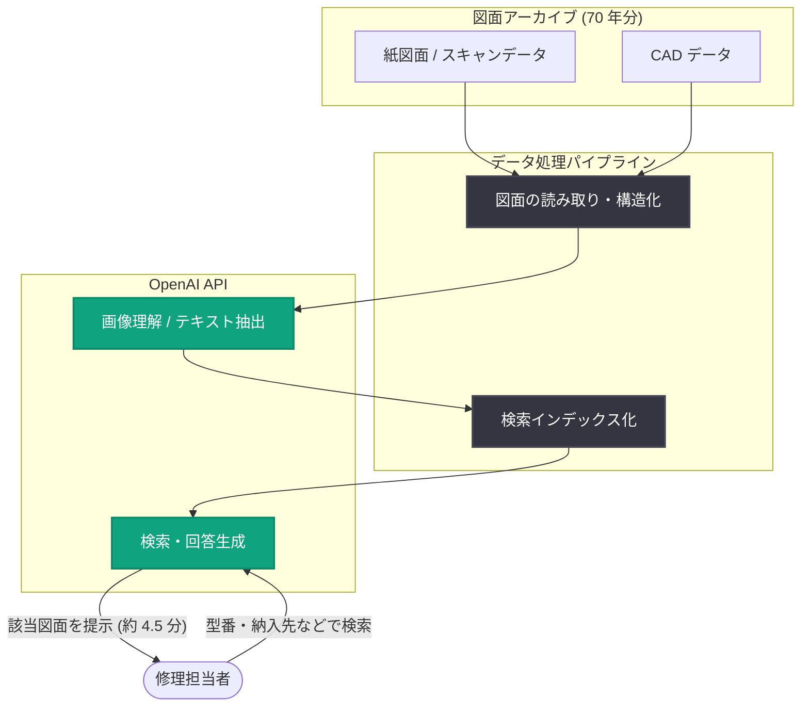

# 空研工業、70 年分の冷却塔図面を数分で検索可能に

## メタデータ

| 項目 | 内容 |
|------|------|
| 発表日 | 2026-11-09 |
| ソース | OpenAI News |
| カテゴリ | 導入事例 (日本 / 製造業) |
| 公式リンク | https://openai.com/index/kuken |

> **注**: 記事ページの取得が制限されていたため (HTTP 403)、本レポートは公開されているサマリー情報および既知の背景情報に基づいて作成しています。最新かつ正確な詳細は上記の公式リンクを参照してください。

## 概要

冷却塔メーカーの空研工業が、OpenAI API を活用して 70 年分の冷却塔図面を検索可能にした導入事例が OpenAI News で公開されました。修理対応に必要な図面の検索時間は、従来の約 1 時間から 4.5 分へと大幅に短縮されています。

冷却塔のような長寿命の産業設備では、数十年前に納入した製品の修理・部品交換の依頼が今も発生します。その際に必要となる過去の設計図面は膨大な紙・スキャンデータとして蓄積されており、目的の図面を探し出す作業が熟練担当者の時間を大きく奪っていました。本事例は、AI による図面アーカイブの検索性向上が、製造業のアフターサービス業務を直接的に効率化できることを示すものです。

## 主な内容

### 背景: 70 年分の図面資産と属人化した検索業務

空研工業は長年にわたり冷却塔を製造・納入しており、その設計図面は 70 年分に及びます。冷却塔は導入から数十年単位で稼働し続けるため、修理や部品交換の際には当時の図面を参照する必要があります。

しかし、過去の図面は年代ごとに管理方法や記載形式が異なり、検索は担当者の記憶や経験に依存していました。1 件の修理依頼に対して図面を特定するまでに約 1 時間を要することもあり、対応スピードと属人化が課題となっていました。

### OpenAI API による図面検索システム

空研工業は OpenAI API を活用し、蓄積された図面データを検索可能にするシステムを構築しました。これにより、修理用図面の検索時間は約 1 時間から 4.5 分へと、約 92% 短縮されています。

| 項目 | 導入前 | 導入後 |
|------|--------|--------|
| 図面検索時間 | 約 1 時間 | 約 4.5 分 |
| 検索方法 | 担当者の記憶・経験に依存 | AI による検索 |
| 対応可能者 | 熟練担当者中心 | より広い担当者 |

### 導入効果

- **検索時間の短縮**: 修理用図面の検索が約 1 時間から 4.5 分に短縮され、顧客への修理対応が迅速化
- **属人化の解消**: 熟練担当者の記憶に頼っていた検索業務を、システムとして誰でも実行可能に
- **知識資産の活用**: 70 年分の図面という企業の知識資産を、死蔵させずに現場業務で活用できる形に変換

## アーキテクチャ (想定構成)

公開情報に基づく一般的な図面検索システムの構成イメージです。実際の構成は公式記事を参照してください。

## 企業・開発者への影響

- **レガシー資産の AI 活用モデル**: 数十年分の紙図面・スキャンデータといった非構造化のレガシー資産でも、OpenAI API の画像理解・検索能力を組み合わせることで実用的な検索システムに変換できることを示す事例
- **アフターサービス業務の効率化**: 長寿命製品を扱う製造業 (プラント設備、建材、産業機械など) では、同様のアプローチで修理・保守対応のリードタイムを大幅に短縮できる可能性がある
- **技能伝承・属人化対策**: ベテラン担当者の経験に依存していた業務をシステム化することで、人材の退職リスクに備えたナレッジマネジメントとしても機能する
- **日本企業の導入事例の増加**: OpenAI が日本の中堅製造業の事例を公式に紹介したことは、日本市場における企業向け AI 導入の広がりを示しており、同規模の企業にとって参考になるベンチマークとなる

## 関連リンク

- [公式発表 (OpenAI News)](https://openai.com/index/kuken)
- [OpenAI API ドキュメント](https://platform.openai.com/docs)
- [OpenAI Stories (導入事例)](https://openai.com/stories)
- [OpenAI News](https://openai.com/news)

## まとめ

空研工業の事例は、最先端の AI 機能そのものではなく、「70 年分の図面を 4.5 分で探せるようにする」という地に足の着いた業務改善に OpenAI API を適用した点が特徴です。製造業が抱える図面・技術文書の検索という普遍的な課題に対して、検索時間を約 92% 短縮するという明確な数値成果を示しており、長寿命製品を扱う企業にとって再現性の高い活用パターンと言えます。
