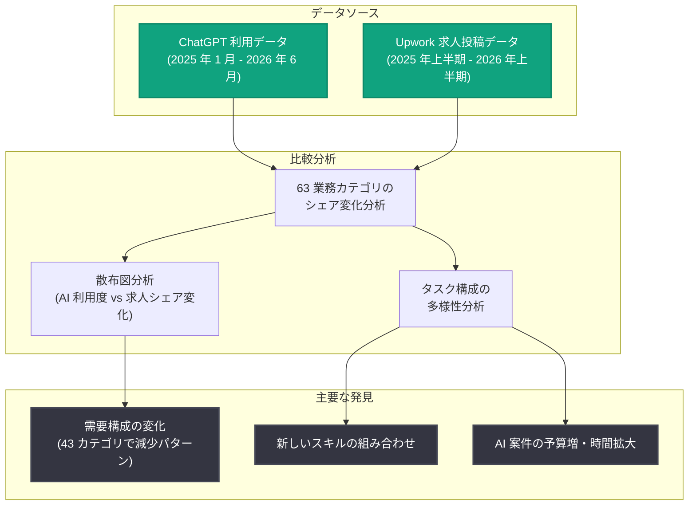

# Work at the Frontier: AI がフリーランス業務に与える影響 — OpenAI と Upwork の共同研究

## メタデータ

| 項目 | 内容 |
|------|------|
| 発表日 | 2026-11-10 |
| ソース | OpenAI News / Research |
| カテゴリ | 研究成果 |
| 公式リンク | https://openai.com/index/ai-effect-on-freelance-work |

## 概要

OpenAI の経済研究チーム (Economic Research Team) は、フリーランスマーケットプレイス大手の Upwork と提携し、「Work at the Frontier」シリーズの新しい研究として、AI がフリーランス業務に与える影響を分析した結果を発表した。本研究は、ChatGPT の利用実態データと Upwork 上の求人投稿データを比較分析するもので、フリーランス契約は短期かつ頻繁に更新されるため、経済全体の雇用統計よりも早く AI の影響を検出できるという前提に基づいている。

分析の結果、フリーランス需要の変化、新しいスキルの組み合わせの出現、AI 関連プロジェクトにおける予算の増加と稼働時間の拡大が明らかになった。研究は単純な「AI による仕事の代替」という構図を否定しており、原文では "The findings do not point to a simple substitution story" と述べられている。AI はクライアントがフリーランサーに求める内容と、プロジェクトの組み立て方の両方を変えつつあることが示唆された。

## 主な内容

### 研究の背景: フリーランス市場の重要性

本研究の背景として、以下の統計が示されている。

- Upwork の 2026 Future Workforce Index によれば、米国の熟練ナレッジワーカーの **38%** がフリーランス業務に従事している
- 2025 年版の調査では、フリーランスのナレッジワークは 2024 年に米国で **約 1.5 兆ドル** の収入を生み出したと推計されている

フリーランス市場は契約の更新サイクルが短いため、AI の労働市場への影響をいち早く観測できる「最前線 (Frontier)」として位置づけられている。

### 主要な調査結果

**1. 需要構成の変化 (63 カテゴリの分析)**

分析対象となった **63 の業務カテゴリ** のうち、**43 カテゴリ** で「ChatGPT で多用される業務ほど Upwork での求人シェアが減少する」というパターンが観測された。一方、残りの **20 カテゴリ** では逆のパターンが見られた。

また、プラットフォーム間で業務構成に違いがあることも判明した。ChatGPT ではライティングの利用比率がはるかに高いのに対し、Upwork では動画・アニメーションの依頼が大きなシェアを占めていた。

**2. AI 要求の拡大と多様化**

2025 年後半までに、クライアントはチャットボット開発、動画制作、マーケティング自動化、アプリケーション統合など、多様な業務で AI の活用を要求するようになった。AI 関連投稿のタスク構成は 2023 年初頭から 2025 年後半にかけて **45% 多様化** し、実質的に同等に一般的なタスク数は約 **14.6 から 21.2** に増加した。

**3. 新しいスキルの組み合わせ**

AI 関連の投稿は、タスク数自体は他の投稿と同程度だが、従来はほとんど同時に出現しなかったタスクを組み合わせる傾向が確認された。例として、「AI 生成動画・編集・モーショングラフィックス」を 1 件の投稿でまとめて依頼するケースが挙げられている。

**4. 報酬構造: 予算の増加と稼働時間の拡大**

時間単価は AI 関連案件と他の案件で同水準だったが、AI 関連プロジェクトは **固定報酬の予算が大きく、作業時間も長い** ことが判明した。これは AI 関連案件の業務範囲の広さを反映している可能性がある。

## 分析手法

本研究では、以下のデータと手法が用いられた。

- **ChatGPT 利用シェア**: 2025 年 1 月〜2026 年 6 月のデータ
- **Upwork 求人シェア**: 2026 年上半期のデータ (変化は 2025 年上半期から 2026 年上半期への比較、パーセントポイント)
- **散布図分析**: 横軸に「ChatGPT 利用シェア (2025 年下半期) ÷ Upwork 求人シェア (2023 年上半期)」の自然対数、縦軸に Upwork 投稿シェアの変化率 (対数スケール) を取り、AI 利用度と求人需要の変化の関係を可視化

### 研究の限界: capability overhang

OpenAI は、本比較が「人々が現在 ChatGPT をどのように使っているか」を捉えたものであり、AI が支援可能な業務の全範囲を示すものではない点に言及している。この「現在の利用」と「潜在的な能力」のギャップを、OpenAI は **capability overhang (能力の余剰)** と呼んでいる。つまり、AI の労働市場への影響は今後さらに拡大する余地があることが示唆されている。

## 開発者・フリーランサーへの影響

- **単純な代替ではない**: 研究結果は AI がフリーランスの仕事を単純に置き換えているのではなく、需要の構成と案件の組み立て方を変化させていることを示している
- **複合スキルの価値向上**: AI 生成コンテンツと編集・モーショングラフィックスのように、従来は別々だったスキルを組み合わせられる人材への需要が高まっている
- **AI 関連案件の経済的魅力**: AI 関連プロジェクトは固定報酬の予算が大きく作業時間も長いため、AI スキルを持つフリーランサーには大きな機会となる
- **需要シフトへの備え**: ChatGPT で多用される業務カテゴリ (ライティングなど) は Upwork でのシェアが減少する傾向があり、該当分野のフリーランサーはスキルの再構成を検討する必要がある

## 関連リンク

- [Work at the Frontier: AI's effect on freelance work (OpenAI)](https://openai.com/index/ai-effect-on-freelance-work)
- [OpenAI News](https://openai.com/news)
- [OpenAI Research](https://openai.com/research)
- [Upwork Research Institute](https://www.upwork.com/research)

## まとめ

OpenAI と Upwork の共同研究は、ChatGPT の利用データと Upwork の求人データという 2 つの大規模データソースを比較することで、AI がフリーランス市場に与える影響を定量的に分析した。63 カテゴリ中 43 カテゴリで AI 多用業務の求人シェア減少が見られた一方、AI 関連案件はタスク構成が 45% 多様化し、より大きな固定報酬予算とより長い作業時間を伴っていた。研究は「単純な代替」の構図を否定し、AI がクライアントの求めるスキルの組み合わせと案件の構造自体を変えつつあることを示している。さらに capability overhang の概念が示すように、現在観測されている変化は AI の潜在的な影響の一部に過ぎない可能性がある。
