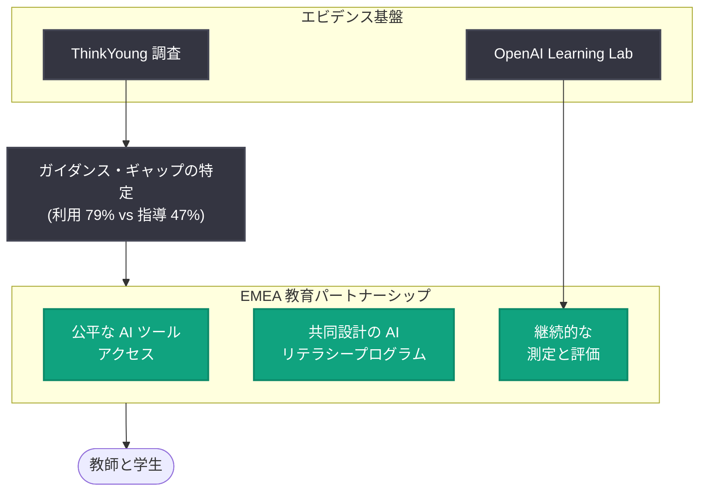

# 教育における AI ガイダンス・ギャップの解消: ThinkYoung 調査と EMEA 教育パートナーシップの知見

## メタデータ

| 項目 | 内容 |
|------|------|
| 発表日 | 2026-11-10 |
| ソース | OpenAI News |
| カテゴリ | 教育 / 調査 |
| 公式リンク | https://openai.com/index/closing-ai-guidance-gap-education |

## 概要

OpenAI は 2026 年 11 月 10 日、教育における「AI ガイダンス・ギャップ (指導の格差)」をテーマとした記事を公開した。執筆者は Tom Duff Gordon 氏 (VP, Global Affairs EMEA) と Leah Belsky 氏 (VP, Education) である。記事では、欧州の若者シンクタンク ThinkYoung による新しい調査結果と、OpenAI が EMEA (欧州・中東・アフリカ) 地域で進める教育パートナーシップから得られた初期の知見が共有されている。

中心となる発見は、調査対象の学生の 79% が宿題や課題に AI を使用していると回答した一方、AI の使い方を教わったと回答した学生は 47% にとどまるという点である。つまり、学生の AI 利用は急速に広がっているにもかかわらず、学校や教師による体系的な指導が追いついておらず、約 32 ポイントの「ガイダンス・ギャップ」が生じている。OpenAI は、AI が高度化するほど教師の役割はむしろ重要になると主張し、政府と教育機関に対して教育者への支援を急ぐよう呼びかけている。

## 主な内容

### ThinkYoung 調査が示す「ガイダンス・ギャップ」

ThinkYoung の新しい調査で明らかになった主要な統計は以下のとおりである。

| 指標 | 数値 |
|------|------|
| 宿題や課題に AI を使用していると回答した学生 | 79% |
| AI の使い方を教わったと回答した学生 | 47% |
| 両者の差 (ガイダンス・ギャップ) | 約 32 ポイント |

この結果は、学生が指導のないまま独学で AI を利用している実態を示している。OpenAI はこのギャップを放置すれば、AI の利用が学習効果につながらず、不適切な利用が広がるリスクがあると指摘し、政府は教育者を支援し、学生に対して AI 利用に関する明確な期待値を示す必要があると論じている。

### EMEA 教育パートナーシップの取り組み

OpenAI はエストニア、スロバキア、ギリシャ、イタリアなどの国々と教育分野でのパートナーシップを進めている。各国の取り組みは現地の言語・カリキュラム・制度に適応させる形で展開されており、共通する優先事項は次の 3 点である。

1. **最先端 AI ツールへの公平なアクセス**: 地域や学校間の格差を生まないツール提供
2. **共同設計による AI リテラシープログラム**: 現地の教育関係者とともにプログラムを設計
3. **継続的な測定と評価**: 導入効果を現地の文脈に即して検証し続ける

### 各国パートナーシップから得られた 3 つの初期パターン

記事では、これらのパートナーシップを通じて見えてきた 3 つの初期パターンが整理されている。

**1. 国別パートナーシップの教訓**: エストニア、ギリシャ、スロバキアでの経験から、成功の条件として以下が挙げられている。

- 明確な方向性を示す強力な公的リーダーシップ
- 教師のスキルと自信への投資
- 現地カリキュラムと教室のニーズに合わせた実践的支援

**2. ガイダンス・ギャップ解消の緊急性**: 前述の調査結果が示すとおり、学生の利用拡大に指導が追いついていない。教育者が AI 利用の条件を自ら設定できるよう、政府による支援が求められる。

**3. 教師への初期的メリットと検証の必要性**: 教師の AI 導入率と報告されている時間節約の効果は有望である。一方で、AI が学生の知識・自立的思考・記憶定着を強化するかどうかについては、継続的な評価と研究が必要だとしている。

### レポートを構成する 5 つのテーマ

記事と関連レポートは、以下の 5 つのテーマで知見を整理している。

| テーマ | 内容 |
|--------|------|
| 明確な教育目標 | AI 導入の目的を教育成果に結び付ける |
| 教育者の準備 | 教師のスキル・自信への投資と研修 |
| 現地パートナーシップ | 言語・カリキュラム・制度への適応 |
| 批判的 AI リテラシー | AI を鵜呑みにしない批判的な活用能力の育成 |
| 信頼できるエビデンス | 調査・プログラム監視・協議による継続的検証 |

### OpenAI Learning Lab

OpenAI は「OpenAI Learning Lab」を通じて教育研究者を集め、AI がいつ・どのような条件で教育システムを支援できるかを研究している。記事では、これらの取り組みは「単一のモデル (正解)」としてではなく、あくまで初期段階の経験として共有されていると強調されている。

## 教育関係者・政策立案者への影響

- **政府・教育行政**: 強力な公的リーダーシップのもと、AI 導入の明確な方向性と学生への期待値を示すことが求められる。エストニアやギリシャ、スロバキアの事例が参考になる
- **学校・教師**: 学生の約 8 割がすでに AI を利用している前提で、AI 利用の条件設定と指導方法の整備が急務となる。教師のスキルと自信への投資が成功の鍵とされる
- **教育プログラム設計者**: ツールの配布だけでなく、現地の言語・カリキュラムに適応した AI リテラシープログラムの共同設計と、効果の継続的な測定・評価が重要になる
- **研究者**: AI が知識習得・自立的思考・記憶定着に与える影響はまだ検証途上であり、OpenAI Learning Lab などを通じた信頼できるエビデンスの蓄積が求められる

## 関連リンク

- [Closing the AI guidance gap in education (OpenAI 公式)](https://openai.com/index/closing-ai-guidance-gap-education)
- [ThinkYoung 公式サイト](https://www.thinkyoung.eu/)
- [OpenAI News](https://openai.com/news)

## まとめ

本記事は、学生の 79% が AI を宿題に利用する一方で指導を受けたのは 47% にとどまるという ThinkYoung の調査結果を軸に、教育における「AI ガイダンス・ギャップ」の解消を訴えるものである。OpenAI はエストニア、スロバキア、ギリシャ、イタリアなどとの EMEA 教育パートナーシップを通じて、公平なアクセス、共同設計の AI リテラシープログラム、継続的な測定・評価という 3 つの優先事項を実践している。AI が高度化するほど教師の役割は重要になるという立場のもと、教育者への投資と信頼できるエビデンスの蓄積が、今後の教育システムにおける AI 活用の成否を左右すると結論付けている。
