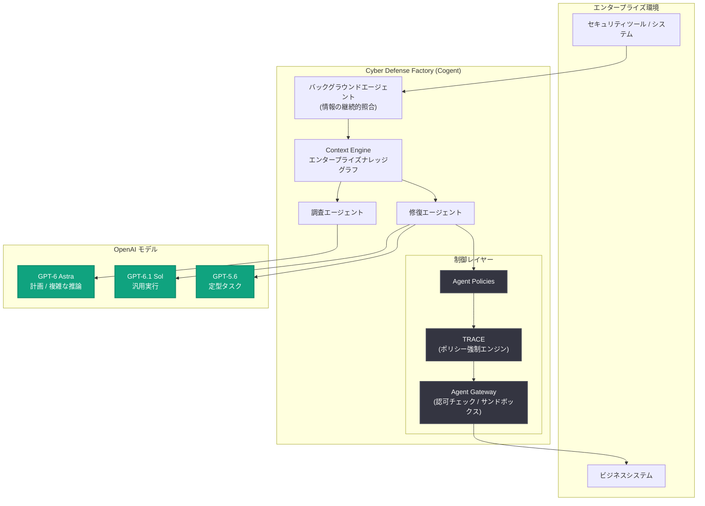

# Cogent と OpenAI、企業向けサイバー防御ファクトリーを構築

## メタデータ

| 項目 | 内容 |
|------|------|
| 発表日 | 2026-11-10 |
| ソース | OpenAI News |
| カテゴリ | 導入事例 (エンタープライズセキュリティ) |
| 公式リンク | https://openai.com/index/cogent-security |

## 概要

Cogent Security は、OpenAI のモデルと自社のエンタープライズコンテキストを組み合わせ、企業向けに「Cyber Defense Factories (サイバー防御ファクトリー)」を構築している。同社は、企業セキュリティにおける最大の課題は脆弱性の発見ではなく修復 (remediation) にあると捉えている。修復作業は複数チームにまたがる複雑な作業であり、攻撃者がどのように脆弱性を悪用し得るか、どのビジネスシステムが影響を受けるか、どの変更を安全に実施できるかといった、企業環境に対する文脈的理解が不可欠である。

Cogent の AI エージェントは、GPT-6.1 Sol と GPT-5.6 を自社のエンタープライズコンテキストおよび制御機構と組み合わせ、調査から検証済みの修復までを自律的に処理する。エージェントはエクスポージャーを評価し、許可された変更を実行し、リスクが排除されたことを確認する。脆弱性の発見と悪用が加速する状況に対応し、防御側がマシンスピードで動けるように設計されている。

## 主な内容

### エージェントにコンテキストと行動権限を与える仕組み

Cogent の Context Engine は、顧客ごとに資産、脆弱性、アイデンティティ、所有権、依存関係からなるエンタープライズナレッジグラフを維持する。専用のバックグラウンドエージェントがセキュリティツールとシステム間の情報を継続的に照合し、調査エージェントと修復エージェントに環境の共通理解を提供する。

この作業における事前計画と複雑な推論は GPT-6 Astra が担当する。Cogent の共同創業者兼 CTO である Geng Sng 氏はこれを「エンタープライズのためのメモリハーネス」と表現し、「新しいタスクが発生するたびに世界の姿を学び直す必要がない」と述べている。コンテキストの再利用により、レイテンシ、推論コスト、結果の不整合が削減される。

安全性の制御は以下の多層構造で実現されている。

- **Agent Policies**: 企業ごとに許可された変更と承認要件を定義
- **TRACE (ポリシー強制エンジン)**: 実行前にツール呼び出しをポリシーと照合。チェックは決定論的で、別途のモデル推論を必要としない
- **Agent Gateway**: 独立して認可をチェックし、リスクの高い作業は分離されたサンドボックスで実行可能

顧客は、調査のみを委任する、変更に承認を必須とする、範囲を限定した自律修復を許可する、といった選択ができる。

### 脆弱性開示から検証済み修正まで: PHP2Shell の事例

Web サイトの実行に使われるプログラミング言語 PHP で「PHP2Shell」と呼ばれる重大なセキュリティ欠陥が開示された際、顧客は環境にすでに展開されていた Cyber Defense Factories を活用した。

GPT-6.1 Sol と GPT-6 Astra が調査と修復計画のための深い推論を提供した。エージェントは Cogent のコンテキストレイヤーを使って影響を受けるシステムを特定し、エクスポージャーを評価し、アプリケーションの依存関係と運用上の制約を考慮した計画を策定した。その後、顧客が定義した承認・実行ワークフローに沿って修正をオーケストレーションし、解決を検証した。

Cogent が報告する顧客の成果は以下のとおり。

| 顧客 | 成果 |
|------|------|
| Fortune 1000 自動車関連企業 | 重大な脆弱性の平均修復時間 (MTTR) を 75% 削減 |
| Fortune 500 IT サービス企業 | 脆弱性トリアージのスループットを 5 倍に向上 |

取引プラットフォームの MarketAxess は、修復の優先順位付けに Cogent を活用している。同社グローバル CISO の Vijay Bala 氏は「Cogent は攻撃者の視点で当社の環境を見る。インターネットから脆弱なシステムまでの経路をたどり、その途中の制御を確認する。当社の修復作業は今や、最大のリスクと攻撃者が侵入に使い得る経路に集中している」と述べている。

### Cogent が OpenAI モデルと Codex を選ぶ理由

Cogent はクローズドソースとオープンソースの代替モデルを継続的に評価しており、OpenAI モデルについて以下の優位性を報告している。

- 長時間実行のセキュリティタスクにおけるより強力な推論
- より高い忠実度と、技術的なコードベースにおけるハルシネーションの少なさ
- より信頼性の高い実行。修復ワークフロー全体でコンテキストを保持しながら、ツール呼び出しを逐次・並列に連鎖できる

モデルの使い分けとして、複雑な調査には推論品質を優先し、単純な作業にはコストを優先する。汎用的な実行には GPT-6.1 Sol を、高度な推論の重要性が低い定型的な脆弱性管理タスクには GPT-5.6 を使用している。Geng Sng 氏は「OpenAI モデルは他のプロバイダーと比べてコスト効率が高い。巨大なエージェントスウォームを動かす場合、これは大きな利点だ」と述べている。

また、OpenAI モデルの採用により、修復とパッチ適用のために Cogent が構築すべき支援ソフトウェアも削減された。OpenAI API は「リクエストルーティングとエージェントオーケストレーションを合理化し、社内のエンジニアリングオーバーヘッドを大幅に削減して、複雑なセキュリティワークフローの市場投入までの時間を短縮した」という。さらに、Cogent のエンジニアの多くは開発に Codex を選択しており、オープンソースのコーディング環境で同じモデルを使うよりも、Codex と OpenAI モデルの組み合わせの方が生産性が高いとしている。

### 自律的サイバー防御の拡大

Cogent は「Trusted Access for Cyber and Daybreak」を通じて、社内のレッドチーミングと攻撃経路研究に対する技術支援を受けている。Daybreak 内のアクセス階層である Daybreak Red は、認可された攻撃・脆弱性研究のための専用 OpenAI モデルをチームに提供する。「良い防御には良い攻撃が必要だ」と Geng Sng 氏は語る。

今後のロードマップには、単純な構成変更から複数のエンタープライズシステムにまたがるマルチステップワークフローまで、エージェントが実行できる修正の範囲と複雑さを広げる、より自律的な修復が含まれる。また、自律的な発見と検証の開発も進めており、すべての脆弱性から継続的に学習して将来の調査と修正を改善しながら、リスクを発見・排除するクローズドループシステムの実現を目指している。

## アーキテクチャ

## 開発者・企業への影響

- **修復の自動化**: 脆弱性の発見から検証済み修復までをエージェントが一貫して処理するモデルが、エンタープライズで実運用段階に入ったことを示す事例
- **定量的効果**: 平均修復時間 75% 削減、トリアージスループット 5 倍など、具体的な成果が報告されている
- **ガバナンス設計の参考**: Agent Policies、決定論的なポリシーチェック (TRACE)、独立した認可 (Agent Gateway)、サンドボックス実行という多層制御は、自律エージェントを本番環境で安全に動かすための設計パターンとして参考になる
- **モデルの使い分け**: 複雑な推論には上位モデル (GPT-6 Astra / GPT-6.1 Sol)、定型タスクには低コストモデル (GPT-5.6) という使い分けにより、大規模エージェントスウォームのコスト効率を確保
- **コンテキスト再利用**: ナレッジグラフによる「メモリハーネス」でコンテキストを再利用し、レイテンシ・推論コスト・結果の不整合を削減するアプローチ

## 関連リンク

- [Cogent and OpenAI build cyber defense factories for enterprises (公式記事)](https://openai.com/index/cogent-security)
- [Cogent Security](https://www.cogent.com/)
- [OpenAI News](https://openai.com/news)

## まとめ

Cogent Security は、GPT-6.1 Sol、GPT-6 Astra、GPT-5.6 と自社のコンテキストエンジン・ポリシー制御を組み合わせた Cyber Defense Factories により、企業の脆弱性修復を自律化している。PHP2Shell 脆弱性への対応では、調査から検証済み修復までをエージェントが実行し、顧客は平均修復時間 75% 削減や脆弱性トリアージ 5 倍のスループットといった成果を達成した。同社は Trusted Access for Cyber and Daybreak による攻撃研究も活用し、リスクを発見・排除しながら継続的に学習するクローズドループシステムの実現を目指している。
