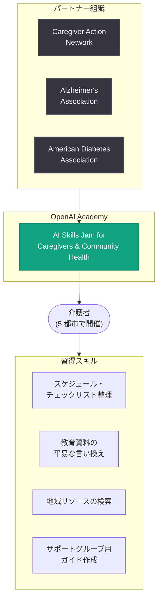

# 介護者の日常生活における AI 活用支援: OpenAI Academy が米国 5 都市で無料ワークショップを開催

## メタデータ

| 項目 | 内容 |
|------|------|
| 発表日 | 2026-11-10 |
| ソース | OpenAI News |
| カテゴリ | 社会貢献 / 教育 |
| 公式リンク | https://openai.com/index/helping-caregivers-use-ai-in-everyday-life |

## 概要

OpenAI は 2026 年 11 月 10 日、全米家族介護者月間 (National Family Caregivers Month) に合わせ、介護者向けの無料対面学習イベント「AI Skills Jam for Caregivers & Community Health」を米国 5 都市で開催すると発表した。本イベントは OpenAI Academy の取り組みの一環であり、介護者が ChatGPT を「自信を持って、安全に、実践的に」使えるようになることを目的としている。

背景には、介護に伴う大きな負担がある。介護者はスケジュール管理、情報の記録、仕事や家庭との両立をこなしながら、必要なサポートを探さなければならない。OpenAI の分析によると、米国内の ChatGPT における医療関連メッセージのうち、週 4,000 万件以上が「他者のための医療」に関する質問と推定されており、介護を担う人々がすでに AI に支援を求めている実態がうかがえる。

## 主な内容

### イベント概要

| 項目 | 内容 |
|------|------|
| イベント名 | AI Skills Jam for Caregivers & Community Health |
| 開催日 | 2026 年 11 月 10 日 |
| 形式 | 無料の対面型学習イベント |
| 対象 | 個人・家族介護者、介護者支援団体、慢性疾患や重篤な健康状態を抱える人々 |
| 前提知識 | 技術的な知識やコーディング経験は不要 |
| サポート体制 | OpenAI のファシリテーターとメンターが実践的に支援 |

### 開催都市 (米国 5 都市)

1. オークランド (カリフォルニア州)
2. タンパ (フロリダ州)
3. ピッツバーグ (ペンシルベニア州)
4. アトランタ (ジョージア州)
5. デトロイト (ミシガン州)

### パートナー組織

本イベントは、介護・医療分野の主要な非営利団体と連携して実施される。

- **Caregiver Action Network**: 家族介護者を支援する全米規模の団体
- **Alzheimer's Association (アルツハイマー協会)**: 認知症患者とその家族を支援
- **American Diabetes Association (米国糖尿病協会)**: 糖尿病患者とその介護者を支援

### プログラム内容

参加者は、介護の日常業務に ChatGPT を活用する以下のような方法を学ぶ。

- 介護スケジュールとチェックリストの整理
- 信頼できる教育資料のわかりやすい言葉への変換
- 地域リソースの検索
- サポートグループのディスカッションガイド作成

### 責任ある AI 利用の指導

プログラムでは実践的な活用法に加え、安全で責任ある利用方法も重視されている。

- 個人情報の保護方法
- AI ツールの限界の理解
- 医療専門家に相談すべきタイミングの見極め

OpenAI は、AI は医療・法律・金融のアドバイスを「補完するものであり、代替するものではない (complement, not replace)」という位置づけを明確にしている。

### OpenAI Academy における位置づけ

本イベントは、AI を誰にとっても実践的で利用しやすいものにするという OpenAI Academy の継続的な取り組みの一環である。OpenAI Academy はこれまでに、非営利団体、中小企業、K-12 教育者、高齢者を対象としたイベントを開催してきており、今回の介護者向けプログラムはその対象をさらに広げるものとなる。また、参加者から寄せられる質問、アイデア、経験は、今後の学習リソースの開発に活かされる予定である。

## 介護者・支援団体への影響

- **個人・家族介護者**: 技術的な前提知識なしで ChatGPT の実践的な活用法を無料で学べる機会が得られる。スケジュール管理や資料の理解など、日常の介護負担の軽減が期待できる
- **介護者支援団体**: Caregiver Action Network などの団体と OpenAI の連携モデルは、支援団体が AI リテラシー教育を自組織のプログラムに組み込む際の参考になる
- **医療・福祉関係者**: AI はあくまで専門家のアドバイスを補完するものという位置づけが明示されており、介護者に対して適切な AI 利用の指針を示す土台となる
- **地域コミュニティ**: 5 都市での対面開催により、オンラインだけではリーチしにくい層にも AI スキル習得の機会が広がる

## 関連リンク

- [Helping caregivers use AI in everyday life (OpenAI 公式)](https://openai.com/index/helping-caregivers-use-ai-in-everyday-life)
- [OpenAI Academy](https://academy.openai.com/)
- [Caregiver Action Network](https://www.caregiveraction.org/)
- [OpenAI News](https://openai.com/news)

## まとめ

OpenAI は全米家族介護者月間に合わせ、OpenAI Academy を通じて介護者向けの無料対面ワークショップ「AI Skills Jam for Caregivers & Community Health」をオークランド、タンパ、ピッツバーグ、アトランタ、デトロイトの 5 都市で開催する。Caregiver Action Network、アルツハイマー協会、米国糖尿病協会と連携し、スケジュール整理や資料の平易化といった実践的な ChatGPT 活用法に加え、個人情報の保護や AI の限界の理解といった責任ある利用方法も指導する。週 4,000 万件以上と推定される「他者のための医療」に関する質問が示すとおり、介護における AI 活用のニーズはすでに大きく、本プログラムはそのニーズに安全かつ実践的に応える取り組みと位置づけられる。
