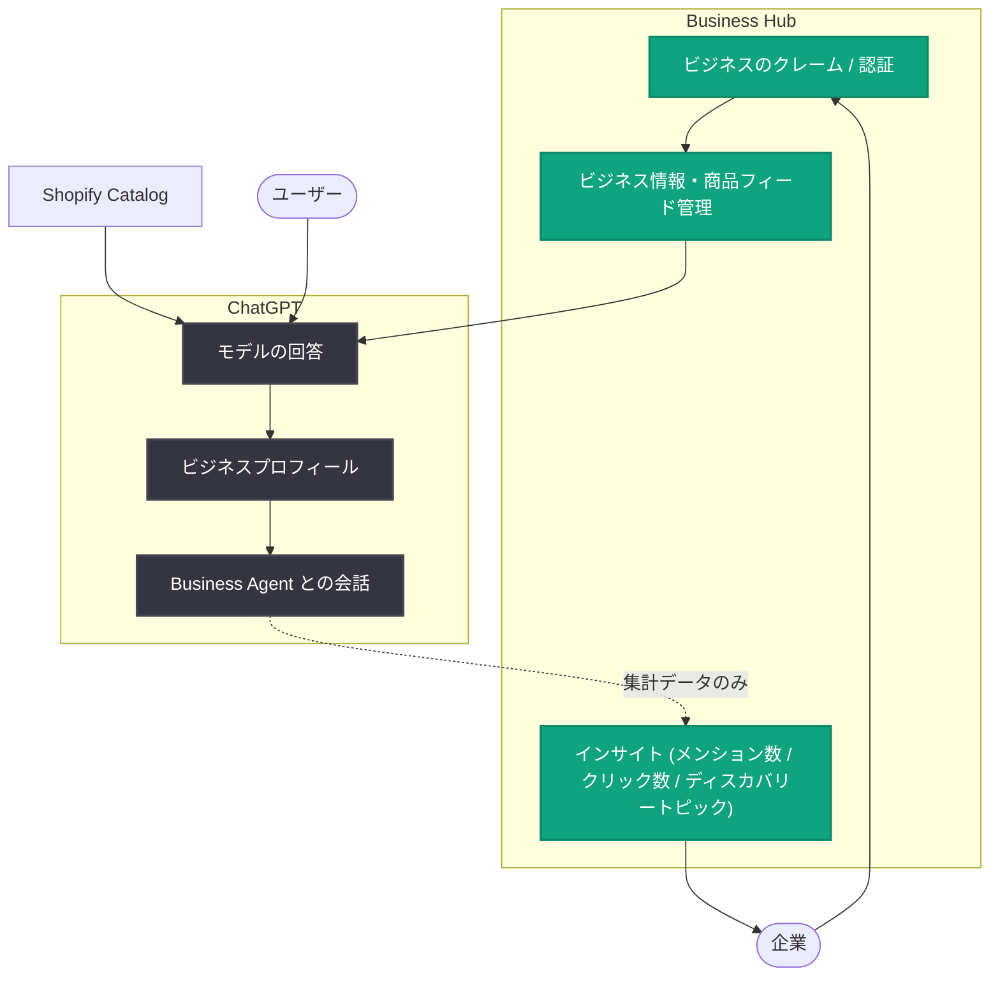

# Businesses in ChatGPT の発表: ビジネスと 12 億人のユーザーをつなぐ新プラットフォーム

## メタデータ

| 項目 | 内容 |
|------|------|
| 発表日 | 2026-11-10 |
| ソース | OpenAI News |
| カテゴリ | 新機能 |
| 公式リンク | https://openai.com/index/introducing-businesses-chatgpt |

## 概要

OpenAI は 2026 年 11 月 10 日、「Businesses in ChatGPT」をベータ版として発表した。これは、週あたり 12 億人が利用する ChatGPT 上で、企業が自社とユーザーをつなぐための新しい仕組みである。企業は「Business Hub」を通じて自社のビジネスをクレーム (所有権の登録・認証) し、ビジネス情報を管理し、ChatGPT 上でユーザーが自社とどのように関わっているかのインサイトを確認できる。

さらに、企業がユーザーと対話するための強力な新手段として「Business Agent」が導入された。Business Agent は、まず米国の対象となる EC (e コマース) およびオンラインサービス事業者向けに提供が開始される。これらの機能により、ユーザーが選択肢を検討し意思決定を行う過程で、企業がユーザーと接点を持つ新たな方法が生まれる。

## 主な内容

### Business Hub でのビジネスのクレーム

Business Hub では、企業が ChatGPT 上で自社の組織をクレームし、認証が完了すると以下が可能になる。

- **主要情報の更新**: ビジネスの基本情報を最新の状態に維持
- **セルフサービスの商品フィード追加**: 価格や在庫状況を含む商品フィードを自社で登録
- **正確な情報提供**: ユーザーが製品やサービスを検討する際に、最も正確で最新の情報を ChatGPT に提供

対象となる企業は以下の方法でクレームできる。

| 企業タイプ | クレーム方法 |
|-----------|-------------|
| ChatGPT が利用可能な地域の対象企業 | Business Hub から直接クレーム |
| 既存の OpenAI Enterprise 顧客・広告主 | OpenAI の担当者経由でクレーム |
| Shopify マーチャント | Business Hub または Shopify 管理画面からストアを接続し、認証を効率化 |

なお、Shopify マーチャントの対象商品は、Shopify Catalog を通じてすでに ChatGPT に統合されている。

### エンゲージメントのインサイト

Business Hub は、ChatGPT 上でユーザーが自社ビジネスとどのように関わっているかについて、集計されたインサイトを提供する。

- **メンション数**: ビジネスが言及された回数
- **ウェブサイトクリック数**: ビジネスのサイトへのクリック数
- **ディスカバリートピック**: 自社ウェブサイトが引用された会話に共通するテーマの分析

これらのインサイトにより、企業は自社が ChatGPT 上でどのように表示されているかを把握し、共有する情報を改善する機会を見つけられる。

**プライバシー保護の設計**: ユーザーの会話や Business Agent でのチャット内容は企業に共有されない。インサイトは集計値のみで、一定のしきい値を超える会話数・インタラクション数がある場合にのみ提供される。

### Business Agent によるエージェント機能

ビジネスのクレーム完了後、対象となる組織は Business Agent を構築・テスト・公開できる。これは、質問に回答し、ユーザーが企業の製品・サービスを探索するのを支援する新しい手段である。

動作の流れは以下のとおり。

1. モデルの回答に企業が表示されると、ユーザーはクリックしてその企業の ChatGPT プロフィールを閲覧できる
2. Business Agent が利用可能な場合、ユーザーは企業との会話を開始し、製品・サービスについて追加の質問ができる
3. 例えば、製品を比較しているユーザーが 2 つの選択肢の違いや自分のニーズに合う機能について質問すると、Business Agent は企業の情報をもとに回答を支援する

Business Agent の会話は明確にラベル付けされ、ユーザーの元の ChatGPT 会話とは分離されており、ChatGPT 自身の独立した回答とも区別される。

また、企業は Business Agent をスポンサー対象とし、ChatGPT Ads の遷移先として活用して、より多くの潜在顧客にリーチすることもできる。スポンサー付きの掲載は明確にラベル付けされ、ChatGPT の回答とは分離される。

Business Agent は現在、米国の対象となる EC およびオンラインサービス事業者向けに提供されている。

### 今後の展開

今回の発表は、企業を ChatGPT により深く取り込むための初期ステップと位置付けられている。OpenAI はまず「正確なビジネス情報」「有用なインサイト」「意思決定を支援する会話」という基盤から着手し、今後は以下を計画している。

- Businesses in ChatGPT と Business Agent のより多くの市場・業種への拡大
- より複雑なニーズを持つ組織向けのツールの構築
- ChatGPT 内外で、企業が直接またはエージェントを通じて顧客とつながる方法の拡充

## アーキテクチャ

## 開発者・企業への影響

- **AI 時代の顧客接点の確保**: ユーザーが製品の発見・比較・意思決定に AI を利用する流れの中で、企業は ChatGPT 上に公式な「ホーム」を持てるようになる
- **情報の正確性のコントロール**: 商品フィードやビジネス情報を自社で管理することで、ChatGPT がユーザーに提示する自社情報の正確性と鮮度を高められる
- **新しい分析チャネル**: メンション数、クリック数、ディスカバリートピックといったインサイトは、AI 経由の流入を把握する新しい指標となる
- **Shopify 連携**: Shopify マーチャントは既存のストア接続を活用して認証を効率化できる
- **広告との統合**: Business Agent を ChatGPT Ads の遷移先として利用でき、広告からエージェント会話への導線を構築できる
- **段階的な提供**: Business Agent は現時点で米国の EC・オンラインサービス事業者に限定されており、他地域・他業種への展開は今後の計画となる

## 関連リンク

- [Introducing Businesses in ChatGPT (公式発表)](https://openai.com/index/introducing-businesses-chatgpt)
- [OpenAI News](https://openai.com/news)
- [OpenAI 公式ドキュメント](https://platform.openai.com/docs)

## まとめ

Businesses in ChatGPT は、企業が ChatGPT 上で自社情報を管理し、ユーザーとのエンゲージメントを可視化し、Business Agent を通じて対話的に顧客を支援できるようにするベータ版プラットフォームである。Business Hub によるビジネスのクレームと情報管理、プライバシーに配慮した集計インサイト、米国の EC・オンラインサービス事業者向け Business Agent の 3 本柱で構成される。OpenAI はこれを企業向けプラットフォームの基盤構築の第一歩と位置付けており、今後の市場・業種拡大と高度なツールの提供が予定されている。
