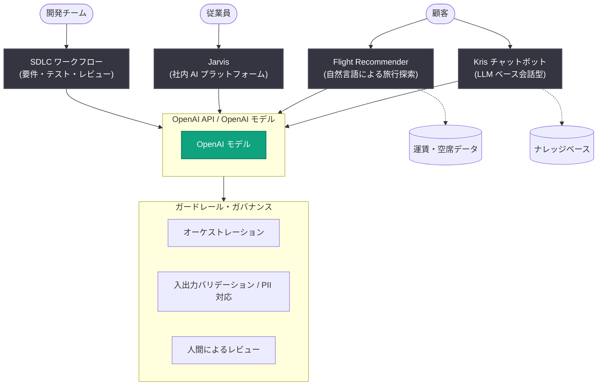

# シンガポール航空、OpenAI 技術で旅行体験と業務を進化

## メタデータ

| 項目 | 内容 |
|------|------|
| 発表日 | 2026-11-10 |
| ソース | OpenAI News |
| カテゴリ | 導入事例 |
| 公式リンク | https://openai.com/index/singapore-airlines-travel-work |

## 概要

シンガポール航空は、顧客サービス、従業員の生産性向上、ソフトウェア開発の各領域で OpenAI の技術を活用している。顧客向け体験には OpenAI API を、従業員向けにはガバナンスの効いた社内 AI プラットフォーム「Jarvis」で OpenAI モデルを採用し、ソフトウェア開発ワークフローにも OpenAI モデルを組み込んでいる。

主な成果として、チャットボット「Kris」を従来のダイアログフロー型から LLM ベースの会話型体験に移行したことで顧客満足度 (CSAT) が 2 倍に向上したほか、AI 支援ツールによりカスタマーサービス担当者の平均処理時間が約 10% 削減され、自然言語で旅行を探索できる「Flight Recommender」の月間ユーザーは過去 1 年で約 3 倍に成長した。

## 主な内容

### スクリプト型サポートから会話型サポートへ (Kris チャットボット)

最も目に見える AI 活用事例が、顧客向けチャットボット「Kris」である。従来のダイアログフロー型システムでは、すべてのトピックを手動でマッピングし、すべてのフローを事前に記述する必要があり、カバレッジの拡大が困難だった。インテントが未定義の場合、セルフサービスで処理できる要求であっても、カスタマーサービス担当者の対応が必要になりがちだった。

OpenAI API を使用して Kris を完全に LLM ベースの会話型体験へ移行した結果、以下が可能になった。

- 自然言語による顧客インテントの解釈
- ナレッジベースに基づいた回答の生成
- 複数トピックにまたがる会話の管理
- 必要時に関連コンテキストを添えて担当者へ引き継ぎ

現在、顧客は一般的な問い合わせ、特別リクエスト、リアルタイムのフライト運航障害情報、一部のトランザクション処理に Kris を利用している。今後は予約変更、手荷物関連のトランザクション、より複雑なエージェント型のやり取りへと機能拡張を進めている。

また、OpenAI API を活用した通話要約など、カスタマーサービス担当者向けの AI 支援ツールも導入し、通話後の事務作業時間を削減。平均処理時間を約 10% 短縮した。

### 自然言語による旅行探索 (Flight Recommender)

「Flight Recommender」は、フィルタや日付、目的地を繰り返し調整する代わりに、顧客が希望する旅行を自然言語で記述できるツールで、利用は過去 1 年で約 3 倍に成長した。

OpenAI API 上に構築され、運賃・空席データに接続されたオーケストレーション層を使用。顧客のインテントを解釈し、関連ツールを呼び出して、パーソナライズされた旅行の提案を自然言語で返す。

ガードレールとして以下を実装している。

- 入出力のバリデーション
- 悪意ある、または不適切なクエリへの対応
- ハルシネーションの低減
- PII (個人識別情報) の取り扱い
- クエリごとに必要なコンテキストのみへの認証付きアクセス

今後は、検索をやり直すのではなく、会話を重ねて旅行プランを洗練できる、より会話的なチャットボット体験への拡張を準備している。

### ソフトウェア開発ライフサイクルへの AI 導入

顧客向け体験に加え、ソフトウェア開発ライフサイクル (SDLC) の一部にも OpenAI モデルを活用し、計画、要件の洗練、テスト、レビューを効率化している。対象とした SDLC 活動全体で、最大 20% の生産性向上を達成した。

AI はコーディングだけでなくデリバリーライフサイクル全体で活用されており、具体的には以下の業務を支援している。

- 要件の洗練とステークホルダーセッションの分析
- プロダクト仕様の作成
- エッジケースの特定とテストケースの作成
- アーキテクチャレビュー
- 複雑な作業をテスト可能な小さなタスクへ分解

ある商用機能の開発では、開発開始前に OpenAI API を使って前提を検証し、曖昧な要件やエッジケースを洗い出した。要件が明確になった後は、AI が設計オプション、実装計画、テストケース、コード生成への変換を支援した。デプロイ後も、本番環境でのシステム挙動の解釈や、見落とされがちな問題の検出に AI が役立っている。

これにより、チームメンバーはすべての成果物を自ら作成する役割から、AI の生成物を指示・レビュー・検証する役割へと移行し、優先順位付け、アーキテクチャ、ガバナンス、ステークホルダー対応など、人間の判断が真に必要な業務に集中できるようになった。

### 全従業員が AI を使いやすく (社内プラットフォーム Jarvis)

エンジニアリングチーム以外にも、社内 AI プラットフォーム「Jarvis」を通じて全社的に AI を利用可能にしている。OpenAI モデルを搭載した Jarvis は、文書の要約からカスタムワークフローの作成まで、ガバナンスの効いた形で従業員の日常業務での AI 活用を支える。

従業員はセキュアな環境で PDF、Word 文書、Excel ファイル、PowerPoint 資料などを横断的に扱い、カスタムワークフローや軽量なナレッジベースを作成している。現在、シンガポール航空の従業員の 60% 以上が毎月 Jarvis を利用しており、採用は増加を続けている。

## 技術的な詳細

シンガポール航空は各デプロイメントにおいて、OpenAI モデルに以下を組み合わせ、AI を責任ある形で本番ワークフローに導入するための一貫した方法をチームに提供している。

- オーケストレーション
- 内部データ制御
- バリデーション
- 人間によるレビュー

## アーキテクチャ

## 成果サマリー

| 指標 | 成果 |
|------|------|
| 顧客満足度 (CSAT) | AI ベースの Kris チャットボットへの移行後に 2 倍に向上 |
| 平均処理時間 (AHT) | AI 支援ツール利用のカスタマーサービス担当者で約 10% 削減 |
| Flight Recommender 月間ユーザー | 過去 1 年で約 3 倍に成長 |
| SDLC 生産性 | 対象活動で最大 20% 向上 |
| Jarvis 月間利用率 | 従業員の 60% 以上 |

## 開発者・企業への影響

- **ダイアログフロー型から LLM 型への移行事例**: 事前定義フローに依存する従来型チャットボットを OpenAI API ベースの会話型体験へ移行することで、インテントのカバレッジ問題を解消し、CSAT を大幅に改善できることを実証
- **ガードレール設計の参考例**: 入出力バリデーション、不適切クエリ対応、ハルシネーション低減、PII の取り扱い、最小権限のコンテキストアクセスなど、本番導入に必要な安全対策の具体例を提示
- **SDLC 全体への AI 適用**: コーディングにとどまらず、要件定義からテスト、アーキテクチャレビュー、本番監視まで AI を組み込むことで、人間が「作成者」から「指示・レビュー・検証者」へ役割を移行するモデルを提示
- **全社 AI 基盤の普及モデル**: ガバナンスの効いた社内プラットフォーム (Jarvis) により、エンジニア以外の従業員にも AI 活用を広げられることを示す

## 関連リンク

- [Singapore Airlines elevates travel & work with OpenAI technology (公式記事)](https://openai.com/index/singapore-airlines-travel-work)
- [OpenAI News](https://openai.com/news)
- [OpenAI API ドキュメント](https://platform.openai.com/docs)

## まとめ

シンガポール航空は、顧客向けの Kris チャットボットと Flight Recommender、従業員向けの Jarvis、そしてソフトウェア開発ライフサイクルという 4 つの領域で OpenAI 技術を本番活用し、CSAT 2 倍、平均処理時間約 10% 削減、SDLC 生産性最大 20% 向上などの定量的成果を上げている。オーケストレーション、データ制御、バリデーション、人間によるレビューを組み合わせた責任ある AI 導入アプローチは、エンタープライズでの LLM 活用の実践的なモデルケースといえる。今後は Kris のトランザクション機能拡充や Flight Recommender の会話型体験化など、さらに深いセルフサービスへの拡張が予定されている。
