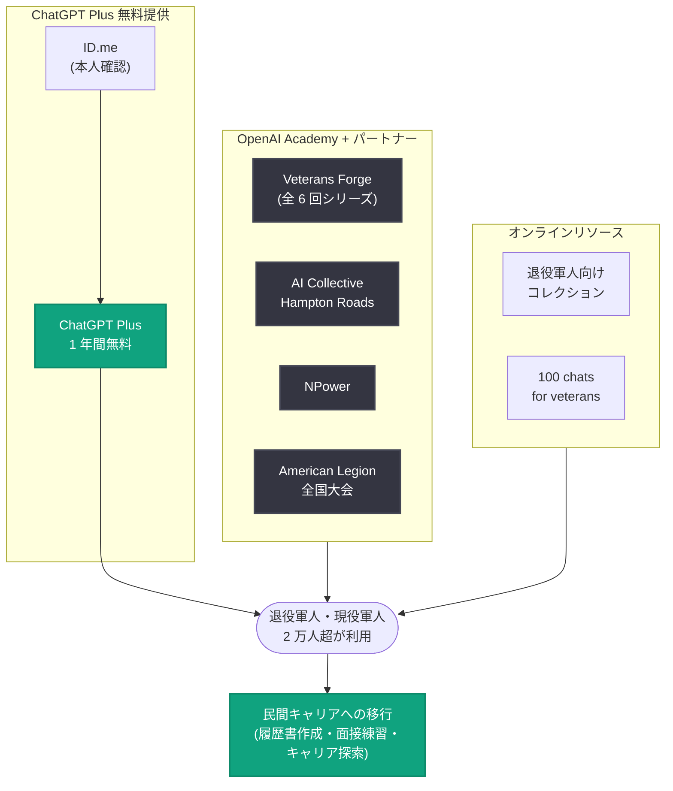

# 退役軍人・現役軍人向け ChatGPT Plus: 2 万人超が無料提供を利用し、民間キャリアへの移行に活用

## メタデータ

| 項目 | 内容 |
|------|------|
| 発表日 | 2026-11-11 |
| ソース | OpenAI News |
| カテゴリ | 社会貢献 / 教育 |
| 公式リンク | https://openai.com/index/chatgpt-plus-for-veterans |

## 概要

OpenAI は 2026 年 11 月 11 日 (米国の退役軍人の日)、過去 1 年間で 2 万人を超える退役軍人および退役移行中の現役軍人が、OpenAI が提供する ChatGPT Plus の 1 年間無料プログラムを利用したと発表した。このマイルストーンを機に、退役軍人たちが民間キャリアへの準備や、自身と家族の次のステップを見つけるために AI をどのように活用しているかが紹介されている。

この取り組みは、OpenAI 社内で働く退役軍人たち、すなわちこれらのツールを日々使い、軍からの移行がいかに困難かを身をもって知る人々から始まった。無料アクセスの提供に加え、OpenAI Academy とコミュニティパートナーは、軍関係コミュニティの約 1,000 人を対象に 12 回以上のトレーニングを開催しており、年内にさらに 7 回の開催が予定されている。

## 主な内容

### プログラムの実績

| 項目 | 内容 |
|------|------|
| 無料提供の内容 | ChatGPT Plus 1 年間無料 |
| 利用者数 | 2 万人超の退役軍人・退役移行中の現役軍人 |
| トレーニング実績 | 12 回以上開催、約 1,000 人が参加 |
| 今後の予定 | 年内にさらに 7 回のトレーニングを開催予定 |
| 本人確認パートナー | ID.me (無料提供へのアクセスを支援) |

### 民間キャリアへの準備

軍を離れることは、多くの場合、不慣れな就職市場に足を踏み入れ、長年の軍務経験が民間の職務にどう置き換えられるかを考えることを意味する。多くの退役軍人が ChatGPT を以下の用途で活用している。

- 就職活動の整理
- 面接の練習
- これまで考えてこなかったキャリアパスの探索

### OpenAI Academy による共同学習

誰もが AI ツールの利用に自信を持って臨めるわけではない。そのため OpenAI Academy は、退役軍人、退役移行中の現役軍人、軍人の配偶者が、同じ経験を持つ仲間とともに学べる場を提供している。

- **Veterans Forge との連携**: 退役軍人と軍人家族が ChatGPT を使って目標達成に取り組むことを支援する、全 6 回の Academy シリーズ (初回パイロット) を完了
- **その他のパートナー**: AI Collective Hampton Roads および NPower とのワークショップも実施しており、これらの経験が今後の退役軍人向けプログラムの設計に反映される

### 各地のワークショップ事例

**バージニア州レストン**: 約 100 人の退役軍人と現役軍人が参加し、AI の活用方法を探索した。参加者の Ryan Kaono-Wedemeyer 氏は、まず自身の軍歴を詳細に書き出し、それを AI に民間向け履歴書へと整形してもらう方法を学んだ。講師の Erin Marie 氏は、参加者がキャリア移行を支援するカスタム GPT を構築するのを手助けし、懐疑的な気持ちで参加した人々がツールの実用的な価値を見出していく様子を見届けた。

**ケンタッキー州ルイビル**: American Legion (米国在郷軍人会) の全国大会で、80 人を超える会員が 3 回の AI トレーニングセッションに参加した。

**オンラインリソース**: イベントに参加できない人向けに、OpenAI Academy の退役軍人向けオンラインコレクションと「100 chats for veterans」が、自分で試せる活用例を提供している。

### 今後の展開

OpenAI は年内を通じて、全米のパートナーとともにこの取り組みを継続する。目標は、退役軍人と軍人家族が軍務で培ったスキルを、次に選ぶどのような仕事にも活かせるよう支援することである。OpenAI は、無料提供へのアクセスを支援した ID.me と、イベントを実現したコミュニティパートナーへの感謝を表明している。

## 退役軍人・コミュニティへの影響

- **退役移行中の軍人**: ChatGPT Plus を 1 年間無料で利用でき、軍歴の民間向け履歴書への翻訳、面接練習、キャリア探索といった移行準備を AI で支援できる
- **軍人家族・配偶者**: OpenAI Academy のトレーニングは軍人の配偶者も対象としており、家族全体でのスキル習得機会が提供される
- **退役軍人支援団体**: Veterans Forge や American Legion との連携モデルは、支援団体が AI リテラシー教育を自組織の活動に組み込む際の参考になる
- **イベントに参加できない層**: オンラインの退役軍人向けコレクションと「100 chats for veterans」により、場所を問わず自習できる環境が整備されている

## 関連リンク

- [ChatGPT Plus for veterans and servicemembers (OpenAI 公式)](https://openai.com/index/chatgpt-plus-for-veterans)
- [ChatGPT for veterans (無料提供の詳細)](https://openai.com/index/chatgpt-for-veterans/)
- [OpenAI Academy イベント一覧](https://academy.openai.com/home/events)
- [OpenAI Academy 退役軍人向けコレクション](https://academy.openai.com/public/collections/veterans)
- [100 chats for veterans](https://chatgpt.com/use-cases/veterans)
- [OpenAI News](https://openai.com/news)

## まとめ

OpenAI が退役軍人・退役移行中の現役軍人向けに提供する ChatGPT Plus の 1 年間無料プログラムは、開始から 1 年で利用者が 2 万人を超えた。社内の退役軍人たちの発案から始まったこの取り組みは、無料アクセスの提供にとどまらず、OpenAI Academy と Veterans Forge などのコミュニティパートナーによる 12 回以上のトレーニング (約 1,000 人参加) へと広がっている。退役軍人たちは、軍歴の履歴書への翻訳、面接練習、カスタム GPT の構築などを通じて民間キャリアへの移行に AI を活用しており、OpenAI は年内もパートナーとともにこの支援を継続する方針である。
