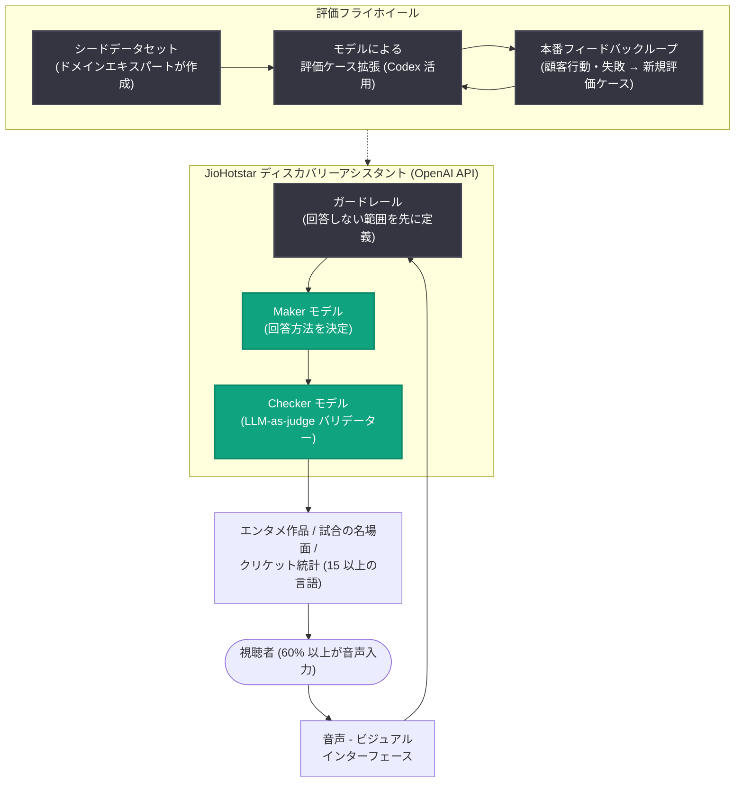

# JioStar チーフアーキテクトが語る 5 億ユーザー規模の AI コンテンツディスカバリー

## メタデータ

| 項目 | 内容 |
|------|------|
| 発表日 | 2026-11-11 |
| ソース | OpenAI News |
| カテゴリ | 導入事例 / Executive Function シリーズ |
| 公式リンク | https://openai.com/index/jiostar-vijay-seshadri |

## 概要

OpenAI の Executive Function シリーズとして、インドのエンターテインメント・ライブスポーツ配信大手 JioStar のチーフアーキテクトである Vijay Seshadri 氏へのインタビュー記事が公開された。JioStar は 5 億人以上のユーザーを抱え、ライブスポーツでは最大 7,250 万人の同時視聴をサポートした実績を持つ。同社は OpenAI API を活用し、JioHotstar に会話型の動画・クリケット統計ディスカバリーアシスタントを構築した。視聴者は自然な話し言葉で映画や番組、過去のハイライト、ライブ試合の名場面、クリケット統計を検索でき、結果はビジュアルかつ会話的な体験として返される。

本インタビューはシンガポールで開催された OpenAI の Executive Summit において、OpenAI の ASEAN 向け Go-to-Market 責任者 Sidharth Sharma 氏が実施したもの。15 以上の言語に対応した体験を約 8 週間で構築した経緯と、AI をデモから本番環境へ展開するリーダーへの教訓が語られている。

## 主な内容

### コンテンツディスカバリーを変える「音声 - ビジュアルインターフェース」

Seshadri 氏によれば、コンテンツディスカバリーは過去 25 年間ほとんど進化しておらず、レコメンデーションが最後の大きな転換だった。しかし「何を観るか」の選択は極めて個人的なものである。「悲しい気分だから元気が出るものを見せて」という単純なリクエストにも多くのニュアンスが含まれるが、従来のレコメンデーションシステムはその瞬間の文脈を理解するのが難しい。会話であれば視聴者が自分で説明できる。同社はこれを「音声 - ビジュアルインターフェース (voice-visual interface)」と呼んでいる。

### 2 つの異なるディスカバリー問題を 1 つの体験に統合

開発は 10 月から 11 月にかけて構想を進め、2 月の大規模クリケットトーナメントに向けて約 2 か月で取り組んだ。対象ユーザーは性質の異なる 2 種類だった。

- **エンターテインメント視聴者**: 「金曜の夜だから何かおすすめして」といった曖昧な要望や、タイトルを知らない映画の特徴説明
- **スポーツ視聴者**: ウィケットの落ち方、連続シックス、特定の選手が一定のラン数を記録した試合など、具体的な情報。熱心なクリケットファンは全ボールの統計まで求める

これらの大きく異なるディスカバリー問題を、多言語対応のうえで 1 つの体験に短期間で統合した。

### 精度・レイテンシ・コストの 3 方向トレードオフ

技術設計の初期段階で、問題を「精度 (accuracy)・レイテンシ (latency)・コスト (cost)」の 3 方向トレードオフとして定式化し、すべてのエンジニアリング判断で 3 つを同時にバランスさせた。特に音声の重要性が高く、ユーザーの 60% 以上がテキストではなく音声を利用している。応答は関連性が高く、高速で、かつ大規模運用において経済的に成立する必要があった。

### 本番環境での評価システム: 評価フレームワークと検証レイヤー

Seshadri 氏は評価システムを 2 つの要素で捉えている。

1. **評価フレームワーク**: 本番投入前に、評価結果がプロンプト変更を促すべきもの
2. **検証レイヤー (フィードバックループ)**: 本番環境で顧客の行動や失敗事例を新しい評価ケースへ変換するもの

このフライホイールは自己増幅的になり得るが、正しく機能させるのは極めて難しいと指摘する。また、ドメインエキスパートが不可欠であり、スポーツ統計の評価にはスポーツ雑誌の編集者など、熱心なファンが何を尋ねるかを理解している人々と協業した。「プロンプトだけで始めることはできない。深い人間の専門知識でシステムをシードする必要がある」と述べている。

### 約 8 週間での構築: ガードレール優先と maker-checker パターン

成功要因として、明確な問題定義のもとに少人数のデータサイエンティストとエンジニアのチームを編成したことを挙げている。OpenAI のフォワードデプロイドエンジニアも並走し、絶対に正しく実装すべき少数のポイントを特定した。

- **スコープとガードレールを最初に決定**: 音声・テキストインターフェースはほぼ何でも質問できるため、まず「システムが回答すべきでないこと」から決めた
- **評価データセットの拡張**: シードデータセットから始め、モデルを使ってバリエーションを拡大
- **maker-checker パターン**: 1 つのモデルが回答方法を決定し、別のモデルが競合する目的を持つバリデーター (LLM-as-judge) として機能
- **「ジャッジを誰がテストするのか」**: バリデーターの設計自体が評価問題であると認識
- **Codex の活用**: 評価ケースの生成やシステム更新などの作業を加速。ただし構築が速くなっても、人間の判断と検証の必要性はなくならない

## アーキテクチャ

記事で語られた会話型ディスカバリーの構成と評価フライホイールの概念図。

## 開発者・経営層への影響

Seshadri 氏は AI を実験から本番システムへ移行する経営層に向けて、次の教訓を挙げている。

- **振り返っての反省点**: モデル有効性 (model efficacy) の本番モニタリングへ、より早期に投資すべきだった。P99 レイテンシなど従来のインフラ指標は重要だが、それだけでは不十分
- **技術と企業の現実のギャップ**: フロンティアモデルの発表すべてに追随できていなくても、それは珍しいことではない
- **活動量ではなく成果に集中する**: 目に見える動きを意味のある進捗と取り違えやすい。生成したコード行数などの入力指標は、意味のある価値を生んだかを示さない
- **人間のスキルと主体性を過小評価しない**: 汎用的なスキリングプログラムだけでは不十分で、ツールを判断力を持って適用できる人材が必要。優秀なエンジニアに Codex のようなツールを与えれば影響は何倍にもなるが、本番システムを検証する判断力がなければリスクも何倍にもなる

同氏は「あなたの手にはロケットがある。特に本番システムでは検証とガードレールが必要で、正しい人に鍵を渡す必要がある」と締めくくっている。

## 関連リンク

- [JioStar's chief architect on AI discovery at 500M-user scale (OpenAI 公式)](https://openai.com/index/jiostar-vijay-seshadri)
- [OpenAI News](https://openai.com/news)
- [OpenAI API ドキュメント](https://platform.openai.com/docs)

## まとめ

JioStar は OpenAI API を活用し、5 億人以上のユーザーを対象とする会話型コンテンツディスカバリーを約 8 週間・少人数チームで本番投入した。成功の鍵は、(1) 回答しない範囲 (ガードレール) を最初に定義するスコープ設計、(2) ドメインエキスパートによるシードデータと maker-checker (LLM-as-judge) パターンを組み合わせた評価体制、(3) 精度・レイテンシ・コストの 3 方向トレードオフの明示的な管理である。デモから本番への移行では、ツールによる構築の高速化以上に、人間の判断力・検証・モデル有効性の本番モニタリングが重要であることを示す事例となっている。
