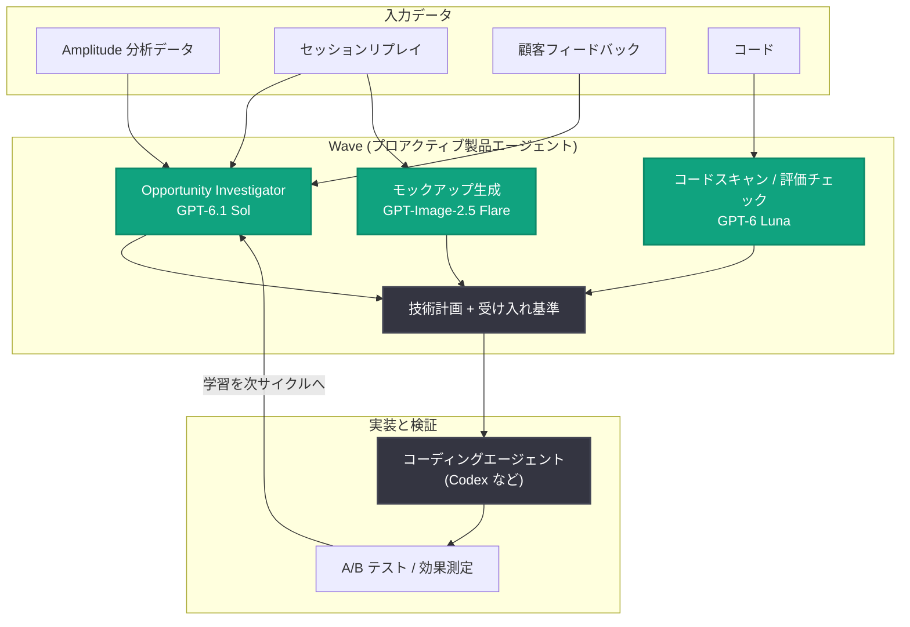

# Amplitude、OpenAI を活用し製品改善を 1〜2 日で出荷 — プロアクティブ製品エージェント「Wave」の導入事例

## メタデータ

| 項目 | 内容 |
|------|------|
| 発表日 | 2026-11-12 |
| ソース | OpenAI News |
| カテゴリ | 導入事例 |
| 公式リンク | https://openai.com/business/customer-stories/amplitude |

## 概要

プロダクトアナリティクス企業の Amplitude は、OpenAI モデルを基盤とするプロアクティブ製品エージェント「Wave」を構築し、製品改善の出荷期間を従来の約 1 か月から 1〜2 日に短縮したと発表した。Wave は約 80% が OpenAI モデル (GPT‑6.1 Sol、GPT‑6 Luna、GPT‑Image‑2.5 Flare) で構成されており、製品インサイトを実装計画に変換し、Codex を含むコーディングエージェントに引き渡し、その効果を測定するまでを一貫して担う。

Amplitude 自社ホームページでの実証では、Wave が提案したサジェスションカードのパーソナライズにより、カード経由のメッセージ送信数が対照群比で 160% 増加した。CEO の Spenser Skates 氏は「AI は、私たちが割り当てようと考えもしなかった有用な仕事を自ら見つけられるようになった」と述べている。

## 主な内容

### 製品データから出荷済みの改善へ

Wave は Amplitude のプロアクティブ製品エージェントである。チームが対象の製品領域と改善したい目標・メトリクスを指定すると、Wave は Amplitude のデータ、セッションリプレイ、顧客フィードバック、コードを統合して分析し、以下を実行する。

1. **機会の特定と優先順位付け**: 改善機会を発見し、優先度を決定
2. **ソリューションの開発**: 修正案、技術計画、受け入れ基準を作成
3. **実装の調整**: 人とコーディングエージェント (Codex を含む) に実装を引き渡し
4. **効果測定**: 結果を追跡し、学習を次の改善サイクルに反映

機会が実装可能な状態になると、チームは Wave から直接、技術計画と受け入れ基準を添えてコーディングエージェントに作業を送信できる。

### タスクごとに最適な OpenAI モデルを使い分け

Amplitude はタスクごとに品質、レイテンシ、コストを評価し、モデルを割り当てている。

| モデル | 役割 |
|--------|------|
| GPT‑6.1 Sol | 機会マネージャーと、コード・データに対する深い調査 (高度な推論) |
| GPT‑6 Luna | コードのスキャンや小規模な評価チェックなど、高頻度・低コストのタスク |
| GPT‑Image‑2.5 Flare | セッションリプレイのスクリーンショットを視覚参照として製品モックアップを生成 |

Skates 氏は「OpenAI は強力な推論モデルと、より小さく高速なモデルの両方を提供してくれたため、製品全体で品質・レイテンシ・推論コストのバランスを取ることができた」と述べている。専門化したエージェントに作業を分割することで、高価な推論モデルを本当に必要なタスクに集中させている。

### 160% のエンゲージメント向上を実現した実例

Amplitude は自社ホームページで Wave をテストした。同ページには AI エージェントとの会話を始めるための汎用的なサジェスションカードが設置されていたが、Wave は 100 件のセッションリプレイのサンプル分析から、80 人のユーザーが自分で質問を入力し、カードを選択したのはわずか 12 人であることを発見した。

Wave は、ユーザーの最近のチャート、ダッシュボード、遷移元ページに基づいてカードをパーソナライズすることを提案。自由入力の維持や、パーソナライズ用コンテキストがない場合の汎用サジェスション表示を含む技術計画を作成した。チームは簡単なレビューの後、コーディングエージェントに作業を引き渡して A/B テストを実施した。

その結果、ホームページのサジェスションカード経由のメッセージ送信数は、1 日で対照群比 160% 増加した。Senior Principal AI Engineer の Eric Carlson 氏は「画期的ではないが見過ごされがちな改善が、予想外の形で機能の採用を高める好例だ」と説明している。

## 技術的な詳細

### モデル評価の結果

Amplitude は各タスクに対してモデルを定量評価している。

**Opportunity Investigator (機会調査エージェント) の評価**: 発見の裏付け、偽陽性の回避、評価者フィードバックの反映、ツール障害からの回復、証拠と主張の整合性という 5 つの基準で評価。

- GPT‑6.1 Sol: 総合スコア 4.06 / 5 (代替 3 モデルは 3.62、3.52、2.94)
- 5 つの調査基準すべてでトップ
- 調査時間の中央値も最速の 54 分

**Data Science Agent の評価**。

- GPT‑6.1 Sol: 67.5 / 100 (別の主要モデルは 69.3)
- ディスパッチあたりの平均モデルコスト: GPT‑6.1 Sol が 1.28 ドル、比較対象は 2.63 ドル
- ツール契約の遵守、推定と不確実性、証拠の根拠付けでは GPT‑6.1 Sol が上回る

**ワイヤーフレーム生成の評価**: コミュニケーション品質、製品忠実度、指示遵守、テキストと UI の可読性、視覚的一貫性を 15 件の機会で評価。

- OpenAI の画像生成モデル: 80.3 / 100 (別の画像生成モデルは 63.9)

## アーキテクチャ

## 開発者への影響

- **自己改善型プロダクトの実践例**: データ分析から機会発見、実装計画、コーディングエージェントへの引き渡し、効果測定までを閉ループで回すエージェント設計の参考になる
- **タスク別モデル選定の指針**: 深い調査には高推論モデル (GPT‑6.1 Sol)、高頻度の軽量タスクには小型高速モデル (GPT‑6 Luna) という使い分けで品質・レイテンシ・コストを最適化できる
- **人の統制を保った自動化**: バグ修正はコーディングエージェントに直行させ、新機能や大きな変更は人間がレビューするなど、自動化レベルをチームが制御する運用モデルが示されている
- **出荷スピードの実績**: 顧客が公開した実験・フラグ・ガイドのうち、4 分の 1 は Wave が機会を提示した当日に公開され、半数は 4 日以内、3 分の 2 は 1 週間以内に公開された

## 関連リンク

- [Amplitude 導入事例 (OpenAI 公式)](https://openai.com/business/customer-stories/amplitude)
- [OpenAI for Business](https://openai.com/business/)
- [OpenAI News](https://openai.com/news)
- [Codex](https://openai.com/codex/)

## まとめ

Amplitude の Wave は、OpenAI モデル (GPT‑6.1 Sol、GPT‑6 Luna、GPT‑Image‑2.5 Flare) を約 80% の基盤として構築されたプロアクティブ製品エージェントであり、製品改善の出荷期間を約 1 か月から 1〜2 日に短縮した。自社ホームページでの検証では、サジェスションカードのパーソナライズにより 160% のエンゲージメント向上を達成している。タスクごとの厳密なモデル評価に基づく使い分けと、人間がレビュー範囲を制御する運用により、「自己改善するプロダクト」というビジョンを現実のワークフローとして示した事例である。
