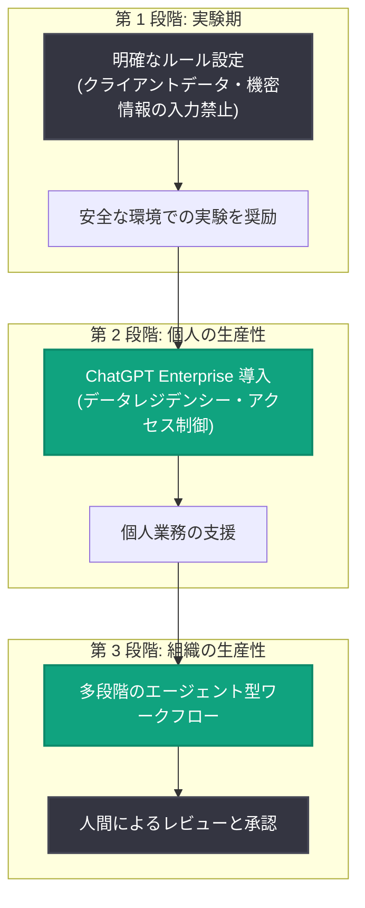

# Gilbert + Tobin、AI で法務ビジネスを再考 - CEO Sam Nickless 氏との対談

## メタデータ

| 項目 | 内容 |
|------|------|
| 発表日 | 2026-11-12 |
| ソース | OpenAI News |
| カテゴリ | 導入事例 |
| 公式リンク | https://openai.com/index/gilbert-tobin-sam-nickless |

## 概要

OpenAI の連載シリーズ「Executive Function」の一環として、オーストラリア有数の企業法務事務所 Gilbert + Tobin のパートナー兼 CEO である Sam Nickless 氏との対談記事が公開された。同事務所は資本市場、M&A、紛争解決、テクノロジー分野を手がけており、専門知識と慎重な判断、機密情報の安全な取り扱いが強く求められる法務業界において、ChatGPT Enterprise や Codex などを全社的に導入した先進事例である。

対談では、社員による安全な実験の奨励から始まり、個人の生産性向上、そして人間がレビューと承認を担う多段階のエージェント型ワークフローへと段階的に AI 活用を進化させてきた道のりが語られている。有効化された ChatGPT ユーザーの 87% がアクティブに利用するという高い定着率を実現しており、AI の価値を「コスト削減ではなく、人間的な仕事への集中」と位置づける経営哲学が示されている。

## 主な内容

### AI 導入で目指す 3 つの目標

Nickless 氏は、AI 導入の目的として以下の 3 点を挙げている。

1. **クライアントへのより良いサービス提供**
2. **社員にとって働きがいのある職場づくり**
3. **市場でのリーダーとしての地位確立**

特筆すべきは、AI の真の価値をコスト削減や人員削減ではなく、弁護士がクライアントとの面談、チームの指導、将来のリーダー育成といった「人間的な仕事」に集中できるようにすることに置いている点である。Nickless 氏は「より人間的な側面の仕事に取り組めるよう解放することが目的だった」と語っている。

### 段階的な導入アプローチ

Gilbert + Tobin の AI 導入は、実験から組織的な生産性向上へと段階的に進められた。

- **実験期**: ChatGPT 登場当初から、クライアントデータや機密情報を入力しないという明確なルールの下で、安全な環境での実験を奨励した
- **安全なチャネルの提供**: ChatGPT Enterprise を管理された環境で導入。オーストラリア国内のデータレジデンシー、契約上の保護、ロールベースのアクセス制御、管理機能が、全社展開への確信につながった
- **ガバナンスの方針**: 「AI の利用は不正ではない」というメッセージを明確に打ち出した。ただし、タスクの定義、出力の確認、最終成果物への責任は常に人間が担う

### 87% のアクティブ利用率を支える文化づくり

同事務所では、有効化された ChatGPT ユーザーの **87% がアクティブに利用**しており、これは社内の他ツールの通常利用率の 2 倍以上にあたる。この高い定着率は、利用目標の義務化によってではなく、以下のような取り組みで実現された。

- リーダー自身が技術を使い、実験し、限界を試す姿勢を示す
- 職務に合わせたワークフローのデモ、動画、ショーケースの提供
- 社内チャレンジや初期の「AI バウンティ」によるアイデアの発掘

Nickless 氏は「自分自身がまず始めることが、組織の空気をつくり、他者を勇気づける」と述べており、技術チームだけでなく組織全体から創造的な活用アイデアが生まれたことを成果として挙げている。

### CEO 自身の活用例: デジタルツインと年次レビュー

Nickless 氏自身も AI を日常業務で積極的に活用している。

**デジタルツイン**: 自身の文章例、過去に受けたフィードバック、会社の背景情報、仕事のスタイルをもとにカスタム GPT を作成。これを直属の部下と共有することで、部下は Nickless 氏に相談する前に ChatGPT 経由で「彼のフィードバック」に近い観点から自分の考えを検証できる。ただし、意思決定や本人の代弁は行わないという線引きを明確にしている。

**年次レビュー業務**: 120 名のパートナーが関わる機密性の高い年次レビューにおいて、スプレッドシートのデータをもとにしたファイル更新、PDF 作成、資料の取りまとめを数分で完了させた。利用ダッシュボードで確認したこの作業のコストは**約 62 ドル**。本来であれば複数人が数日かけて行う作業であり、極めて費用対効果の高い投資だったと評価している。

### 他の経営者へのアドバイス

対談の締めくくりとして、Nickless 氏は AI 導入を検討する経営者に向けて次のように助言している。

- **まず自分自身が使うこと**: 実際の業務で実験し、限界を理解し、学ぶ姿勢を組織に示す
- **ガバナンスと実践支援の両立**: 役割に応じた事例の提供、安全な実験環境の整備、結果への責任の維持を組み合わせる
- **機会を大きく捉えること**: AI の機会は単なる作業の高速化にとどまらない。うまく使えば成果の質と量を高め、専門性と判断力が最も価値を生む複雑で戦略的な仕事に時間を使えるようになる

## ビジネスへの影響

本事例は、機密性と正確性が最重要視される法務業界においても、適切なガバナンスの下で AI の全社導入が可能であることを示している。

- **規制産業への示唆**: データレジデンシー、契約上の保護、ロールベースのアクセス制御といったエンタープライズ機能が、機密情報を扱う業界での導入の鍵となる
- **定着率向上の方法論**: 義務化ではなく、リーダーの率先垂範と職務に即した実例の提供が高い利用率につながる
- **人間中心の AI 活用**: タスク定義・出力確認・最終責任を人間が担う「human-in-the-loop」の設計が、専門サービス業における信頼性を担保する
- **エージェント型ワークフローへの進化**: 個人の生産性支援から、人間のレビューを組み込んだ多段階のエージェント型ワークフローへという発展経路は、他業界にも応用可能なモデルである

## 関連リンク

- [Gilbert + Tobin rethinks the business of law with AI (公式記事)](https://openai.com/index/gilbert-tobin-sam-nickless)
- [OpenAI News](https://openai.com/news)
- [ChatGPT Enterprise](https://openai.com/chatgpt/enterprise)
- [Codex](https://openai.com/codex)

## まとめ

Gilbert + Tobin の事例は、AI 導入の成否が技術そのものよりも、経営トップのコミットメントと段階的なガバナンス設計にかかっていることを示している。「実験の奨励 → 安全なチャネルの提供 → エージェント型ワークフローへの発展」という 3 段階のアプローチ、87% という高いアクティブ利用率、そして約 62 ドルで数日分の作業を完了させた具体例は、法務のような規制の厳しい専門サービス業界においても AI が実用段階にあることを裏付けている。AI の価値を人員削減ではなく「人間的な仕事への集中」に置く同社の姿勢は、AI 時代の専門職のあり方を考える上で示唆に富む。
