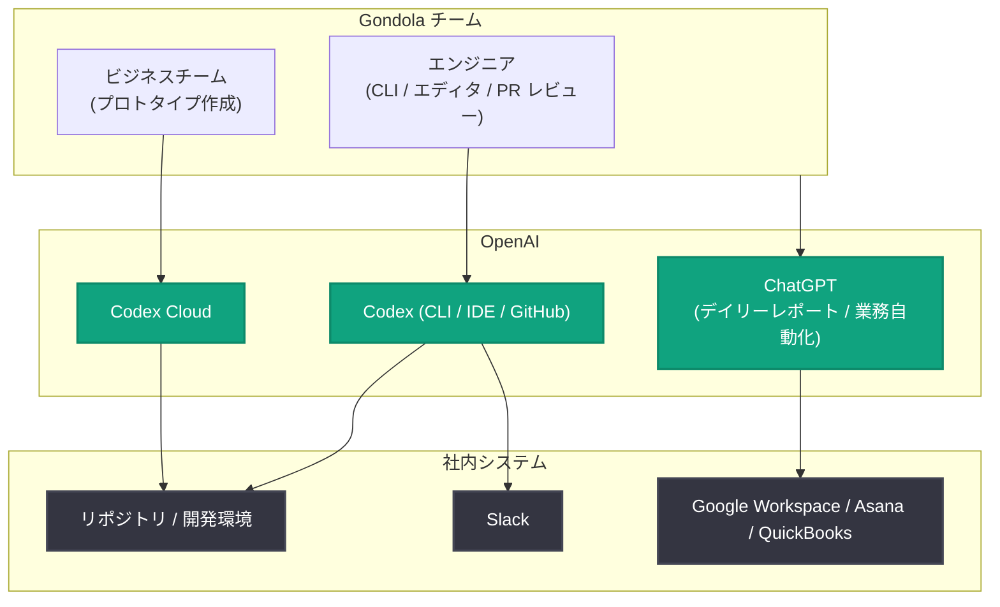

# Gondola、Codex の活用でチームの開発力を拡大し売上を倍増

## メタデータ

| 項目 | 内容 |
|------|------|
| 発表日 | 2026-11-12 |
| ソース | OpenAI News |
| カテゴリ | 導入事例 |
| 公式リンク | https://openai.com/business/customer-stories/gondola |

## 概要

クリエイターが制作実績を示し、その価値を証明し、次の仕事につなげることを支援するプラットフォーム [Gondola](https://gondola.cc/) の導入事例が公開された。創業者 兼 CEO の Jared Kleinstein 氏は、クリエイティブ制作エージェンシー Fresh Tape Media を運営する中で、「ソーシャルメディア向けの優れたクリエイティブ作品が作られているのに、制作者が正当なクレジットを得られていない」という課題に気づき、Gondola を立ち上げた。

小規模チームである Gondola にとって最大の制約は、プロダクト開発と運営業務に割けるリソースの少なさだった。現在、同社は Codex でより多くのアイデアをソフトウェアとして実現し、ChatGPT で日常業務を簡素化している。その結果、月間エンジニアリング生産量はチーム全体で 25% 増、リードエンジニアは 50% 増となり、会社の売上は前年比で 2 倍以上に成長した。

> 「OpenAI を使うことで、私たちの規模の会社が作れるものに対する野心が高まりました」
> — Jared Kleinstein 氏 (Founder and CEO, Gondola)

## 主な内容

### ビジネスチームがエンジニアと共に開発できる体制 (Codex Cloud)

Gondola のプロダクトアイデアの多くは、事業開発チームやリーダーシップチームが顧客との対話や運営上の課題から直接得たものである。Codex 導入前は、要件を定義して文書化し、エンジニアに空きができるのを待って最初のバージョンを作ってもらう必要があった。

現在は、同じビジネスチームが Codex Cloud を使ってコードベースを探索し、インターフェースやワークフローのプロトタイプを作成し、仮説を検証し、エンジニアが関わる前に動作する初期バージョンまで到達することも多い。Jared 氏と Creator and Client Partnerships Manager の Jojo Hesketh 氏は、いずれも人生初のコードコントリビューションをメインのコードベースにマージした。

> 「プロダクトマネージャーはもう、文書化されたプロダクト要件で止まる必要はありません。動くプロトタイプをエンジニアリングチームに持ち込めるのです」
> — Jared Kleinstein 氏 (Founder and CEO, Gondola)

代表例が「Programs」である。これは企業がクリエイターを見つけ、応募者を審査し、プロジェクトを管理し、予算を追跡するためのツールで、今後は契約や支払いの調整支援も計画されている。Jojo 氏が Programs のスポンサーとなり、Codex でワークフローのプロトタイプを作成した上で、エンジニアに引き渡して改良・リリースした。チームは GPT‑5.4 で着手し、作業の大半を GPT‑5.5 で行い、後期の機能追加・最適化・バグ修正には GPT‑6.1 を使用した。

Jared 氏は、Codex によって数日から数週間分の開発時間が節約され、手作業でコーディングした場合よりも少ないバグで Programs をローンチできたと見積もっている。「Programs の機能は、素早くプロトタイプを作り、うまくいかないものは捨て、うまくいったものを残せたことの恩恵を受けました」と同氏は語る。

### エンジニアによる Codex の活用方法

Gondola のエンジニアは、実装を加速するためにコマンドラインインターフェース (CLI) とエディタツールを通じて Codex を使用し、GitHub 上ではプルリクエストのレビューに活用している。同社は Codex をリポジトリ、開発環境、Slack に接続し、プロダクトのコンテキストが開発に反映されるようにしている。一方で、アーキテクチャ、セキュリティ、データハンドリング、本番環境への準備については、引き続きエンジニアが責任を持つ。

### タイムリーな顧客ニーズへの迅速な対応 (World Cup Creator Map)

Codex 導入前は、時間的制約のあるアイデアがエンジニアリングリソース待ちのバックログに留まり、機会を逃すこともあった。しかしこの夏、Codex により Gondola は「World Cup Creator Map」をタイムリーに構築・テストできた。

チームは既に保有していたデータを Codex で迅速に活用し、ブランド・チーム・エージェンシーがワールドカップ開催都市のフォトグラファーやビデオグラファーを見つけられるマップを作り上げた。Jojo 氏がこの Creator Map もスポンサーし、Codex で完全に動作するプロトタイプを構築、その後すぐにエンジニアがローンチに向けて仕上げた。Jared 氏は、スコープが小さく自己完結しており、明確な期限があったことから、この構築を「非常に速かった」と表現している。また、Creator Map と Programs のいずれも、Codex がなかった場合よりバグが少なく、完成度の高い状態でローンチできたと考えている。

### ChatGPT による少人数チームの業務運営

プロダクト構築は Gondola の業務の一部にすぎない。チームは ChatGPT を使って提案書の準備、スケジュール管理、社内システム横断での情報検索、タスクの自動化も行っている。

Gondola は ChatGPT で、従業員が朝一番にその日の計画を立てるためのデイリーレポートテンプレートを構築した。Gmail、Calendar、Sheets、Drive を含む Google Workspace のほか、Asana、Slack、QuickBooks、天気情報などのソースを統合し、その日の全体像を提供する。Jared 氏によれば、これほど網羅的なレポートを手作業で準備すれば「何時間もの作業」になるが、ChatGPT のセットアップでは短時間で完成する。なお、対外的に送付される成果物や経営判断に使われる重要な業務については、引き続き人間がレビューしている。

## 導入効果

| 指標 | 効果 |
|------|------|
| リードエンジニアの月間アウトプット | 約 50% 増 (マージされた変更数ベース) |
| チーム全体のエンジニアリング生産量 | 約 25% 増 (エンジニア増員なし) |
| 会社売上 | 前年比 2 倍以上 (人件費・大きなオーバーヘッドの追加なし) |
| ブランドによるクリエイター採用数 | 前年比 2.5 倍 |
| PR レビュー時間 | より大きな変更を出荷しつつ横ばいを維持 |

> 「OpenAI は、プロダクト担当者にはより多くの構築力を、エンジニアには難しいエンジニアリングのための時間を、ビジネスチームには顧客・パートナー・クリエイターと過ごす時間を与えてくれます」
> — Jared Kleinstein 氏 (Founder and CEO, Gondola)

## アーキテクチャ

Gondola における Codex の統合イメージ。

## 開発者・企業への示唆

- **非エンジニアによるプロトタイピング**: Codex Cloud により、プロダクトマネージャーやビジネス担当者が文書要件ではなく「動くプロトタイプ」をエンジニアに引き渡す開発フローが実現できる
- **エンジニアの役割の変化**: エンジニアはプロトタイプの仕上げ、アーキテクチャ、セキュリティ、本番品質の担保に集中し、難易度の高いエンジニアリングに時間を使えるようになる
- **小規模チームの生産性向上**: 増員なしで生産量を 25〜50% 向上させ、時間的制約のある機会 (ワールドカップなどのイベント) にも対応できる
- **モデルの段階的活用**: GPT‑5.4 から GPT‑5.5、GPT‑6.1 へと、プロジェクトの進行に合わせて新しいモデルを取り入れる運用が可能
- **人間によるレビューの維持**: 自動化を進めつつも、対外的な成果物や経営判断には人間のレビューを組み込むことが重要

## 関連リンク

- [Gondola 導入事例 (OpenAI 公式)](https://openai.com/business/customer-stories/gondola)
- [Gondola 公式サイト](https://gondola.cc/)
- [Codex](https://openai.com/codex/)
- [OpenAI for Business](https://openai.com/business/)
- [OpenAI News](https://openai.com/news)

## まとめ

クリエイター支援プラットフォーム Gondola は、Codex と ChatGPT の活用により、小規模チームのまま開発力と業務効率を大幅に向上させた。ビジネスチームが Codex Cloud で動くプロトタイプを作成し、エンジニアが仕上げるという新しい開発フローにより、リードエンジニアのアウトプットは約 50% 増、チーム全体では約 25% 増を達成。売上は前年比 2 倍以上、ブランドによるクリエイター採用数は 2.5 倍に拡大した。今後は Programs を中心に、タレント発掘、予算・承認管理、契約、支払いといった企業とクリエイターをつなぐ業務のさらなる AI 化を目指す。
