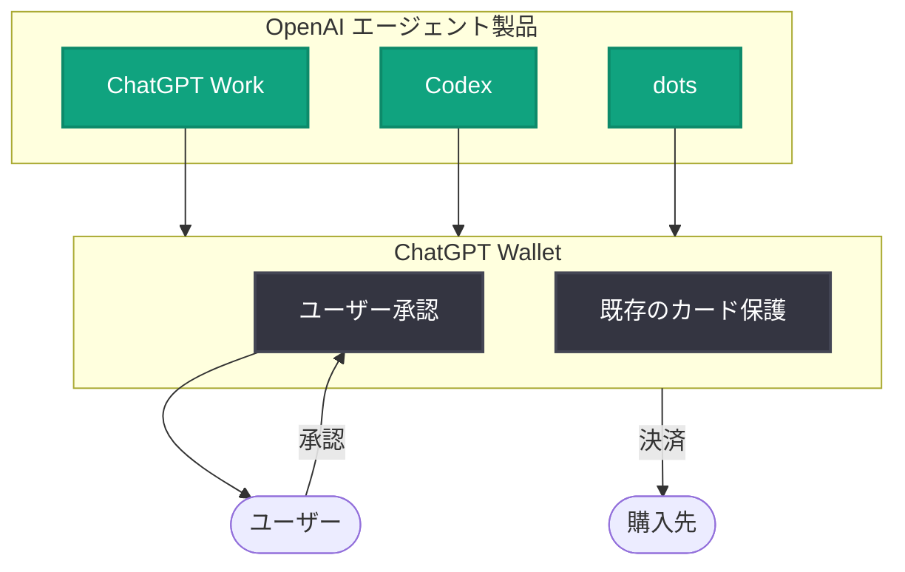

# ChatGPT Wallet の発表: エージェントによる安全な購入手続きを実現

## メタデータ

| 項目 | 内容 |
|------|------|
| 発表日 | 2026-11-13 |
| ソース | OpenAI News |
| カテゴリ | 新機能 |
| 公式リンク | https://openai.com/index/introducing-chatgpt-wallet |

> **注記**: 本レポート作成時点で記事本文を取得できなかったため (アクセス制限)、OpenAI News に掲載された公式の概要情報のみに基づいて記載しています。詳細な仕様は公式リンクを参照してください。

## 概要

OpenAI は 2026 年 11 月 13 日、ChatGPT Wallet を発表しました。ChatGPT Wallet は、ChatGPT Work、Codex、dots のエージェントが購入手続きを完了するための安全な仕組みです。

公式の概要によると、購入はユーザーの承認 (user approval) を経て実行され、既存のカード保護 (existing card protections) が適用されます。エージェントが自律的にタスクを進める中で発生する決済を、ユーザーの管理下で安全に処理することを目的とした機能です。

## 主な内容

### 対応製品

公式概要で言及されている対応製品は以下のとおりです。

- **ChatGPT Work**: 業務向けの ChatGPT 製品
- **Codex**: OpenAI のコーディングエージェント
- **dots**: OpenAI のエージェント製品

### セキュリティと承認フロー

公式概要から確認できるポイントは以下のとおりです。

- **ユーザー承認**: エージェントによる購入はユーザーの承認を経て完了する
- **既存のカード保護**: 購入には既存のカード保護が適用される
- **安全な仕組み**: エージェントの購入手続きを安全に行うための仕組みとして設計されている

## 購入フローの概念図

公式概要に基づく概念的なフローは以下のとおりです (詳細な実装は公式ドキュメントを参照)。

## 開発者・ユーザーへの影響

- エージェントがタスクの一環として購入を完了できるようになり、人手を介した決済手続きの中断が減る可能性がある
- 購入にはユーザー承認が必須であるため、エージェントが無断で決済を行うリスクを抑えた設計となっている
- 既存のカード保護が適用されるため、従来のカード決済と同等の保護を受けられる

## 関連リンク

- [Introducing ChatGPT Wallet (公式発表)](https://openai.com/index/introducing-chatgpt-wallet)
- [OpenAI News](https://openai.com/news)
- [OpenAI ヘルプセンター](https://help.openai.com/)

## まとめ

ChatGPT Wallet は、ChatGPT Work、Codex、dots のエージェントがユーザー承認のもとで購入手続きを安全に完了するための新機能です。既存のカード保護を維持しながらエージェントに決済能力を与える点が特徴で、エージェントによるタスク自動化の適用範囲を購買領域へ広げる発表といえます。詳細仕様や提供時期・対象地域については、本レポート作成時点で記事本文を確認できなかったため、公式リンクでの確認を推奨します。
