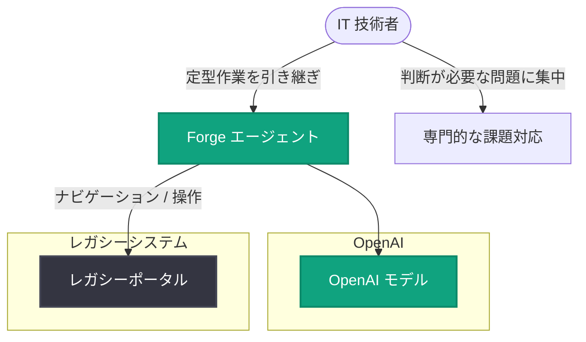

# Shield、OpenAI を活用して IT 技術者のレガシーポータル業務の引き継ぎを支援

## メタデータ

| 項目 | 内容 |
|------|------|
| 発表日 | 2026-11-13 |
| ソース | OpenAI News |
| カテゴリ | 導入事例 |
| 公式リンク | https://openai.com/business/customer-stories/shield |

## 概要

Shield は OpenAI の技術を活用し、IT 技術者がレガシーポータル上での作業を引き継げるようにする仕組みを構築した。同社の Forge エージェントがレガシーシステムのポータル操作 (ナビゲーション) を代行することで、技術者は人間の判断が必要な問題に集中できるようになる。

本事例は、レガシーシステムの運用という多くの IT 組織が抱える課題に対して、AI エージェントによる作業の自動化・引き継ぎという解決アプローチを示すものである。

## 主な内容

### レガシーポータル業務の課題

多くの IT 現場では、技術者が古いポータル画面を手作業で操作する業務に時間を取られている。こうした定型的な操作は、技術者本来の専門性である「判断を要する問題への対応」から時間を奪う要因となっていた。

### Forge エージェントによる作業の引き継ぎ

Shield の Forge エージェントは、OpenAI の技術を基盤として、レガシーシステムのポータルを自律的にナビゲートする。これにより、技術者は定型的なポータル操作を Forge エージェントに引き継ぎ (ハンドオフ)、自身の判断が必要な課題にリソースを集中できる。

## アーキテクチャ

記事概要から確認できる役割分担を図示する (概念図)。

注: 本図は公開されている概要情報に基づく概念図であり、実際のシステム構成の詳細 (使用モデル、API 構成など) は記事本文から確認できていない。

## 開発者・企業への影響

- レガシーシステムを抱える組織にとって、AI エージェントによるポータル操作の自動化という実践的なユースケースが示された
- 「人間は判断が必要な業務に集中し、定型操作はエージェントに引き継ぐ」という人間 - AI 協働の分業モデルの参考事例となる
- システムの刷新 (リプレイス) を待たずに、既存のレガシーポータルをそのまま活かしながら業務効率化を図るアプローチの一例である

## 関連リンク

- [Shield 導入事例 (OpenAI 公式)](https://openai.com/business/customer-stories/shield)
- [OpenAI News](https://openai.com/news)
- [OpenAI 公式ドキュメント](https://platform.openai.com/docs)

## まとめ

Shield は OpenAI を活用した Forge エージェントにより、IT 技術者がレガシーポータルでの定型作業をエージェントへ引き継げる仕組みを実現した。エージェントがシステムのナビゲーションを担うことで、技術者は判断を要する問題への対応に集中できる。レガシーシステム運用における AI エージェント活用の導入事例として注目される。

なお、本レポートは記事ページの取得が制限されていたため、公開されている概要情報のみに基づいて作成している。
