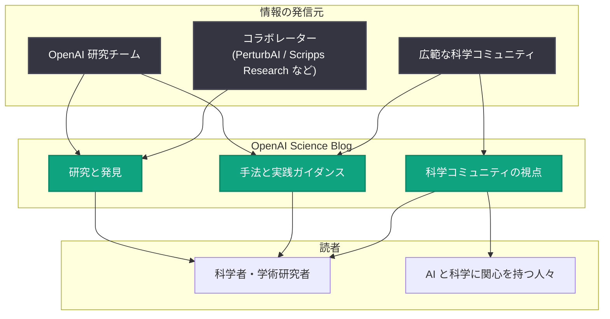

# OpenAI が科学専門ブログ「OpenAI Science Blog」を開設

## メタデータ

| 項目 | 内容 |
|------|------|
| 発表日 | 2026-11-15 |
| ソース | OpenAI News (Science blog) |
| カテゴリ | 発表 / 研究コミュニケーション |
| 公式リンク | https://openai.com/index/our-new-blog-for-science |

## 概要

OpenAI は、科学者や学術研究者が AI を活用した発見やその手法を共有するための専門ブログ「OpenAI science blog」を開設すると発表した。OpenAI のミッションである「AGI が全人類に利益をもたらすことを保証する」ことに向けて、科学的発見の加速を最もインパクトの大きい取り組みの 1 つと位置づけ、その成果と知見を発信する場として立ち上げられた。

ブログでは、OpenAI 自身やコラボレーター、そして広く科学コミュニティによる研究成果に加え、モデルの実践的な活用方法や研究者の視点まで、幅広い科学分野のコンテンツが掲載される予定である。

## 主な内容

### ブログ開設の背景

科学は世界の理解を広げ、より良い医薬品から新しいエネルギー源まで、さまざまな進歩を可能にする。こうした進歩の多くは、実用的な意義が何年も後になって明らかになる基礎的な問いから始まる。OpenAI は近年、自社モデルが対応できる科学的問題の範囲が拡大していることを受け、科学者と学術研究者が AI による発見とその進め方を共有できる場としてこのブログを開設した。

### 直近数か月の科学分野での実績

発表では、ブログ開設の背景として以下の成果が紹介されている。

- **数学・物理学**: 2026 年 9 月に OpenAI の内部システムがナビエ・ストークス方程式の存在と滑らかさ問題に取り組む証明を生成。10 月初旬には幅広い数学的成果を公開し、その中には準リーマン予想 (quasi-Riemann hypothesis) に関する結果が含まれる。これは、与えられた数より小さい素数の個数を推定する古典的な公式の誤差に、より厳密な上界を与えるものである。同月後半には、波の集中の仕方、効率的な計算の限界、相互作用する量子場理論の数学的基礎に関する、数学・計算機科学・物理学にまたがる成果を共有した
- **生物学**: PerturbAI および Scripps Research との協働では、GPT-Rosalind を搭載した数千のエージェントが、数百万のマウス脳細胞から得られた既存の実験データを 32 分で解析。遺伝子破壊の影響と科学文献を結びつけ、検証可能な生物学的メカニズムの候補を特定した
- **創薬**: César de la Fuente のチームは ChatGPT と Codex を使って抗生物質候補分子を特定するアルゴリズムを構築し、実際にラボで合成・検証している

### 科学の実践への影響

これらの能力は、科学の実践に新しい可能性と変化をもたらしている。

- **数学**: 証明を生成するシステムの登場により、新しい論証をどのように検証し、説明し、分野に取り込むかという問いが生まれている
- **実験科学**: より多くの仮説を探索できるようになったことで、どの実験を優先するかの判断に機会と課題の両方が生じている
- **分野横断**: 研究者の訓練、成果の帰属 (attribution)、仕事に必要なスキルへの影響が議論されており、OpenAI はその影響は分野ごとに異なるため、科学コミュニティ自身がツールの使い方の形成に関与すべきだとしている

## 技術的な詳細

本発表はブログ開設のアナウンスであり、API やモデルの変更は含まれない。科学ブログの位置づけと掲載コンテンツは以下の 3 種類である。

### 掲載コンテンツの種類

| カテゴリ | 内容 |
|---------|------|
| 研究と発見 (Research and discoveries) | OpenAI、コラボレーター、広範な科学コミュニティによる新しい科学的成果と進行中の研究のアップデート |
| 手法と実践ガイダンス (Methods and practical guidance) | 科学計算、データ解析、文献探索、実験計画などにモデルを使う実例。結果の検証方法や手法の限界も含め、他の研究者が応用できるアプローチを共有 |
| 科学コミュニティの視点 (Perspectives from the scientific community) | AI を使う研究者の一次証言、得られた学び、各分野への影響。科学の実践に関する未解決の問いや、ツールをより多くの人に役立てる方法の議論も扱う |

## アーキテクチャ

科学ブログを中心とした情報フローを以下に示す。

## 開発者への影響

- **実践的な手法の入手**: 科学計算、データ解析、文献探索、実験計画などへのモデル活用例が、検証方法や限界の説明付きで公開されるため、研究用途のアプリケーション開発の参考になる
- **再現可能なアプローチ**: 「他の研究者が応用できるアプローチ」の共有が明言されており、自分の分野やプロダクトに適用できるワークフローを学べる
- **科学分野のユースケース把握**: GPT-Rosalind によるマルチエージェント解析や、ChatGPT と Codex を使ったアルゴリズム構築など、AI for Science の具体的な適用パターンを継続的に追跡できる
- **議論への参加機会**: 証明の検証、実験の優先順位づけ、帰属やスキルといった AI 時代の科学実践に関する未解決の問いが提示され、コミュニティがツールの使い方を形成する流れに関与できる

## 関連リンク

- [Our new blog for science (公式記事)](https://openai.com/index/our-new-blog-for-science)
- [ナビエ・ストークス問題への証明](https://openai.com/index/navier-stokes-solution/)
- [数学における AI の進歩の共有](https://openai.com/index/sharing-ai-progress-in-mathematics/)
- [準リーマン予想に関するプレプリント (GitHub)](https://github.com/openai/math/blob/main/preprints/The-Quasi-Riemann-Hypothesis-September-30-2026/paper.pdf)
- [学術コミュニティとの科学的理解の構築](https://openai.com/index/building-scientific-understanding-with-academic-communities/)
- [複雑な生物学データのための AI 研究のスケーリング](https://openai.com/index/scaling-ai-research-for-complex-biological-data/)
- [抗生物質発見の加速](https://openai.com/index/accelerating-antibiotic-discovery/)
- [OpenAI News](https://openai.com/news)

## まとめ

OpenAI は、科学者と学術研究者が AI による発見と手法を共有する場として「OpenAI science blog」を開設した。「研究と発見」「手法と実践ガイダンス」「科学コミュニティの視点」の 3 カテゴリで、幅広い科学分野のコンテンツを発信する。背景には、ナビエ・ストークス問題への証明や準リーマン予想に関する結果、GPT-Rosalind による大規模生物学データ解析など、モデルが対応できる科学的問題の急速な拡大がある。OpenAI は、AI が科学をどう変えているかをより多くの人が理解し、自らの発見に活用できるようになることを目指すとともに、ツールの使い方の形成には科学コミュニティ自身が関与すべきだと強調している。
