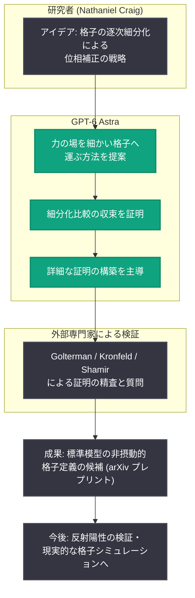

# 標準模型の格子上での定義に向けた一歩 — GPT-6 Astra が支援した非摂動的定式化の提案

## メタデータ

| 項目 | 内容 |
|------|------|
| 発表日 | 2026-11-15 |
| ソース | OpenAI Research (Science blog) |
| カテゴリ | 研究成果 |
| 公式リンク | https://openai.com/index/step-toward-defining-the-standard-model |

## 概要

素粒子物理学の標準模型 (Standard Model) は、既知の素粒子と 4 つの基本相互作用のうち 3 つ (強い力、弱い力、電磁気力) を記述する、極めて成功した理論である。しかし理論の誕生から 50 年以上が経過した今も、相互作用を小さな補正として扱わない「非摂動的な定義」をどのように与えるかという基礎的な問題が未解決のまま残されていた。

本記事では、物理学者 Nathaniel Craig 氏が GPT-6 Astra の支援を受けて 2026 年 10 月に arXiv へ投稿したプレプリントを紹介している。この研究は、時空を格子 (lattice) として離散化したうえで、標準模型全体に対する非摂動的な定義の候補を提案するものである。著者が持っていた戦略を具体的な構成へと発展させ、詳細な証明を主導したのが GPT-6 Astra であり、AI が最先端の理論物理学研究に本質的な貢献を果たした事例として注目される。

## 主な内容

### 標準模型の定義に欠けていたもの

標準模型の予測の多くは摂動論 (perturbation theory) に依拠している。相互作用をいったんオフにした厳密に解ける系から出発し、相互作用を小さな補正の級数として加えていく手法で、電子の磁気モーメントを 1 兆分の数個の精度で予言するなどの成果を挙げてきた。

しかし、理論の豊かさの多くは摂動論の外側にある。たとえば陽子の質量は、内部のクォークとグルーオンの運動・相互作用に由来しており、強い力をオフにすると陽子自体が崩壊してしまうため、摂動論では説明できない。連続時空における標準模型全体については、非摂動的な定義はおろか、相互作用する理論が数学的に well-defined かどうかさえ分かっていなかった。

有望な代替手段が、時空を格子点のグリッドに離散化する格子場理論 (lattice field theory) である。格子間隔が理論の解像できる最短距離を定め、有限の格子上では所与の間隔における厳密な非摂動的定義が可能になる。この手法は強い力の理解に大きな進展をもたらし、陽子質量の第一原理計算も実現してきた。

### カイラル理論という障壁

格子場理論が強い力でこれほど成功したにもかかわらず標準模型全体に拡張できなかったのは、標準模型がカイラル理論 (chiral theory) だからである。カイラル理論とは、空間反転 (鏡映) のもとで異なって見える理論を指す。鏡に映した左手用の手袋が右手用になるように、弱い力は左巻きフェルミオンと右巻きフェルミオンを異なる仕方で扱う。

左巻きフェルミオンを素朴に格子上に置くと、最も自然な規則では「頼んでもいない右巻きのパートナー」が現れてしまう。このダブリング (doubling) 問題により、素朴な格子定式化では弱い力に対して誤った粒子内容が得られてしまう。これが、標準模型の完全な非摂動的定義が長年欠けていた理由のひとつである。

### 光と鏡によるアナロジー

記事では、左円偏光のみのレーザーを 2 枚の鏡で挟んだ箱に閉じ込める思考実験でダブリングを説明している。通常の鏡では、反射時に光の進行方向が反転する一方で電場の回転方向は変わらないため、左円偏光が右円偏光に変わってしまう。これが格子上のダブラー出現に相当する。

この問題には「カイラルミラー」という巧妙な解決策がある。分子配向が層ごとに少しずつ回転して螺旋を描く特殊なフィルムを使うと、左巻きの光を左巻きのまま反射し、右巻きの光は透過させられる (一部のコガネムシの殻にも同様の螺旋構造が存在する)。格子上でも同様のトリックが知られており、Ginsparg と Wilson が格子上の規則を導き、Narayanan と Neuberger がオーバーラップフェルミオン (overlap fermions) という定義を構築し、Lüscher が格子上で左巻きと右巻きを区別する方法を示し、菊川 (Kikukawa) らが弱い相互作用への応用を探求してきた。しかし、1 つのピースがまだ欠けていた。

### 位相の整合という未解決問題

欠けていたピースが「位相 (phase)」の処方である。カイラルミラーの箱では、一周して戻ってきた光とレーザーからの新しい光の位相が揃えば光は増幅され、半周期ずれていれば打ち消し合う。片方の鏡をビーム軸まわりに回転させることで位相を調整できる。

格子上では、この位相が標準模型の力の場がすべての格子点で何をしているかに依存するため、問題は格段に難しくなる。力の場を小さなステップで変化させて元の配位に戻るループを考えると、許される状態は同じでも、ループを一周する間に位相がずれてしまう可能性がある。あらゆるループについて位相を補正する方法が必要であり、Lüscher はカイラル版の電磁気学のような単純なクラスの理論については位相の処方を解決したものの、標準模型全体については 25 年以上にわたり未解決のままだった。

### Astra と共に構成を築く

Craig 氏のアイデアは、理論を定義したい元の格子上の力の場を、より細かい格子の系列の上に表現し直すというものである。隣り合う 2 つの格子上で許されるフェルミオン状態を比較すると、力の小さな変化に対する位相補正の一部が得られ、それらを足し上げることで元の格子上の位相規則が得られる。証明は、この規則があらゆる許されるループについて正しい補正を与えることを示している。これにより、格子スケールでの場の強さに対する制限のもと、有限の格子間隔における標準模型の測度 (measure) が与えられる。

GPT-6 Astra は、この細分化 (refinement) 戦略を実際に機能する構成へと変えるうえで本質的な役割を果たした。具体的には以下の貢献が挙げられている。

- 所与の力の場をより細かい格子へと運ぶ正しい方法を提案した
- より細かい格子上での比較が確定した答えに収束することを示した
- 詳細な証明の構築を主導した

また、人間の専門家も重要な役割を担った。格子場理論の専門家である Maarten Golterman、Andreas Kronfeld、Yigal Shamir の各氏が Astra の証明を精査し、鋭い質問を投げかけることで結果への信頼を築く助けとなった。

## 技術的な詳細

### 格子定式化のポイント

| 要素 | 内容 |
|------|------|
| 対象 | 標準模型全体 (カイラルゲージ理論) の非摂動的定義 |
| 手法 | 格子場理論 + オーバーラップフェルミオン |
| 核心的課題 | フェルミオン測度の位相をあらゆるループで整合させること |
| 提案手法 | 格子の逐次細分化による位相補正の構成 (refinement strategy) |
| 成立条件 | 格子スケールでの場の強さに対する制限 (bound on field strengths) |
| 性質 | 補正は近傍の場に主に依存し、同じ場の異なる数学的記述に対して同じ答えを与える |

### 先行研究との関係

本研究は以下の系譜の上に成り立っている。

1. **Ginsparg-Wilson 関係**: カイラルミラーに相当する格子上の規則
2. **Narayanan-Neuberger のオーバーラップフェルミオン**: ダブラーを除去する格子上の粒子定義
3. **Lüscher の位相処方**: カイラル版電磁気学など単純な理論での解決
4. **Kikukawa らの研究**: 弱い相互作用への応用の探求

今回の成果は、25 年以上未解決だった「標準模型全体に対する位相の整合」を解決する候補を与えるものである。さらに、OpenAI による最近の Yang-Mills 理論の存在証明と組み合わせることで、標準模型のゲージ場とフェルミオンを含む最も単純な統一 Yang-Mills 理論の存在が、格子上のオーバーラップフェルミオンから出発して連続極限を取ることにより証明されたとしている。

## アーキテクチャ

研究のワークフローを以下に示す。

## 開発者・研究者への影響

- **AI による数学・物理研究の実例**: GPT-6 Astra が証明構築を「主導」した事例であり、AI が最先端の理論研究で人間の戦略を具体的な構成と厳密な証明に変換できることを示した
- **人間と AI の協働モデル**: 研究者のアイデア、AI による証明構築、外部専門家による検証という 3 段階のワークフローは、今後の AI 支援研究の参考になる
- **格子 QCD コミュニティへの波及**: 標準模型全体の非摂動的シミュレーションへの道が原理的に開かれたが、著者自身が述べるとおり「実践よりも原理のレベルの答え」であり、現実的な格子シミュレーションに使えるようにするには多くの作業が残されている
- **未解決の課題**: 有限格子間隔での反射陽性 (reflection positivity) の成立や、連続時空における相互作用する理論の定義などが今後の課題として挙げられている

## 関連リンク

- [公式記事: A step toward defining the Standard Model on a lattice](https://openai.com/index/step-toward-defining-the-standard-model)
- [arXiv プレプリント (2026 年 10 月)](https://arxiv.org/abs/2610.09093)
- [OpenAI Research](https://openai.com/research)
- [OpenAI News](https://openai.com/news)

## まとめ

本研究は、素粒子物理学の標準模型に対して 50 年以上欠けていた非摂動的な格子定義の候補を提示するものである。カイラル理論特有のダブリング問題はオーバーラップフェルミオンで解決済みだったが、フェルミオン測度の位相を標準模型全体で整合させる方法は 25 年以上未解決だった。研究者の「格子の逐次細分化」という戦略を、GPT-6 Astra が具体的な構成と詳細な証明へと発展させ、外部の格子場理論の専門家による精査を経て結果の信頼性が高められた。著者はこの構成を「終わりではなく始まり」と位置づけており、反射陽性の検証や現実的なシミュレーションへの応用など、今後の科学的対話と研究の進展が期待される。
