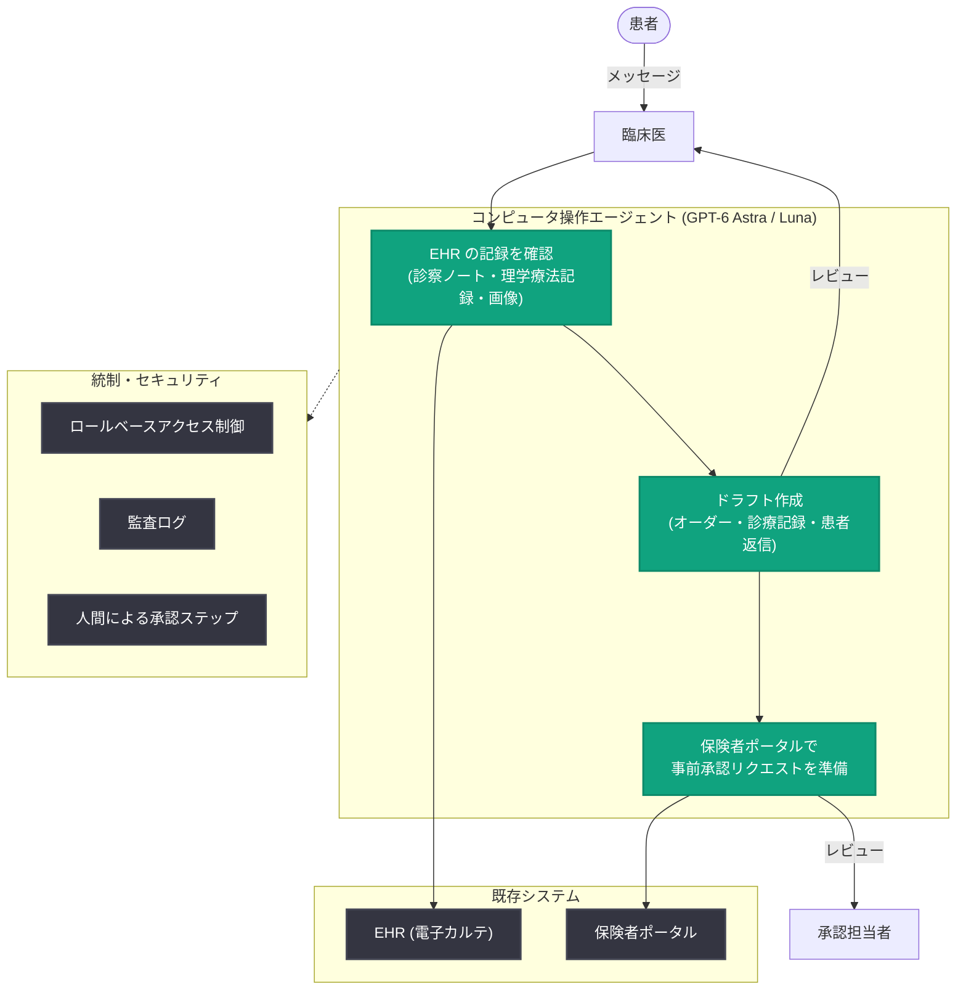

# 医療チーム向けコンピュータ操作エージェントの進化

## メタデータ

| 項目 | 内容 |
|------|------|
| 発表日 | 2026-11-16 |
| ソース | OpenAI News |
| カテゴリ | Product (新機能・パートナーシップ) |
| 公式リンク | https://openai.com/index/advancing-computer-use-for-healthcare-teams |

## 概要

OpenAI は、医療分野におけるコンピュータ操作エージェント (computer-use agents) の性能・安全性・コストに関する新しい評価結果を発表した。コンピュータ操作エージェントは、クリック、タイピング、アプリケーション間の移動によって複数ステップのワークフローを実行する AI であり、医療チームが日常的に使用しているソフトウェア上で反復的な業務を支援できる。医療は断片化されており、患者がケアを受けるまでにチームがシステム間で情報を手作業で移動させる必要があることが多い (例: MRI のオーダー時に、保険者が必要とする情報を電子カルテから取得して別のポータルに入力する事前承認業務)。本発表はこうした課題への対応を示すものである。

また、Abridge、Ambience、Cigna Healthcare、CVS Health といった大手医療関連組織との協業事例も公開された。これらの機能は、OpenAI API、ChatGPT for Healthcare、ChatGPT for Clinicians を通じて即日利用可能であり、HIPAA 準拠のワークフロー、承認・エージェントアクセスの設定、監査ログの記録をサポートする。同日発表の「More ways to move care forward with ChatGPT for Healthcare」の関連記事である。

## 主な内容

### 有用性・安全性・コストの評価

OpenAI は、臨床医が EHR (電子カルテ) の受信トレイで処理するタスクについて GPT-6 Astra を評価した。これらのタスクは医師の意見をもとに設計され、患者の経時的なコンテキストに対する臨床推論と、複雑なインターフェースのナビゲーションの両方を試すマルチステップのワークフローで構成されている。

- **臨床安全性**: モデルの成果物に含まれる不正確さ、欠落、アクションが患者への危害につながり得るかを評価。レビュー対象となった 325 タスクのうち **99% が安全** と評価された
- **有用性**: 医師が 5 段階で評価し、646 件の評価のうち **93% が「very helpful」または「extremely helpful」** を選択した

レビュアーは、モデルのアクションと、生成されたノート、オーダー、患者へのメッセージを併せて検証し、タスクの文脈において有用かつ臨床的に安全かを判断した。

### 管理業務ワークフローの性能とコスト

事前承認 (prior authorization)、不服申立て (appeals)、医療機器オーダーなどの管理タスクについても評価を実施した。Stanford の研究者による独立ベンチマーク **HealthAdminBench** での結果は以下のとおり。

| モデル | ルーブリックポイント獲得率 | コスト |
|--------|------------------------|--------|
| GPT-6 Astra | 94.3% | - |
| GPT-6 Luna | 91.8% | 1 タスクあたり 8.5 セント (Astra 比 98% 低コスト) |

両モデルとも最大推論努力 (maximum reasoning effort) で評価された。この結果は、大量の管理業務ワークフローに対応できる、高性能かつ低コストなエージェントへの進歩を示している。

### デモ: 臨床医と承認担当者が同じ MRI リクエストを処理

合成患者データを使ったデモでは、患者が腰痛について臨床医にメッセージを送ると、コンピュータ操作エージェントが EHR 内の診察ノート、理学療法記録、過去の画像検査を確認し、MRI オーダー、診療記録、患者への返信ドラフトを作成して臨床医のレビューに回す。さらに同じ記録を用いて、保険者のポータル上で事前承認リクエストを準備し、承認担当者のレビューに回す。

## パートナー組織との開発事例

OpenAI のパートナーは、数百の医療システムで使われるソフトウェアを開発し、世界中のメンバーのケアを調整し、数億人の患者にケアを提供している。

### CVS Health: 臨床システム横断の管理業務の完遂

- ドキュメント送付、紹介状 (referral) 処理、専門医コンサルト支援など、API が完全にはサポートしないステップをエージェントが既存アプリケーションを操作して実行
- 本番ワークフローでは、数か月分のドキュメント送付バックログをエージェントが **週末のうちに解消**
- 別のエージェントは **1 日数万件のコンサルト** のシステム操作を処理
- スクリーンショットとアクション記録による検証チェックと人間の監督を併用
- OpenAI の Agents SDK で構築した [Agent Kit](https://github.com/cvs-health/cua-agent-kit) をオープンソース化
- データは CVS Health のエンタープライズ管理インフラ内に留まり、本番データは基盤モデルの学習に使用されない

### Abridge: あらゆるケアの場面でのシステム横断連携

- 臨床医が日常的に使うアプリケーション (API がないものを含む) 横断でケアプランを遂行するエージェントを開発中
- 計画中の入院患者向けユースケースでは、臨床会話に EHR 情報と看護師・臨床医のコンテキストを加え、注意すべき点の特定と次のステップの調整を行う
- 例: 臨床医が Abridge Assistant に退院障壁の解消を依頼すると、エージェントが服薬アクセスと在宅医療の調整を並行して処理。臨床判断が必要な決定には臨床医が関与する

### Cigna: ケアマネジャーのメンバーアウトリーチ準備

- 従来、Cigna Healthcare のケースマネジャーは **10 以上の臨床・管理システム** を行き来してコンテキスト (給付・補償、プロバイダー、予約、過去のやり取りなど) を収集する必要があった
- コンピュータ操作により、これらのシステムをナビゲートして関連情報を **数秒で集約** でき、情報検索の時間を削減し、ケースマネジャーがメンバー支援に使える時間を増やす

### Ambience: 医療におけるコンピュータ操作のガバナンス確立

- EHR や保険者ポータルで API が届かないタスクをエージェントが完遂できる一方、医療ではすべてのアクションが制御・監査可能であることが必須という前提で追加の統制機能を構築
- デモでは、患者のカルテの根拠をもとに保険者サイトで事前承認リクエストを準備。記録が曖昧な場合はエージェントが停止して臨床医に確認し、承認を待ってから送信する
- 医療システム側は、エージェントが実行できるアクションを設定し、いつでも一時停止でき、監査用のステップごとのログを取得できる

### スタートアップ事例: Assort

紹介状ワークフローは予約だけでは完結せず、Athena の API では紹介状をカルテに添付できても、完了処理は EHR インターフェース上の別ステップが必要だった。Assort は **Codex のコンピュータ操作機能** を使い、エージェントが Athena 上で直接、紹介元プロバイダーの選択、紹介詳細の入力、「visit scheduled」のマークを実行。既存の API 統合の限界を超えてワークフローを拡張し、紹介状がスタッフのフォローアップリストから外れる結果を得た。

## アーキテクチャ

コンピュータ操作エージェントが EHR と保険者ポータルをまたいで業務を遂行し、人間のレビューを経由する流れを示す。

## 患者データのセキュリティとエージェント統制

医療におけるコンピュータ操作エージェントには、臨床安全性の評価、患者情報の保護、人間のレビューなしにエージェントが実行できる範囲の明確な制限が必要となる。

- ChatGPT for Healthcare はロールベースのアクセス制御と監査ログを提供
- 組織はワークフローに追加のレビュー・承認ステップを組み込み、タスクごとに必要な記録とアクションのみにアクセスを限定するよう、エージェントが使用するアプリケーションと環境を設定できる
- 組織のデータは OpenAI の基盤モデルの学習に使用されない
- 保護対象保健情報 (PHI) を扱う HIPAA 準拠ワークフローには、OpenAI との BAA (Business Associate Agreement) の対象となる適格サービスと、必要なセキュリティ・保持設定の使用が必須

## 開発者・医療機関への影響

- **医療機関**: [セールスチームへの問い合わせ](https://openai.com/contact-sales/) で臨床・管理ワークフローへの AI 導入を相談できる。既存顧客はワークスペース管理者に依頼して ChatGPT Work と Codex でコンピュータ操作を有効化できる
- **個人の臨床医**: 米国の臨床医は無料の [ChatGPT for Clinicians アカウント](https://chatgpt.com/plans/clinicians/) に登録し、ChatGPT Work と Codex でコンピュータ操作を体験できる
- **開発者**: [OpenAI API](https://developers.openai.com/api/docs/quickstart) で医療アプリケーションを構築でき、[computer use ガイド](https://developers.openai.com/api/docs/guides/tools-computer-use) を参照して既存ソフトウェア横断で動作するエージェントを構築できる
- API が存在しない、または不完全なレガシーシステム (EHR、保険者ポータルなど) に対しても、UI 操作ベースで自動化を拡張できる点が大きい
- GPT-6 Luna の低コスト (1 タスク 8.5 セント) により、大量の管理業務の自動化が経済的に現実的になる

## 関連リンク

- [Advancing computer-use agents for healthcare teams (本記事)](https://openai.com/index/advancing-computer-use-for-healthcare-teams)
- [HealthAdminBench (Stanford)](https://som-shahlab.github.io/health-admin-bench-website/)
- [CVS Health Agent Kit (GitHub)](https://github.com/cvs-health/cua-agent-kit)
- [Computer use ガイド (OpenAI 開発者ドキュメント)](https://developers.openai.com/api/docs/guides/tools-computer-use)
- [OpenAI API クイックスタート](https://developers.openai.com/api/docs/quickstart)
- [ChatGPT for Clinicians](https://chatgpt.com/plans/clinicians/)
- [OpenAI News](https://openai.com/news)

## まとめ

- OpenAI はコンピュータ操作エージェントの医療ワークフローにおける評価結果を公開し、GPT-6 Astra が EHR 受信トレイのタスクで **安全性 99% (325 タスク)**、**有用性 93% (646 評価)** を達成した
- 管理業務ベンチマーク HealthAdminBench では GPT-6 Astra が 94.3%、GPT-6 Luna が 91.8% を獲得。Luna は 1 タスク 8.5 セントと 98% 低コストで、大量処理への道を開いた
- CVS Health、Abridge、Cigna Healthcare、Ambience などが本番・パイロット環境での活用を進めており、CVS Health は Agents SDK ベースの Agent Kit をオープンソース化した
- ロールベースアクセス制御、監査ログ、承認ステップ、HIPAA 準拠 (BAA) により、医療に求められる統制・セキュリティ要件への対応が組み込まれている
- OpenAI API、ChatGPT for Healthcare、ChatGPT for Clinicians を通じて本日から利用可能であり、医療チームが「システム間の情報移動」ではなく「患者のケア」に時間を使えるようにすることを目指している
