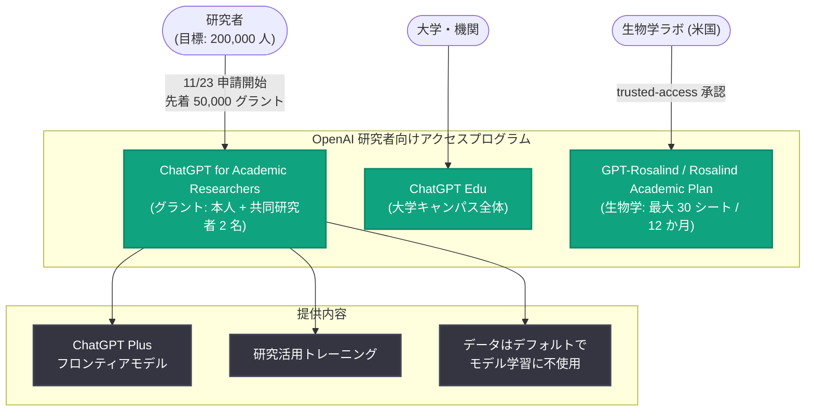

# 科学者への AI アクセス拡大: ChatGPT for Academic Researchers プログラムが全世界 200,000 人規模へ

## メタデータ

| 項目 | 内容 |
|------|------|
| 発表日 | 2026-11-16 |
| ソース | OpenAI News |
| カテゴリ | 研究成果 / プログラム拡大 |
| 公式リンク | https://openai.com/index/expanding-chatgpt-for-academic-researchers |

## 概要

OpenAI は、学術研究者向けプログラム「ChatGPT for Academic Researchers」を拡大し、全世界で最大 200,000 人の研究者に ChatGPT への無料アクセスを提供すると発表した。このプログラムは 2026 年 7 月にパイロットとして開始され、これまでに 33 か国 20,000 人の研究者が参加している。次回ラウンドの申請受付は 11 月 23 日 (月) に開始され、資格要件を満たす研究者に先着順で 50,000 件の新規グラント (利用枠) が付与される。

あわせて、OpenAI の Economic Research チームによる新しい調査レポート「Science at the Frontier: How Scientists Use ChatGPT」も公開された。夏のパイロットに参加した 1,800 人超の研究者の利用実態を分析したもので、調査対象者は「AI なしで同じ品質の研究を行った場合、ほぼ 2 倍の時間がかかっていた」と推定している。

## 主な内容

### プログラム拡大の詳細

次回ラウンドの主なポイントは以下のとおり。

- **申請開始日**: 2026 年 11 月 23 日 (月)
- **新規グラント数**: 50,000 件 (資格要件を満たす申請者に先着順で付与)
- **カバー範囲**: 各グラントは受給者本人と最大 2 名の共同研究者をカバーし、今回ラウンドだけで最大 150,000 人の研究者を支援
- **全体目標**: プログラム全体で 200,000 人の研究者への提供を目指す。これは 7 月のパイロット開始時に発表した目標の 2 倍
- **既存の待機リスト登録者**: 資格を満たす場合、申請開始前にアカウント有効化の手順がメールで案内される

参加者は OpenAI のフロンティアモデルを利用でき、研究での ChatGPT 活用方法に関するトレーニングも受けられる。また、プログラムを通じて共有されたデータは、デフォルトでモデルの学習には使用されない。

### パイロットからの変更点

夏のパイロットで得られたフィードバックに基づき、次回ラウンドでは以下の変更が行われる。

| 項目 | パイロット (2026 年 7 月〜) | 次回ラウンド |
|------|------|------|
| 選考方式 | 抽選 (ロッタリー) 方式 | 先着順 (資格要件を満たす最初の 50,000 件) |
| 提供プラン | ChatGPT Pro | ChatGPT Plus |
| グラント範囲 | 受給者本人 | 受給者本人 + 共同研究者最大 2 名 |
| 目標規模 | 100,000 人 | 200,000 人 |

提供プランを Pro から Plus に変更した理由について、OpenAI はパイロットの利用状況を分析した結果、「大半の参加者は ChatGPT Plus の利用上限内に収まっていた」ことを挙げている。この変更により、より多くの研究チームへのアクセス拡大が可能になるとしている。

### パイロットでの活用事例

- **結核治療の短縮を目指す創薬研究**: Brigham and Women's Hospital とハーバード大学医学部の研究者 Shuqi Li 氏は、結核治療期間を短縮し得る新しい創薬ターゲットを探索しており、ChatGPT を使って実験データと患者データを結び付け、抗生物質開発を加速できるかを検証している。
- **博物館標本のデータベース化**: フロリダ自然史博物館の AI 生物多様性担当アシスタントキュレーター Arthur Porto 氏のチームは、AI ツールを用いて博物館標本の写真を検索可能なデータベースに変換している。また、実物の標本と同じように角度によって翅の色が変化するチョウの 3D モデルも作成した。

### 調査レポート「Science at the Frontier」

OpenAI の Economic Research チームは、夏のパイロット期間中に 1,800 人超の研究者がどのように ChatGPT を利用したかを分析した調査レポート「[Science at the Frontier: How Scientists Use ChatGPT](https://openai.com/index/science-at-the-frontier/)」を公開した。調査に回答した参加者は、AI を使わずに同じ品質の研究成果を得るには、ほぼ 2 倍の時間を要していたと推定している。

### 研究者向けアクセス手段の全体像

ChatGPT for Academic Researchers は、OpenAI が研究者に高度な AI ツールを提供する取り組みの 1 つに過ぎず、以下の選択肢も用意されている。

- **ChatGPT Edu**: 大学がキャンパスコミュニティ全体に対し、研究・教育・学習のための ChatGPT アクセスを提供できるプラン。データ分析ツールやアクセス管理のための管理者機能を備える。
- **GPT-Rosalind / Rosalind Academic Plan**: 生物学分野の研究者向けに、専門的な生物学的推論と科学ツール・データベースへのアクセスを統合した GPT-Rosalind を提供。Rosalind Academic Plan では、米国の大学の対象ラボに対し、最大 30 シートを最長 12 か月間無償で提供する。GPT-Rosalind へのアクセスには trusted-access プロセスによる承認が必要。
- **数学分野への支援**: AI が生成した結果を数学者が検証・理解し、その上に新しい成果を築けるよう、Simons Foundation の新イニシアチブに [500 万ドルを拠出](https://openai.com/index/sharing-ai-progress-in-mathematics/)している。

## アーキテクチャ

研究者向けアクセスプログラムの全体像を以下に示す。

## 研究者・開発者への影響

- **無料アクセスの機会拡大**: 先着順 50,000 グラントにより、資格要件を満たす研究者は抽選を待たずに ChatGPT Plus を無料で利用できる。申請は 2026 年 11 月 23 日開始のため、関心のある研究者は早めの申請が推奨される
- **研究チーム単位での利用**: 1 グラントで共同研究者 2 名まで追加できるため、個人ではなくチームとして AI を研究ワークフローに組み込みやすくなった
- **データプライバシーの明確化**: プログラム経由で共有されたデータはデフォルトでモデル学習に使用されないため、未発表の研究データを扱う際の懸念が軽減される
- **分野別の選択肢**: 生物学分野では GPT-Rosalind、機関単位では ChatGPT Edu など、研究の形態に応じたアクセス手段を選択できる
- **生産性向上の定量的根拠**: 調査レポートによれば、参加研究者は AI なしでは同品質の研究にほぼ 2 倍の時間がかかると推定しており、研究機関が AI 導入を検討する際の参考データとなる

## 関連リンク

- [発表記事: Broadening access to AI for scientists](https://openai.com/index/expanding-chatgpt-for-academic-researchers)
- [調査レポート: Science at the Frontier](https://openai.com/index/science-at-the-frontier/)
- [研究者アクセスガイド](https://openai.com/science/researcher-access/)
- [ChatGPT Edu](https://help.openai.com/en/articles/9377311-chatgpt-edu-at-openai)
- [GPT-Rosalind](https://openai.com/rosalind/)
- [Rosalind Academic Plan の紹介](https://openai.com/index/introducing-the-rosalind-academic-plan/)
- [数学分野での AI 進歩の共有 (Simons Foundation への拠出)](https://openai.com/index/sharing-ai-progress-in-mathematics/)
- [OpenAI News](https://openai.com/news)

## まとめ

OpenAI は ChatGPT for Academic Researchers プログラムを大幅に拡大し、目標規模をパイロット時の 2 倍となる全世界 200,000 人の研究者に引き上げた。11 月 23 日から先着順で 50,000 件の新規グラントの申請を受け付け、各グラントは本人と共同研究者 2 名に ChatGPT Plus への無料アクセスを提供する。パイロットの知見に基づき選考方式を抽選から先着順へ、提供プランを Pro から Plus へと変更することで、より多くの研究チームへの提供を可能にした。あわせて公開された調査レポートでは、AI の活用により研究時間がほぼ半減するという参加者の推定が示されており、「AGI の恩恵を全人類に」という OpenAI のミッションの下、科学研究への AI 普及が加速している。
