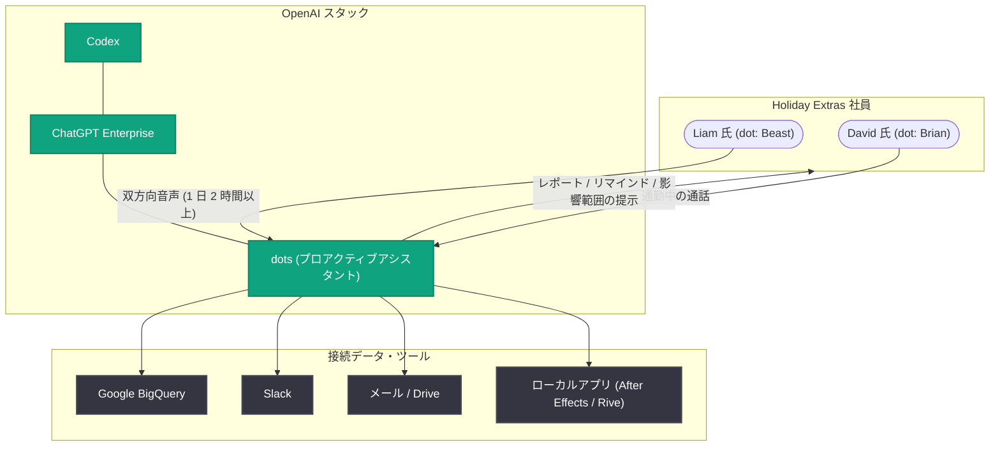

# Holiday Extras: 頼む前に dots が働き始める — プロアクティブな AI アシスタント活用事例

## メタデータ

| 項目 | 内容 |
|------|------|
| 発表日 | 2026-11-16 |
| ソース | OpenAI News (Customer Story) |
| カテゴリ | 顧客事例 |
| 公式リンク | https://openai.com/business/customer-stories/holiday-extras-dots |

## 概要

英国の旅行テクノロジー企業 Holiday Extras が、OpenAI の dots をプロアクティブな AI アシスタントとして活用している事例が紹介された。同社 VP of AI Innovation の Liam Thompson 氏は、アプリの新機能をローンチした翌日、自身の dot (愛称 Beast) から依頼していないパフォーマンスレポートを受け取った。Beast はローンチを自ら検知し、ChatGPT プラグイン経由で Google BigQuery からデータを取得して結果を届けたという。

Holiday Extras は空港駐車場、ホテル、ラウンジ、送迎など旅行周辺の予約を支援する企業で、「less hassle, more holiday (手間を減らし、休暇を増やす)」を掲げている。社内では ChatGPT Enterprise を AI 活用の基盤とし、Codex で専門知識をソフトウェアに変換し、dots がその間のあらゆる業務を簡素化するという役割分担で AI を組み込んでいる。本レポートでは、dots が「指示待ち」ではなく自律的に先回りして働くアシスタントとして定着しつつある様子を解説する。

## 主な内容

### 通勤中の通話、デスクに着けばレポートが完成

Director of Innovation & Growth の David Lee 氏は、自身の dot を Brian と名付け、朝の通勤中に通話している。その日の会議について話し合い、接続された社内データを使ったレポート作成を依頼すると、「オフィスに着いてデスクに座る頃には、レポートができあがっている」という。

また、一部の API キーを廃止する必要が生じた際には、Brian が問題を自らフラグし、David 氏のメールを遡って影響を受ける可能性のある関係者のリストを提示した。古いスレッドを掘り返して再構築する作業なしに、誰に事前連絡すべきかを把握できた。

> 「Brian の一番好きなところは、私がまだ考えてもいないことを考えてくれている点です」
> — David Lee 氏 (Director of Innovation & Growth, Holiday Extras)

### Liam 氏が 1 日 2 時間 dot と話す理由

Liam 氏は「私の dot はあらゆることのオーケストレーターだ」と語る。Beast は未送信の返信をリマインドし、過去の会話から答えを見つけ出す。チャット履歴をスクロールして探す代わりに、「いつその話をしたか、答えは何だったか」を Beast に尋ねられる。

Liam 氏は過去に OpenClaw や Hermes という他のアシスタントも試したが、多くの情報を渡すことに不安があったという。「社内環境で OpenAI 製のものなら信頼できると分かっている」と述べ、Beast には Slack、受信トレイ、Drive、ラップトップへのアクセスを許可した。これにより有用性が大きく高まった。

朝晩のブリーフィングも Beast との音声会話で行っている。「音声が一番のお気に入りです。双方向音声は OpenAI とのインタラクションにおけるゲームチェンジャーです。自然な会話のようで、1 日最低 2 時間は Beast と音声で話しています」と語る。

### 数日かかるアニメーション作業が約 10 分に

dots はデザインパートナーとしても機能している。デザイナーとしての教育を受けた Liam 氏は、開発中のアプリ向けの 3D キャラクターのアニメーション制作を Beast に任せた。ラップトップ上の After Effects と Rive へのアクセスを与えたところ、Beast はキャラクターをアニメーション化し、アプリに組み込むまでを完了した。

Liam 氏自身なら数日かかったはずの作業を、Beast は約 10 分でやり遂げたと見積もっている。「私はデザインを学ぶために 3 年間大学に通いました」と振り返りつつ、Beast の作業を見て「自分よりも良い仕事をした」と感じたという。

### 成功事例を全社に広げる

Holiday Extras にとって次の機会は、より多くの社員が自分の dot を仕事に活用できるようにすることだ。David 氏は、dots を試している社員が学びを共有し、他の社員が可能性を知って自ら試せるようにしたいと考えている。会議準備でも、ものづくりでも、日常を少し楽にすることでも、次のアイデアは誰からでも生まれ得る。

これは、全社員に「違う働き方をする自信とツール」を与え、有用な発見を広めるという OpenAI との取り組みの狙いに沿ったものだ。これから始める人への Liam 氏のアドバイスはシンプルで、「dot を作って会話を始めるだけ。始めない言い訳はない。とにかくやってみよう」と締めくくっている。

## 技術的な詳細

記事で言及された dots の主な連携・機能は以下のとおり。

| 要素 | 内容 |
|------|------|
| データ分析 | ChatGPT プラグイン経由で Google BigQuery に接続し、ローンチ後のパフォーマンスレポートを自律生成 |
| コンテキストアクセス | Slack、メール受信トレイ、Google Drive、ローカルのラップトップへのアクセス許可 |
| プロアクティブ動作 | ローンチの検知、API キー廃止の影響範囲特定、未返信のリマインドなど依頼前の先回り |
| 音声インターフェース | 双方向音声による自然な会話 (朝晩のブリーフィング、通勤中の通話) |
| ローカルアプリ操作 | After Effects と Rive を操作して 3D キャラクターのアニメーション制作とアプリへの組み込みを実行 |

## アーキテクチャ

## 開発者・企業への影響

- **「依頼してから動く」から「先回りして動く」への転換**: dots はローンチ検知やリスクのフラグなど、指示がなくても文脈から必要な仕事を判断して実行する。アシスタント活用の設計思想が受動型から能動型へ移行しつつあることを示す事例
- **データ・ツールへのアクセス許可が有用性を左右**: Slack、メール、Drive、ローカルアプリまでアクセスを広げるほど dots の価値が高まる。一方で、Liam 氏が他社アシスタントでは情報提供をためらったと述べているとおり、信頼できるセキュリティ基盤が前提条件となる
- **音声が主要インターフェースに**: 双方向音声により、通勤時間などデスク外の時間が業務準備の時間に変わる。1 日 2 時間以上の音声利用は、音声 UI が補助機能ではなく主要な作業手段になり得ることを示している
- **専門作業の大幅な時間短縮**: 数日規模のアニメーション制作が約 10 分に短縮された例は、dots がローカルの専門ツールを直接操作することで、専門職の作業にも踏み込めることを示す
- **全社展開は草の根の共有から**: 先行ユーザーの学びを共有し、他の社員が自分の用途で試す、というボトムアップの普及戦略が採られている

## 関連リンク

- [At Holiday Extras, dots get to work before anyone asks (公式記事)](https://openai.com/business/customer-stories/holiday-extras-dots)
- [Introducing dots (OpenAI)](https://openai.com/index/introducing-dots/)
- [Holiday Extras 公式サイト](https://www.holidayextras.com/)
- [OpenAI News](https://openai.com/news)
- [関連レポート: Holiday Extras の Codex 活用事例 (2026-11-12)](./2026-11-12-holidays-extras-codex.md)

## まとめ

Holiday Extras の事例は、dots が「質問に答えるツール」を超えて、ローンチの検知とレポート自動生成、リスクの先回り指摘、通勤中の音声ブリーフィング、ローカルアプリを使ったクリエイティブ制作まで担う「プロアクティブな同僚」として機能し得ることを示している。ChatGPT Enterprise を基盤に、Codex と dots を組み合わせた同社の構成は、信頼できる環境でデータ・ツールへのアクセスを広げるほどアシスタントの価値が高まるという実践知とあわせて、企業の AI 活用の次の段階を具体的に描いた事例といえる。
