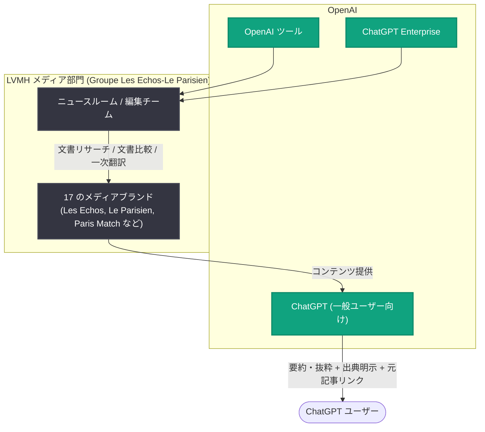

# LVMH メディア部門が OpenAI との戦略的パートナーシップを発表

## メタデータ

| 項目 | 内容 |
|------|------|
| 発表日 | 2026-11-16 |
| ソース | OpenAI News |
| カテゴリ | Company (企業パートナーシップ) |
| 公式リンク | https://openai.com/index/lvmh-media-division-partnership |

## 概要

2026 年 11 月 16 日 (パリ)、LVMH グループのメディア部門 (Groupe Les Echos-Le Parisien) と OpenAI は、戦略的提携契約の締結を発表した。この契約は、同部門のすべての出版物において AI の新しい活用を支援するとともに、そのジャーナリズムを ChatGPT を通じてより多くの人がアクセスできるようにすることを目的としている。契約には、OpenAI のツールと ChatGPT Enterprise をメディア部門の各チームに展開し、日々の業務に合わせた AI アプリケーションを開発できるようにすることが含まれる。

両者の共通の狙いは、メディア部門全体のチームが AI を実験・開発できるようにし、ジャーナリズムと質の高い報道を支える実用的な AI 活用を実現することにある。

## 主な内容

### ニュースルームにおける AI 活用

AI はニュースルームで活用することで、ジャーナリストが本来の職務である取材・分析・執筆に集中できるようにする強力なツールと位置づけられている。各チームは以下のような応用を探索できるようになる。

- **文書リサーチ**: 資料や文献の調査
- **文書比較**: 複数文書の照合・比較
- **一次翻訳 (preliminary translation)**: 翻訳の下訳作成

これらの効率化により、調査報道、分析、現場での取材により多くの時間を割くことが目標とされている。

### パーソナライゼーションによる収益成長

情報があふれる環境の中で、パーソナライゼーションは重要な優先事項となっている。AI は、顧客・読者・広告主それぞれのニーズに応える製品やサービスを開発・提供するための不可欠なツールであり、読者の獲得・維持と各媒体の収益拡大に寄与するとされる。

### ChatGPT における LVMH メディア部門コンテンツの強化

本パートナーシップは全社的な取り組みであり、ChatGPT 内での LVMH グループメディア部門のコンテンツの存在感を高める。具体的には以下が実現される。

- ユーザーの関連する質問に対して、記事の**要約と抜粋**を提供
- **情報源の明示**
- **元記事への直接リンク**の掲載

### 組織全体への展開とトレーニング

パートナーシップはメディア部門のすべての出版物に適用され、組織全体の役割の進化を支援する。具体的には、業務の合理化、効率の向上、そして明日の出版に備えるためのイノベーションと創造性の促進である。展開にあたっては、各人のユースケースに合わせたトレーニングが提供される。

## パートナーシップの構造

## 関係者のコメント

**Michèle Benbunan 氏 (LVMH グループメディア部門 CEO)**:

> 「LVMH のメディア部門 (Les Echos、Le Parisien、Challenges、Paris Match、L'Opinion、Investir、L'Agefi など) と OpenAI は戦略的パートナーシップを結びます。この契約により、当社の出版物はメディア業界の最前線に位置づけられます。AI の統合は、すべてのチームにとって日常的な資産となるでしょう。世界的に専門性と評価が認められているパートナーとともにこの旅を始められることを嬉しく思います」

**Emmanuel Marill 氏 (OpenAI、EMEA マネージングディレクター)**:

> 「質の高いジャーナリズムは、調査し、事実を検証し、オーディエンスが情報を理解する手助けをする人々に支えられています。私たちは LVMH メディア部門のすべての人々のために AI を役立て、チームがストーリーを探求し、AI の新しい使い方を開発できるツールを提供したいと考えています。私たちの狙いは、編集の独立性を尊重しながら、ジャーナリズムの価値の核心により多くの時間を費やせるよう支援することです。このパートナーシップにより、ChatGPT ユーザーはニュースに追随する質の高いジャーナリズムにアクセスできるようになります」

## LVMH メディア部門について

LVMH グループのメディア部門である Groupe Les Echos-Le Parisien は、ニュース、金融、文化、遺産、アート、音楽をカバーする 17 のメディアブランドを擁する。従業員数は 1,800 人 (うち約 700 人がジャーナリスト) で、フランス国内で毎月 2,700 万人以上にリーチしている。

**グループのメディアブランド**: Boursier.com、Capital Finance、Challenges、Connaissance des Arts、Historia、Investir、La Lettre de l'Expansion、L'Agefi、Le Parisien、Aujourd'hui en France、Les Echos、L'Opinion、medici.tv、Mezzo、Mieux Vivre Votre Argent、Paris Match、Radio Classique

**グループの展覧会・出版社**: Citadelles & Mazenod、Fine Arts Paris、In Fine、Salon du Dessin

## 開発者・業界への影響

- **メディア業界における AI 導入の先行事例**: ChatGPT Enterprise のニュースルームへの大規模展開は、報道機関での AI 活用 (リサーチ、文書比較、翻訳支援) の具体的なモデルケースとなる
- **ChatGPT でのニュースコンテンツ体験の向上**: ChatGPT ユーザーは、LVMH メディア部門の出版物に基づく要約・抜粋を、出典と元記事リンク付きで得られるようになる
- **出版社と AI 企業の協業モデル**: 出典明示と元記事への直接リンクを組み込む設計は、編集の独立性を尊重しつつ AI とジャーナリズムが共存する枠組みの一例となる

## 関連リンク

- [OpenAI 公式発表](https://openai.com/index/lvmh-media-division-partnership)
- [LVMH メディア部門によるオリジナル発表 (フランス語)](https://lesechosleparisien.fr/actualites/le-groupe/le-pole-medias-de-lvmh-annonce-un-partenariat-strategique-avec-openai/)
- [OpenAI News](https://openai.com/news)

## まとめ

LVMH グループのメディア部門と OpenAI の戦略的パートナーシップは、(1) OpenAI ツールと ChatGPT Enterprise の編集チームへの展開によるジャーナリズム支援、(2) ChatGPT 上での同部門コンテンツの要約・抜粋提供 (出典明示・元記事リンク付き)、(3) ユースケースに合わせたトレーニングによる組織全体の変革支援、の 3 点を柱とする。Les Echos や Le Parisien、Paris Match など 17 ブランド、月間 2,700 万人以上にリーチするフランス有数のメディアグループが、編集の独立性を保ちながら AI をニュースルームの日常業務に統合する取り組みとして注目される。
