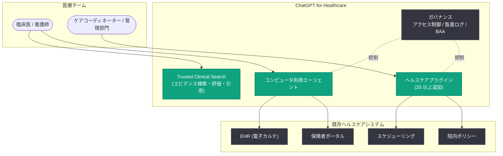

# ChatGPT for Healthcare の進化: コンピュータ利用エージェント、強化された臨床回答、20 以上の新ヘルスケアプラグイン

## メタデータ

| 項目 | 内容 |
|------|------|
| 発表日 | 2026-11-16 |
| ソース | OpenAI News |
| カテゴリ | Product (新機能) |
| 公式リンク | https://openai.com/index/more-ways-to-move-care-forward-with-chatgpt-for-healthcare |

## 概要

OpenAI は 2026 年 11 月 16 日、ChatGPT for Healthcare の大規模なアップデートを発表した。医療チームは診療と運営のために EHR (電子カルテ)、院内ポリシー、スケジューリングシステム、保険者ポータルなど分断された複数システムから情報をつなぎ合わせる必要がある。本アップデートは、こうした既存ソフトウェアを横断して実作業を遂行するためのコンピュータ利用エージェント (computer-use agents) の進化、医学的エビデンスを検索・評価・引用する信頼性の高い臨床検索 (trusted clinical search) の改善、そして 20 以上の新ヘルスケアプラグインの追加という 3 本柱で構成される。

これらの機能により、医療チームは必要な情報を見つけ、医学的エビデンスに基づいた意思決定を行い、すでに使用しているシステム上で次のステップまで実行できるようになる。システム間のナビゲーションに費やす時間を減らし、患者ケアにより多くの時間を使えるようにすることが狙いである。

## 主な内容

### 1. コンピュータ利用エージェントによるヘルスケアシステム横断の作業遂行

医療機関では、ドキュメント作成、ケア調整、管理業務のために、分断されたシステム間で情報を移動させる必要がある。コンピュータ利用エージェントは、画面の読み取り、クリック、入力、アプリケーション間の移動といった操作により、チームがすでに利用しているソフトウェアをナビゲートしてこれらの作業を支援する。

今回の発表内容は以下の通り。

- **より有能・安全・低コストなモデル**: 臨床および管理ワークフロー向けに改良されたモデルを提供
- **アクセス制御と監査ログ**: セキュアなデプロイのための統制機能
- **導入事例**: Abridge、Ambience、Cigna Healthcare、CVS Health などの医療組織がエージェントを導入し、紹介状 (リファラル) の処理、システム間のドキュメント移動、ケアチームが必要とする情報の集約に活用

デモでは、臨床医が ChatGPT アプリの Voice 機能で MRI リクエストのフォローアップを依頼すると、エージェントがカルテを確認し、オーダーと患者への返信のドラフトをレビュー用に作成する様子が紹介されている。

導入にあたって医療機関は、既存アプリケーションをまたぐワークフローから開始し、エージェントがアクセスできるアプリケーションを設定し、人間によるレビューを必須とするステップを明確に定めることができる。保護対象医療情報 (PHI) を扱う HIPAA 準拠ワークフローをサポートするには、OpenAI との BAA (Business Associate Agreement) の対象となる適格サービスを使用し、必要なセキュリティ・保持設定を適用し、接続先システムにも保護を拡張する必要がある。なお、ChatGPT for Healthcare で共有されたコンテンツはモデルの学習には使用されない。

詳細は同日公開の [Advancing computer-use agents for healthcare teams](https://openai.com/index/advancing-computer-use-for-healthcare-teams/) で解説されている。

### 2. より強力な臨床回答: trusted clinical search の改善

ChatGPT for Healthcare と ChatGPT for Clinicians における trusted clinical search が改善された。ChatGPT が医学的エビデンスを「見つけ、評価し、引用する」方法が強化され、臨床医は関連するエビデンスを臨床上の疑問に結び付け、検証可能な引用付きで実践的な次のステップへ変換できるようになる。

**評価結果**: 改善の効果を測定するため、複数の診療科にわたる実際の臨床質問 (マルチターン会話を含む) への回答を医師がブラインド評価した。1,300 件を超えるレビューにおいて、医師は評価対象となった 8 つの側面すべて (事実の正確性、安全性、実行可能性、情報源の権威性などを含む) で、更新後の体験をより高く評価した。

### 3. ヘルスケアツールを 1 つの会話に統合する新プラグイン

臨床ケア、ケア調整、業務オペレーションにまたがる主要企業から 20 以上の新ヘルスケアプラグインが追加された。これらはすべて本日より ChatGPT for Healthcare で利用可能で、EHR ワークフローに ChatGPT を組み込む [ChartGPT](https://openai.com/index/chatgpt-connects-health-records-and-healthcare-sources/) 経由でも利用できる。

**新プラグインの例**:

| プラグイン | 主な領域 |
|-----------|---------|
| Aiva | 院内ポリシー・看護業務 |
| Amion | 医師オンコールスケジュール |
| Assort Health | 紹介状管理・分析 |
| Availity Extend | 保険・ペイヤー連携 |
| Elation Health | EHR |
| Ferry (Ferry Health) | 予約タスク管理 |
| IMO Health MCP Server | 医療用語・プロシージャコード |
| Infinitus Relay | ペイヤー業務自動化 |
| K Health | 臨床支援 |
| Luma Health | 患者アウトリーチ・予約確認 |
| Metriport | 医療データ連携 (退院サマリー等) |
| Notable Integration Specs | 連携仕様 |
| Oracle HDI Overview | ヘルスケアデータ基盤 |
| PenguinAI Medical Coding | 医療コーディング |
| Photon | 処方 |
| Redox | 医療データ連携 |
| Stedi | 保険資格確認 |
| Subsalt | データアクセス |
| Trizetto | 保険資格・給付確認 |
| Turquoise (Turquoise Health) | 医療価格透明性 |
| UpToDate Expert AI | 臨床エビデンス |

これらのプラグインにより、患者記録や院内プロトコルのレビュー、臨床医レビュー用の処方準備、患者アウトリーチの調整、保険資格の確認、医療コストと運営パフォーマンスの分析といった業務を同一の会話内で実行できる。

**記事で紹介された活用例**:

- **ケアコーディネーター**: Luma Health で翌日の未確認予約を抽出し、TriZetto で保険資格を確認して、受診前に解決すべき事項を整理したコールリストを作成
- **プライマリケア医**: 他院で心不全により入院した患者の退院サマリーを Metriport で取得し、変更された薬剤を特定、UpToDate が推奨するフォローアップモニタリングを引用付きで確認
- **入院病棟看護師**: インスリンポンプ持参患者の入院時に、AIVA で院内のポンプポリシー (必要な看護チェックと記録を含む) を参照し、Amion でカバー中の内分泌科医と連絡方法を特定
- **ケアナビゲーター**: IMO Health で膝 MRI のプロシージャコードを特定し、Stedi で保険資格・給付を確認、Turquoise Health で 2 病院それぞれの交渉済み料金を比較して患者の自己負担額を見積もり
- **紹介状マネージャー**: Assort Health で紹介件数・転換トレンド・主要紹介元を要約し、Ferry Health で予約タスクをステータス別に表示して、チームが患者フォローアップの優先順位を決められるブリーフを作成

OpenAI はこのエコシステムへの投資を継続し、より多くのヘルスケア企業に共同開発を呼びかけている。

## アーキテクチャ

## 提供状況と利用開始方法

ChatGPT for Healthcare は、統制されたワークスペースで臨床・研究・管理チームをサポートする。ChatGPT for Clinicians は、米国の適格な認証済み臨床医が医学的エビデンスのレビューと臨床文書の作成に無料で利用できる。いずれの製品も HIPAA 準拠ワークフローをサポートする BAA を OpenAI と締結できる。

- **ChatGPT for Healthcare 顧客**: ChatGPT Work と Codex でのコンピュータ利用エージェント、改善された trusted clinical search は本日より利用可能 (ワークスペース設定に依存)。新プラグインの有効化はワークスペース管理者に依頼する
- **個人の臨床医**: ChatGPT Work と Codex でのコンピュータ利用エージェント、改善された trusted clinical search は本日より利用可能。一部プラグインも利用できる。[ChatGPT for Clinicians の無料アカウント](https://chatgpt.com/plans/clinicians/)から開始可能
- **コンピュータ利用を検討する開発者**: コンピュータ利用エージェント機能は OpenAI API、ChatGPT Work、Codex で利用可能。臨床・管理ワークフローでの活用は[営業チームへの問い合わせ](https://openai.com/contact-sales/)が案内されている

ChatGPT for Healthcare の購入は、OpenAI から直接、または AWS Marketplace のプライベートオファー経由で可能。

## 開発者・医療機関への影響

- **ワークフロー自動化の範囲拡大**: API 連携のない既存ヘルスケアソフトウェアでも、コンピュータ利用エージェントが画面操作ベースで多段階の業務 (紹介状処理、ドキュメント移動など) を自動化できる
- **コンプライアンス統制の組み込み**: アクセス制御、監査ログ、人間によるレビュー必須ステップの設定により、HIPAA 準拠を前提としたエージェント導入が可能。BAA 対象サービスの利用と接続先システムへの保護拡張が要件となる
- **プラグインエコシステムへの参入機会**: OpenAI はヘルスケア企業にプラグイン開発への参加を呼びかけており、臨床・ケア調整・業務オペレーション領域のベンダーにとって ChatGPT 内での提供チャネルが拡大する
- **臨床判断支援の品質向上**: 1,300 件超の医師によるブラインド評価で 8 側面すべての評価が向上しており、引用を検証できる形でのエビデンス活用が実務レベルで強化された
- **データ保護**: ChatGPT for Healthcare で共有されたコンテンツはモデル学習に使用されないため、PHI を含む業務での利用リスクが低減される

## 関連リンク

- [More ways to move care forward with ChatGPT for Healthcare (本記事)](https://openai.com/index/more-ways-to-move-care-forward-with-chatgpt-for-healthcare)
- [Advancing computer-use agents for healthcare teams](https://openai.com/index/advancing-computer-use-for-healthcare-teams/)
- [ChartGPT: ChatGPT connects health records and healthcare sources](https://openai.com/index/chatgpt-connects-health-records-and-healthcare-sources/)
- [ChatGPT for Clinicians (無料サインアップ)](https://chatgpt.com/plans/clinicians/)
- [OpenAI Business Plugins](https://openai.com/business/plugins/)
- [OpenAI 営業チームへの問い合わせ](https://openai.com/contact-sales/)
- [OpenAI News](https://openai.com/news)

## まとめ

本アップデートは、ChatGPT for Healthcare を「質問に答えるツール」から「実作業を遂行するプラットフォーム」へ進化させるものである。コンピュータ利用エージェントは既存ソフトウェアを直接操作して分断されたシステム間の業務を自動化し、改善された trusted clinical search は 1,300 件超の医師評価で 8 側面すべての向上が確認された。さらに 20 以上の新プラグインにより、臨床エビデンス、患者情報、日常業務ツールを 1 つの会話に統合できる。Abridge、Cigna Healthcare、CVS Health などの大手医療組織での導入が進んでおり、BAA、アクセス制御、監査ログといった統制機能により、HIPAA 準拠を前提とした本格的な医療現場での AI エージェント活用が現実のものとなりつつある。
