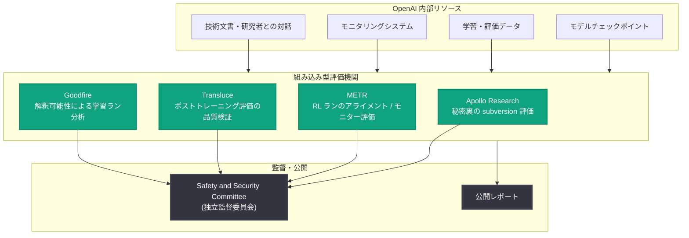

# 組み込み型評価 (Embedded Assessments) の第 1 フェーズ開始

## メタデータ

| 項目 | 内容 |
|------|------|
| 発表日 | 2026-11-16 |
| ソース | OpenAI News |
| カテゴリ | Safety |
| 公式リンク | https://openai.com/index/our-first-phase-of-embedded-assessments |

## 概要

OpenAI は、Apollo Research、METR、Transluce、Goodfire の 4 つの独立評価機関と契約を締結し、「組み込み型評価 (Embedded Assessments)」の第 1 フェーズを開始したことを発表した。組み込み型評価とは、独立した外部の専門家に対してラボ内部のモデルやシステムへの深いアクセスを長期間にわたり提供し、モデルのアライメントやセーフガードの有効性を評価してもらう取り組みである。評価者は、モデルチェックポイント、ソースコード、学習・評価データ、モニタリングシステム、技術文書、担当研究者との対話など、OpenAI の研究者が使用する内部リソースの一部にアクセスできる。

今回の初期評価は、学習中および内部利用中のモデルのアライメントとセーフガードに焦点を当てており、OpenAI のセーフティケース (安全性の論証) を補完するものである。この取り組みは、超知能に関するホワイトハウス合意 (White House Accord on Super Intelligence) における安全管理の独立評価へのコミットメントも支えるものであり、業界全体での独立評価と公開透明性に関する共通基準の強化に貢献することが期待されている。

## 主な内容

### 組み込み型評価とは

組み込み型評価は、独立した専門家がラボの内部モデルとシステムに深くアクセスし、特にセーフティケースに関連する領域において、モデルのアライメントとセーフガードの有効性を長期間にわたり評価する仕組みである。各評価のニーズに応じて、評価者は以下のような内部リソースへのアクセスを得る。

- モデルチェックポイント
- ソースコード
- 学習データおよび評価データ
- モニタリングシステム
- 技術文書
- 担当の研究者・エンジニアとの対話

このアクセスにより、評価者は独立した評価を実施し、OpenAI 自身が予期していなかった失敗を発見するための証拠とコンテキストを得ることができる。この取り組みは、第三者評価に関する優先事項と原則、および長年にわたる第三者評価者との協働 (内部モニタリングシステムのパイロット評価や Hugging Face インシデントの調査を含む) の上に構築されている。

### 4 つのパイロット評価機関と各評価の内容

#### Apollo Research: 秘密裏の subversion (破壊的行動) の評価

Apollo Research は、モデルが開発者の意図に反して秘密裏に行動する可能性と、OpenAI のセーフガードがそのような行動を検出できるかを評価する。学習、安全性テスト、内部利用から得られる証拠に基づき、2 段階で以下の 4 つの主張を検証する。

1. 学習が subversion (破壊的行動) を動機づけていないこと
2. 強力な評価とレッドチーミングでも subversion を誘発できないこと
3. 内部利用中にモデルが subversion を試みていないこと
4. subversion の背後にある推論が検出可能であること

第 1 段階では、公開・未公開モデルや学習チェックポイント、関連する学習データと評価結果、学習介入の記録、モニタリングシステムとフラグされた挙動、コンテキストを提供できる研究者へのアクセスに加え、独立したテストに必要なツールと計算資源が提供される。

#### Goodfire: 解釈可能性による学習ランのモニタリング

Goodfire は解釈可能性 (interpretability) の研究者を OpenAI に組み込み、Goodfire プラットフォームを用いてモデル内部を分析する。評価の主目的は学習ランのモニタリング、デバッグ、アライメントである。評価結果の主な利用者は OpenAI 内部の研究者であり、その知見を安全性改善に活用する。Goodfire はコラボレーションの進展に応じて学びと発見を公開する予定である。

#### METR: アライメント評価とモニター評価

METR とは 2 つの評価を実施する意向が示されている。

- **アライメント評価**: 第 1 フェーズでは、OpenAI 史上最大の強化学習 (RL) ランにおけるミスアライメント挙動を評価する。これには既存のテストやモニターが見逃した可能性のある失敗も含まれる。合意されたアクセス・リソース・安全性の取り決めの範囲内で、METR は独立して評価の優先順位を設定し、探索・分析・引き出し (elicitation) 実験を反復する。アクセスには、関連チェックポイントのサンプリング、学習・評価のロールアウト、当該ランのミスアライメントモニタリング記録が含まれる。
- **モニター評価**: 最近実施したモニターのストレステスト演習に続き、より広範なモニター評価を実施することで暫定的に合意している。ただし評価スコープについては相互合意が保留中である。

#### Transluce: ポストトレーニングのアライメント評価の品質検証

Transluce は、OpenAI のポストトレーニング (post-training) アライメント評価の品質とカバレッジを検証する初期評価を実施する。公開・未公開モデル、ポストトレーニングのアライメント評価と関連結果、モデル挙動データとセーフティケース文書、研究者へのアクセスに加え、独立したテストに必要なツールと計算資源が提供される。

さらに OpenAI と Transluce は、2027 年初頭に約 8 週間のフォローアップ評価を実施する意向を共有している。この評価では、追加モデルへのより広いアクセス、アライメント評価へのより深いアクセス、評価結果がモデルリリース判断にどう反映されるかの情報が提供される予定である。

### 組み込み型評価のプロトコル

OpenAI は評価者からの意見を取り入れ、深いアクセスとセキュリティ・機密性・監督・評価の独立性と完全性のバランスを取るためのプロトコルとプロセスを策定した。まだ標準化されていない組み込み型評価の規範に関する議論を進めるため、これらを公開している。

- **スコープ設定と反復**: 各エンゲージメントは、合意されたスコープと、厳密な評価に必要なアクセス・リソース・安全性の取り決めから始まる。特定の安全性主張をテストする評価もあれば、定義されたシステムや学習ランの中で予期しない失敗モードを発見する余地を評価者に与える評価もある。モデルの重みやアーキテクチャなど最も機密性の高い IP への直接アクセスが必要な場合は、評価者と OpenAI 研究者をペアにして分析を実行するなどの代替手段を検討する。
- **安全なオンサイト環境**: 機密情報へのアクセスが必要な評価者は、OpenAI のオフィスでオンサイト作業を行い、OpenAI のデバイスが提供される。評価者には、実験や評価の実行時に最低限 OpenAI 従業員と同等のセキュリティ基準に従うことが求められる。
- **監督と紛争解決**: OpenAI Foundation の理事会の独立監督委員会である Safety and Security Committee (SSC) が、評価の前・最中・終了時に監督責任を行使できる。SSC は編集されていない報告書を受け取り、評価者と SSC は評価期間中に非公開も含めて相互に対話できる。OpenAI と評価者の間の意見の相違は Safety Advisory Group と OpenAI 幹部にエスカレーションされ、指定期間内に解決されない場合は SSC に付託される。
- **従業員との対話と attestation (証明)**: OpenAI は評価者と話せるスタッフを承認・ガイダンス提供し、対話はオフレコ (評価には活用できるが、公開や従業員への帰属は不可) とする。別途の attestation 経路を通じて、評価者は従業員との会話で得た情報を検証・修正・明確化する OpenAI 証明済みステートメントを要求でき、OpenAI が証明したステートメントの公開、または OpenAI が証明を拒否した事実の開示が可能である。
- **利益相反の開示とクールオフ期間**: 個人的関係や金銭的利害を含む利益相反を明確かつ透明に管理する。評価者が競合情報を慎重に扱いながら複数のラボで責任を持って働けるよう、クールオフ期間の設計も含め、明確なプロセスを評価者と共同で策定中である。
- **公開と責任ある開示期間**: 評価者は評価結果の公開において独立性を維持するが、OpenAI は機密情報を編集 (redact) する権利を保持する。セキュリティや安全性のリスクをもたらす可能性のある発見については、対応と修復の時間を確保するため、責任ある開示の遅延を要請する場合がある。

## 技術的な詳細

組み込み型評価の全体構造は以下のとおりである。各評価機関が異なる専門性で OpenAI の内部システムを評価し、その結果が SSC による監督と公開レポートにつながる。

## 開発者への影響

本発表は API の変更ではなく安全性ガバナンスに関するものだが、OpenAI のモデルを利用する開発者・組織にとって以下の意味を持つ。

- **モデルの信頼性に関する独立した検証**: 利用するモデルのアライメントとセーフガードが、OpenAI 内部だけでなく独立した第三者によって検証されるため、安全性主張の信頼性を判断する材料が増える
- **公開レポートによる透明性向上**: 評価者が独立して評価結果を公開するため、フロンティアモデルのリスクがどのように特定・対処されているかを外部から確認できるようになる
- **業界標準の形成**: 組み込み型評価のプロトコル (オンサイト環境、attestation、紛争解決など) が公開されており、AI 業界全体の独立評価の規範形成に影響を与える可能性がある
- **今後の拡大**: 第 1 フェーズを踏まえ、安全フレームワークへの準拠や組織文化・プロセスを対象とする将来の組み込み型評価も検討されており、より広範な安全性の検証が期待される

## 関連リンク

- [Our first phase of embedded assessments (公式発表)](https://openai.com/index/our-first-phase-of-embedded-assessments)
- [Towards safety cases for frontier AI training](https://openai.com/index/towards-safety-cases-for-frontier-ai-training/)
- [Priorities and principles for third party assessments](https://openai.com/index/priorities-principles-third-party-assessments/)
- [Strengthening safety with external testing](https://openai.com/index/strengthening-safety-with-external-testing/)
- [METR: Red teaming OpenAI agent monitoring](https://metr.org/blog/2026-10-22-red-teaming-openai-agent-monitoring/)
- [METR: OpenAI Hugging Face incident investigation](https://metr.org/blog/2026-08-26-openai-hugging-face-incident-investigation/)
- [OpenAI News](https://openai.com/news)

## まとめ

OpenAI は Apollo Research、METR、Transluce、Goodfire の 4 機関と契約し、独立した専門家が内部モデル・システムに深くアクセスして安全性を評価する「組み込み型評価」の第 1 フェーズを開始した。Apollo Research は秘密裏の subversion の検証、METR は最大規模の RL ランのミスアライメント評価とモニター評価、Transluce はポストトレーニングのアライメント評価の品質検証、Goodfire は解釈可能性によるモデル内部の分析をそれぞれ担当する。評価の独立性とセキュリティを両立するプロトコル (オンサイト環境、SSC による監督、attestation、責任ある開示期間など) も公開されており、超知能に関するホワイトハウス合意のコミットメントを支え、業界全体の独立評価と透明性の共通基準の形成につながる取り組みである。OpenAI は今後数ヶ月でより広範な安全性の問いに対する外部評価を支援し、長期的・継続的な組み込みエンゲージメントへの発展を見込んでいる。
