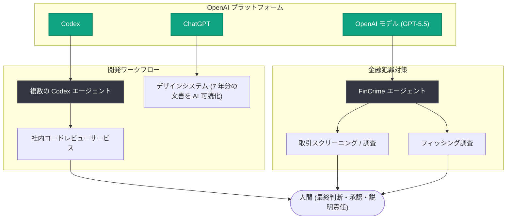

# Revolut が基準を下げずに野心を高める方法: OpenAI モデルと Codex の全社活用事例

## メタデータ

| 項目 | 内容 |
|------|------|
| 発表日 | 2026-11-16 |
| ソース | OpenAI Customer Stories |
| カテゴリ | 顧客事例 (Customer Story) |
| 公式リンク | https://openai.com/business/customer-stories/revolut |

## 概要

フィンテック企業 Revolut が、OpenAI のモデルと Codex を全社的に活用し、コーディング時間を 30〜60% 削減するとともに、金融犯罪 (FinCrime) 調査をスケールさせた事例が公開された。Revolut は 40 以上の市場で事業を展開し、80 万のビジネス顧客を抱え、消費者ベースは過去 12 か月で 23% 成長している。少人数のリーンなチームが迅速に動く文化を持ち、「平均的な従業員は 3 つの異なる仕事を持つ」と言われる同社にとって、AI は人的リソースの制約を超えてスケールするための中核的な手段となっている。

本事例の特徴は、スピードを「基準を下げる」ためではなく「野心を高める」ために使うという明確な方針にある。AI が提案したコード変更にはエンジニアが責任を持ち、フィッシング調査の最終判断は人間が行うなど、人間の説明責任 (アカウンタビリティ) を維持したまま AI 活用を全社に浸透させている点が注目される。

## 主な内容

### 導入の背景: 人間のスケーリングと需要のギャップ

Revolut の AI リードである David Abitbol 氏は、「今日 AI で取り組める最大の問題は、人間のスケーリングと我々が受ける需要のギャップだ (The biggest problem we can tackle with AI today is the scaling of humans versus the demand that we get)」と述べている。取引量の増大に対して調査員などの人的リソースの増員が追いつかないことが課題であり、外部報告では 2025 年に世界の成人の半数超が詐欺に遭遇したとされる状況が背景にある。

### Codex による開発の高速化: コーディング時間を 30〜60% 削減

Revolut では ChatGPT と Codex を全社的に活用しており、タスク開始から機能のマージまでのコーディング時間を 30〜60% 削減した。具体的な成果は以下の通り。

- **マルチエージェントによる開発委任**: シニアプラットフォームエンジニアの Dmitry Pitik 氏は、1 人で複数の Codex エージェントに実装を委任し、社内コードレビューサービスを構築した。同氏は「開発者のチーム全体は必要ないと気づいた。異なるエージェントを起動してタスクを割り当てればよい (I realised I don't need a whole team of developers. I can just launch different agents and assign them a task)」と語っている
- **デザインシステムの AI 可読化**: 約 7 年分のデザインシステム文書を、わずか 1 日で AI が読み取れるコンテキストに変換した
- **セキュリティコードレビューの効率化**: 大規模なセキュリティコードレビュータスクで 1〜2 日を節約した

### FinCrime エージェントによる金融犯罪調査のスケール

OpenAI モデルを搭載した FinCrime エージェントが、金融犯罪の調査とスクリーニングを自動化している。調査員を 1 対 1 で増員することなく、より多くの取引を審査できるようになった。記事では GPT-5.5 が能力とコスト効率の面で転換点となり、スクリーニングと調査のワークフローをエージェントに完全に委任できるようになったと述べられている。

フィッシング調査では、従来は手作業だったメール・リンク・添付ファイル・送信者の追跡を AI が即座に実行する。ただし、最終判断と承認は人間が行う体制を維持している。

### セキュリティと信頼性: 説明責任を軸にした AI ガバナンス

情報セキュリティエンジニアの Mo Amiri 氏は「最も重要な決定は常に説明責任に関するものだ (The most critical decision is always about accountability)」と述べ、信頼構築には導入前の慎重な判断と継続的なテストが重要だと説明している。具体的な取り組みは以下の通り。

- **新規 AI アプリ導入時の審査**: システムが見る情報、情報の行き先、アクセス可能なツール、失敗時の挙動まで、チェーン全体を検証する
- **コード変更への責任**: AI が提案したコード変更は、エンジニアが内容を十分に理解して責任を持てることを前提とする。Pitik 氏は「我々は AI を盲目的に信頼しない (we don't blindly trust AI)」と強調している
- **全社統一の品質基準**: 開発、A/B テスト、ビジネス指標予測に関する統一基準をすべてのエンジニアに適用し、全社共通の AI 開発標準フレームワークを整備している

### 人材観と組織文化

グローバルビジネスマーケティング責任者の Kim Maniovich 氏は、優秀な人材とは「問題を素早く特定し、解決策を導き、複数のシナリオから最善を選んで市場に出す人物」だと説明し、OpenAI との提携により「リーンでコスト効率が高い」ソリューション構築が可能になったと述べている。シニアデザイナーの Dmytro Pavlov 氏は、AI なしでは困難だった重要作業から解放され、顧客にとって本当に重要なことへ焦点を移せるようになったと語っている。

## アーキテクチャ

Revolut における AI 活用の全体像を以下に示す。

## 開発者・企業への影響

本事例は、規制の厳しい金融業界においても AI エージェントを実務の中核に組み込めることを示しており、以下の示唆がある。

- **マルチエージェント開発の実用性**: 1 人のエンジニアが複数の Codex エージェントにタスクを委任して開発を進めるワークフローが、実際のプロダクション環境で成果 (コーディング時間 30〜60% 削減) を上げている
- **組織知識の AI 可読化の価値**: 7 年分のデザインシステム文書を 1 日で AI 向けコンテキストに変換した例のように、既存の組織知識を AI が使える形に整備することが活用の前提条件となる
- **説明責任を維持した AI ガバナンス**: AI の出力を盲目的に信頼せず、最終判断と承認を人間が担う体制は、金融をはじめとする規制産業での AI 導入のリファレンスとなる
- **リーダーシップの教訓**: 記事では (1) 解決する価値のある問題から始める、(2) スピードは基準を下げるためでなく野心を高めるために使う、(3) 人間の説明責任を維持する、(4) スケールの前に信頼を構築する、(5) 組織の知識を AI が使える形に整備する、の 5 点が挙げられている

## 今後の展望

- Abitbol 氏は、カードの凍結、サブスクリプション管理、旅行資金の貯蓄支援など、日常的な金融タスクを対話型インターフェースで実現する構想を語っている
- Pavlov 氏は、その裏側にあるデザイン課題として、複雑さを一貫性のある使いやすい体験に変えることを挙げている
- Maniovich 氏は、「妥協しない野心」という企業価値を、製品を通じて顧客自身の生活にも適用できるようにしたいと述べている
- 記事は、AI によって構築が容易になるほど「何を作るか」の判断力と顧客理解が差別化要因になると結論づけている

## 関連リンク

- [Revolut 顧客事例 (OpenAI 公式)](https://openai.com/business/customer-stories/revolut)
- [Codex](https://openai.com/codex/)
- [OpenAI for Business](https://openai.com/business/)
- [OpenAI News](https://openai.com/news)

## まとめ

Revolut は OpenAI のモデルと Codex を全社的に活用し、コーディング時間を 30〜60% 削減、FinCrime エージェントによる金融犯罪調査のスケール、7 年分のデザイン文書の 1 日での AI 可読化といった成果を上げた。GPT-5.5 が能力とコスト効率の転換点となり、スクリーニングと調査のワークフローをエージェントへ完全委任できるようになった点も重要である。同時に、AI を盲目的に信頼せず人間の説明責任を維持するガバナンスを徹底しており、「スピードを基準の引き下げではなく野心の引き上げに使う」という姿勢は、規制産業で AI を導入する企業にとって有力なモデルケースとなる。
