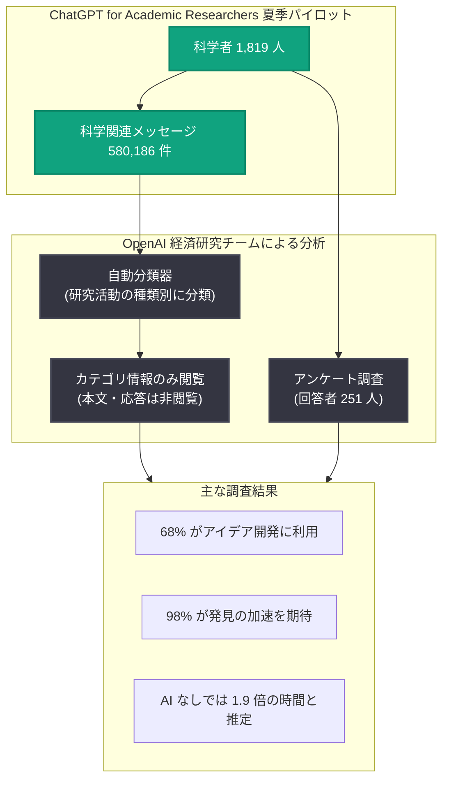

# Science at the Frontier: 科学者 1,800 人超による ChatGPT 活用の実態調査

## メタデータ

| 項目 | 内容 |
|------|------|
| 発表日 | 2026-11-16 |
| ソース | OpenAI Research |
| カテゴリ | 研究成果 |
| 公式リンク | https://openai.com/index/science-at-the-frontier |

## 概要

OpenAI の経済研究チーム (Economic Research) が、「ChatGPT for Academic Researchers」夏季パイロットに参加した 1,819 人の科学者による 580,186 件の科学関連メッセージを分析し、さらに 251 人へのアンケート調査を実施した研究レポート「Science at the Frontier」を公開した。科学者が文献レビューからエビデンス分析、コード作成、研究アイデアの開発、研究成果の伝達に至るまで、研究プロセス全体で ChatGPT をどのように利用しているかを定量的に明らかにしたものである。

調査の結果、回答者の 98% が自分野における科学的発見を AI が加速すると期待しており、ChatGPT で行った作業と同じ品質の作業を AI なしで行った場合、約 1.9 倍の時間がかかると推定していることが示された。AI が科学研究の日常業務に組み込まれつつある現状を、実際の利用データに基づいて示した点が重要である。

## 主な内容

### 調査の規模と方法

本調査は以下の 2 つのデータソースに基づいている。

| 項目 | 内容 |
|------|------|
| メッセージ分析 | 1,819 人の科学者による 580,186 件の科学関連メッセージ |
| メッセージ分析期間 | 2026 年 8 月 20 日〜9 月 22 日 |
| アンケート調査 | 251 人が回答 (質問により回答数は変動) |
| アンケート実施期間 | 2026 年 9 月 30 日〜10 月 7 日 |
| 対象プログラム | ChatGPT for Academic Researchers 夏季パイロット |

プライバシー保護のため、メッセージは自動分類器によって研究活動の種類 (文献レビュー、コード作成、データ分析など) 別に分類され、研究チームはカテゴリ情報のみを閲覧し、メッセージ本文や ChatGPT の応答は一切読んでいない。また、参加者のデータはデフォルトでモデルの学習に使用されない。集計では各科学者のメッセージの活動別割合を算出し、科学者ごとに等しい重みで平均化している。

### AI は科学者の日常業務の一部になっている

科学者は文献レビュー、エビデンス分析、コードの作成、アイデアの開発、研究成果の伝達など、研究プロセス全般にわたって ChatGPT を利用していた。AI は特定のタスク専用のツールではなく、研究ワークフロー全体に広く組み込まれていることがデータから示された。

### 68% の科学者が研究アイデアの開発に ChatGPT を利用

科学者の 68% が研究アイデアの開発に ChatGPT を利用しており、その関わり方は次の 3 パターンに分類された。

| アイデア開発のスタイル | 割合 | 内容 |
|----------------------|------|------|
| 科学者主導 | 35% | 具体的な質問や課題を科学者自身が持ち込む |
| 共同開発 | 36% | 自分のアイデアを持ち込み、ChatGPT に改良を依頼する |
| ChatGPT による提案 | 23% | ChatGPT に研究課題の提案を依頼する |
| その他 (分類不能) | 6% | - |

科学者主導と共同開発を合わせると 71% となり、多くの場合、科学者が主体性を保ちながら AI を思考のパートナーとして活用している実態がうかがえる。

### 98% の科学者が AI による発見の加速を期待

発見のタイムラインに関する質問に回答した科学者のうち 98% が、AI によって自分野の科学的発見が加速すると期待していた。この質問では、「AI なしで 10 年かかる発見が AI によってどれだけ短縮されるか」を 250 人の科学者に推定してもらっている (複数分野の選択が可能)。

また、ChatGPT で行った作業と同じ品質の作業を AI なしで行った場合、約 1.9 倍の時間がかかると回答者は推定しており、体感としての生産性向上が具体的な数値として示された。

### タスクを委任した後も科学者は関与を続ける

ChatGPT にタスクを委任した後も、科学者は明確化・確認・修正のためのフォローアップを行っており、研究活動の種類ごとに「各科学者のリクエストのうちフォローアップにつながった平均割合」が測定された。これは、科学者が AI の出力を鵜呑みにせず、検証と修正のループに積極的に関与していることを示している。

### AI はどのように科学の進歩に貢献しうるか

発見の加速を期待する理由について、224 件の自由記述回答から 367 件の理由が特定され、以下のように分類された (複数回答可)。

| 理由 | 割合 |
|------|------|
| 研究をより速く完了できる | 52% |
| より有望な研究課題を発見できる | 23% |
| より幅広い課題を追求できる | 14% |
| その他 | 11% |

単なる時間の節約にとどまらず、「より有望な研究課題の発見」や「より幅広い課題への取り組み」といった、研究の質と範囲の拡大への期待が合計 37% を占めている点が注目される。

抗菌薬研究者の César de la Fuente 氏は「ChatGPT のようなツールは科学的発見の加速に役立っている」と述べ、こうしたツールを科学者にとっての遊び場のような存在だと表現している。

## 調査の全体像

## 開発者・研究者への影響

- **研究ワークフローへの AI 統合の裏付け**: 文献レビュー、コード作成、データ分析、アイデア開発など研究プロセス全般での活用パターンが定量データで示され、研究機関での導入判断の参考になる
- **人間主導の協働モデル**: 科学者の多くが主体性を保ちつつ ChatGPT を利用し、委任後もフォローアップを継続していることから、「AI に任せきり」ではない検証付きワークフローの重要性が示された
- **アクセス拡大**: OpenAI は「ChatGPT for Academic Researchers」を拡大し、世界中の 20 万人超の研究者に無料アクセスを提供している
- **留意点**: 本調査の期待値 (発見の加速) が実際の成果につながるかは今後の検証が必要であり、記事自体も科学の進展には資金・人員・実験能力が不可欠であると指摘している

## 関連リンク

- [Science at the Frontier (公式記事)](https://openai.com/index/science-at-the-frontier)
- [Expanding ChatGPT for Academic Researchers](https://openai.com/index/expanding-chatgpt-for-academic-researchers/)
- [Accelerating antibiotic discovery](https://openai.com/index/accelerating-antibiotic-discovery/)
- [OpenAI Research](https://openai.com/research)
- [OpenAI News](https://openai.com/news)

## まとめ

OpenAI の経済研究チームによる本調査は、1,819 人の科学者の 580,186 件のメッセージ分析と 251 人へのアンケートに基づき、ChatGPT が科学研究の日常業務に深く組み込まれている実態を明らかにした。68% の科学者が研究アイデアの開発に利用し、98% が AI による発見の加速を期待、AI なしでは同品質の作業に約 1.9 倍の時間がかかると推定されている。一方で、科学者はタスクの委任後も検証・修正に関与し続けており、AI と人間の協働による研究スタイルが定着しつつあることを示すデータとなっている。プライバシーに配慮した自動分類による分析手法も、利用実態調査のモデルケースとして注目される。
