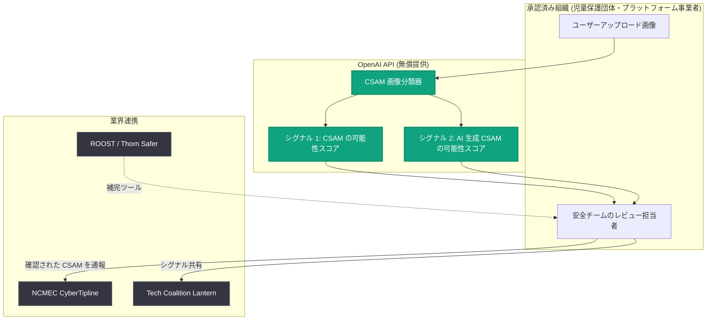

# オンラインの児童性的虐待対策を強化する新ツールと支援策

## メタデータ

| 項目 | 内容 |
|------|------|
| 発表日 | 2026-11-16 |
| ソース | OpenAI News / API Changelog |
| カテゴリ | Safety (安全性) |
| 公式リンク | https://openai.com/index/strengthening-online-child-safety |

## 概要

OpenAI は、児童性的虐待コンテンツ (CSAM: Child Sexual Abuse Material) を検出する新しい画像分類器、有害な行動を中断させ支援につなげる介入機能、開発者向けの実践的ガイダンス、児童保護に取り組む法執行機関への支援を発表した。これらの取り組みは、同社の「Child Safety Blueprint」および虐待の検出・ブロック・通報に関する継続的な活動を基盤とするものである。

同日の API Changelog では、承認済み (vetted) 組織向けに OpenAI CSAM 画像分類器を OpenAI API 経由で**無償提供**することが告知された。この分類器は「CSAM の可能性」と「AI 生成 CSAM の可能性」を別々のシグナルとして返す点が特徴で、AI 生成 CSAM を示す専用シグナルを持つ分類器として広く利用可能になるのは初めてである。

## 主な内容

### 新しい CSAM 画像分類器の提供

OpenAI は、AI 生成コンテンツを含む潜在的な CSAM を検出できる新しい画像分類器をリリースした。主な特徴は以下のとおり。

- **視覚的な虐待の兆候を検出**: 既知のハッシュ照合では見つからない、これまで確認されたことのない新規 (novel) 画像の特定を支援する
- **スコアベースの優先順位付け**: レビュー担当者がどの画像を優先的に確認すべきかを判断できるスコアを返す
- **AI 生成 CSAM の専用シグナル**: CSAM の可能性と AI 生成である可能性を個別のシグナルで返す。この機能を備えた広く利用可能な CSAM 分類器としては初
- **無償提供**: 審査を経た承認済み組織に対し、OpenAI API を通じて無償でアクセスを提供。規模の異なるチームを含む児童保護団体や業界全体での CSAM 検出を容易にする

分類器の訓練・評価・実運用設計は、CyberTipline (児童のオンライン搾取に関する一元的な通報窓口) を運営する非営利団体 **NCMEC (National Center for Missing and Exploited Children)** の協力を得て行われた。また、ツールへのアクセス共有のために **Tech Coalition** と **ROOST** と連携しており、Thorn の Safer など他社の検出ツールも支持している。さらに OpenAI は最近、Tech Coalition の **Lantern プログラム**に参加し、オンラインの児童性的搾取・虐待に関するシグナルをプラットフォーム間で共有・受領してクロスプラットフォーム連携を強化している。

### 評価結果

ユーザーがアップロードした画像を対象とした評価で、新分類器を既存の保護機構と比較した結果は以下のとおり。

| 指標 | 結果 |
|------|------|
| レビュー作業の削減 | 既存ツールとほぼ同数の虐待画像を発見しつつ、フラグ数を **48%** 削減と推定 |
| フラグの精度 | 新分類器がフラグした画像は、虐待を含む可能性が約 **2 倍** |
| fal (早期パートナー) | 人手レビュー済み本番画像で、高信頼度フラグの **72%** が新規 CSAM と確認 |
| invideo AI (早期パートナー) | フラグされたケースの 4 件に 1 件がアカウント BAN に至った |
| SafetyKit (早期パートナー) | 児童を性的に描写するイラスト・アニメーションの **90%** を検出 |

詳細は [CSAM classifier model card](https://deploymentsafety.openai.com/csam-image-classifier) で公開されており、利用を希望する組織は[申請フォーム](https://openai.com/form/csam-classifier-intake/)からアクセスをリクエストできる。

### 有害な行動の中断と支援への誘導

OpenAI は従来から CSAM を禁止し、モデルに要求を拒否するよう訓練し、ポリシー違反アカウントに措置を講じてきた。今回、ChatGPT に新しい**製品内警告**を追加し、虐待コンテンツを探す試みを中断させる仕組みを導入した。

- 警告では、児童の性的描写は AI 生成であっても害を及ぼすことを明示する
- 警告と併せて、該当する会話を削除し、ChatGPT へのアクセスを **24 時間停止**する
- 有害な行動をやめるための専門的支援 (specialist support) への案内は引き続き利用可能
- 違反を繰り返した場合は、より長期の制限、最終的にはアカウント閉鎖や当局への通報につながる可能性がある

このアプローチは、児童性的虐待の防止プログラムを研究・開発する組織や学術アドバイザーの助言を得て設計された。協力者には Protect Children、Lucy Faithfull Foundation、ケント大学の Caoilte Ó Ciardha 博士、抑止メッセージの試験を独立評価したタスマニア大学の Joel Scanlan 氏が含まれる。

### 開発者向けの実践的ガイダンス

OpenAI は [CSAM guidance](https://developers.openai.com/api/docs/guides/csam-guidance) を公開し、虐待の防止、有害コンテンツの検出、対処のための実践的なステップを開発者に提供した。Tech Coalition、Thorn、NCMEC、Internet Watch Foundation (IWF) の助言を受けて作成され、安全システム構築の段階が異なる組織に対応している。

ガイダンスの内容は以下のとおり。

- 明確なルールの策定方法
- ユーザーが懸念を報告できる仕組み
- 検出ツールと、疑わしい虐待のレビュー・通報プロセス
- **safety identifier** を使って不正利用を個々のユーザーに紐づける方法
- センシティブなコンテンツをレビューする担当者を支援する方法

開発者はこのガイダンスを、新しい画像分類器、[Moderation API](https://developers.openai.com/api/docs/guides/moderation)、ROOST のセルフホスト型レビューコンソール Coop、Thorn の Safer などの専用 CSAM 検出サービスと組み合わせて利用できる。

また OpenAI は Anthropic および Google と共同で、AI システムにおける児童性的搾取・虐待の開示 (disclosure) への対応に関する新しいガイダンスを Tech Coalition に委託し、最近公開された。すでにこのガイダンスにより、児童保護ツールにアクセスし NCMEC への CSAM 通報に登録する開発者が増加している。

### 児童保護を担う法執行機関への支援

児童保護専門の捜査官に対して、AI を捜査に活用するための新しいツールとトレーニングを提供する。

- **専用プラグイン・捜査ツール・複雑なデータ分析**を提供し、アクセスはプログラム管理者が管理
- 最初のツールは、長大なチャットログや法的手続きの回答資料のレビュー、潜在的な関連性の特定、タイムラインの作成を支援し、分析結果は出典資料にリンクされる
- 初回トレーニングは概要とデモンストレーションで構成され、実務で参照できるフィールドガイドが付属する
- アクセスには機関の認可とプログラム要件が必要
- 今後のトレーニングは、地域・国・国際会議での実施が提案される予定

## 技術的な詳細

### API Changelog (2026-11-16) の更新内容

OpenAI API Changelog では、本発表に対応する以下の更新が告知された。

- **OpenAI CSAM 画像分類器**を、承認済み (vetted) 組織向けに OpenAI API 経由で**無償提供**
- 分類器は 2 つの独立したシグナルを返す。
  1. 画像が **CSAM である可能性**を示すシグナル
  2. 画像が **AI 生成 CSAM である可能性**を示すシグナル
- アクセスには[申請フォーム](https://openai.com/form/csam-classifier-intake/)からのリクエストと審査が必要

## アーキテクチャ

## 開発者への影響

- **無償の CSAM 検出手段の獲得**: 審査を通過した組織は、OpenAI API 経由で CSAM 画像分類器を無償利用でき、小規模チームでも高度な検出体制を構築しやすくなる
- **AI 生成 CSAM への対応**: AI 生成 CSAM を示す専用シグナルにより、生成 AI 時代特有の新規コンテンツへの対策が可能になる
- **レビュー負荷の軽減**: フラグ数を約 48% 削減しつつ同等の検出力を維持できるため、レビュー担当者の作業量と有害コンテンツへの曝露を減らせる
- **実装の道しるべ**: 公開された CSAM guidance により、ルール策定から NCMEC への通報までのプロセスを段階的に整備できる
- **ChatGPT 利用ポリシーの明確化**: CSAM を探す試みには警告・会話削除・24 時間のアクセス停止が適用され、繰り返せばアカウント閉鎖や当局への通報に至る

## 関連リンク

- [公式発表: Strengthening the fight against online child safety](https://openai.com/index/strengthening-online-child-safety)
- [CSAM classifier model card](https://deploymentsafety.openai.com/csam-image-classifier)
- [CSAM 分類器アクセス申請フォーム](https://openai.com/form/csam-classifier-intake/)
- [CSAM guidance (開発者向け)](https://developers.openai.com/api/docs/guides/csam-guidance)
- [Moderation API ガイド](https://developers.openai.com/api/docs/guides/moderation)
- [Child Safety Blueprint](https://openai.com/index/introducing-child-safety-blueprint/)
- [Combating online child sexual exploitation and abuse](https://openai.com/index/combating-online-child-sexual-exploitation-abuse/)
- [Tech Coalition: AI システムにおける CSEA 開示対応ガイダンス](https://technologycoalition.org/resources/responding-to-child-sexual-abuse-disclosures-in-ai-systems/)
- [OpenAI API Changelog](https://platform.openai.com/docs/changelog)

## まとめ

OpenAI は、(1) AI 生成 CSAM 専用シグナルを持つ初の広く利用可能な CSAM 画像分類器の無償提供、(2) ChatGPT での警告・24 時間アクセス停止による有害行動の中断と支援への誘導、(3) 開発者向け CSAM ガイダンスの公開、(4) 法執行機関向けの捜査支援ツールとトレーニング、という 4 本柱で児童保護対策を強化した。NCMEC、Tech Coalition、ROOST、Thorn などとの業界横断の連携を前提とし、評価ではレビュー対象を 48% 削減しつつ同等の検出力を維持、フラグ画像の虐待含有率は約 2 倍という結果が示されている。承認済み組織は API 経由で分類器を無償利用でき、CSAM と AI 生成 CSAM を個別のシグナルで判定できる点が大きな特徴である。
