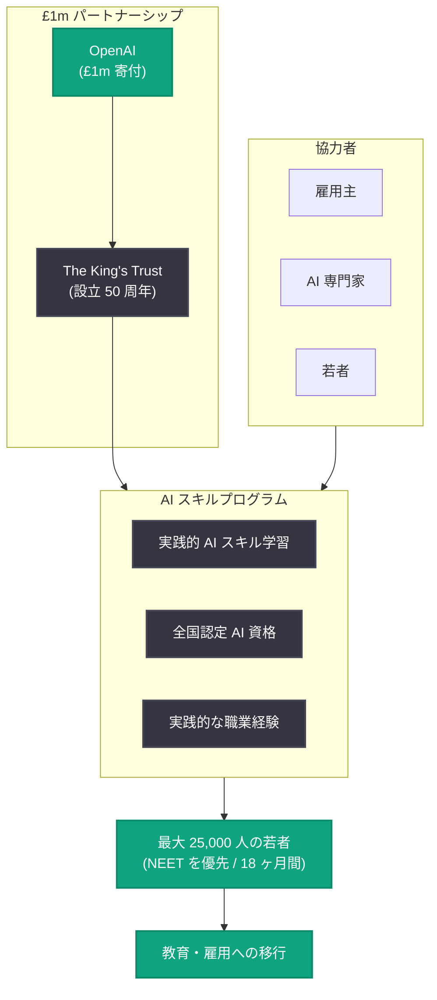

# The King's Trust と OpenAI が 100 万ポンドのパートナーシップを開始

## メタデータ

| 項目 | 内容 |
|------|------|
| 発表日 | 2026-11-16 |
| ソース | OpenAI News |
| カテゴリ | Global Affairs (社会貢献 / AI スキル教育) |
| 公式リンク | https://openai.com/index/the-kings-trust-and-openai |

## 概要

英国の若者支援チャリティ団体 The King's Trust と OpenAI は、英国全土の若者が仕事に役立つ実践的な AI スキルを身につけることを支援する 100 万ポンド (£1m) のパートナーシップを開始した。OpenAI は同団体に 100 万ポンドを寄付し、今後 18 ヶ月間で最大 25,000 人の若者を支援する。特に、教育・雇用・職業訓練のいずれにも参加していない若者 (NEET) を優先的に対象とする。

この発表は、The King's Trust が設立 50 周年を迎えるタイミングで行われたもので、AI が浸透する経済の中で次世代が成功するためのスキルと自信を獲得できるよう支援するという、同団体の将来に向けた取り組みの一環である。

## 主な内容

### パートナーシップの骨子

- **寄付額**: OpenAI が The King's Trust に 100 万ポンドを寄付
- **対象規模**: 今後 18 ヶ月間で最大 25,000 人の若者を支援
- **優先対象**: 教育・雇用・職業訓練に参加していない若者 (NEET)
- **目的**: AI が組み込まれた経済 (AI-enabled economy) で教育や雇用へ移行するための実践的スキルと自信の育成

### 全国的に認定される AI 資格プログラム

このパートナーシップは、The King's Trust が今後数ヶ月以内に開始する、全国的に認定される AI 資格 (nationally recognized AI qualifications) の広範なプログラムの一部に位置づけられる。AI スキルの学習機会を、認定資格と実践的な経験と組み合わせることで、急速に変化する労働市場の機会と課題に若者が備えられるようにする。

The King's Trust は、雇用主、AI 専門家、若者と協力しながら、AI が日常業務の一部となる労働環境で若者に必要となるスキルを検討しており、それらを既存プログラムに組み込まれている就業スキル (employability skills) とどのように補完できるかを模索している。

### 背景: 若者の AI 経験のギャップと学習意欲

プログラムは、若者の AI 経験におけるギャップに対処すると同時に、彼らの学習意欲に応えることを目指している。The Open University の Business Barometer 2026 の調査によると、教育・雇用・職業訓練に参加していない 16〜24 歳の回答者のうち 68% が、就職の見通しを改善するために訓練やスキルアップに取り組む意思があると回答している。

### 50 年の実績と今後の展望

The King's Trust は 50 年にわたり 130 万人以上の若者を支援してきた実績を持つ。独立調査「Young People and Work review」の最終報告に先立ち、Alan Milburn 氏 (Rt Hon) は、若者の学習と収入の機会を改善するという共通の志を踏まえ、このパートナーシップを歓迎するコメントを寄せた。

### OpenAI にとっての位置づけ

OpenAI にとって本パートナーシップは、若者が AI の恩恵を受けるためのスキルと自信を育むことを支援する、より広範なコミットメントの一環である。学生、求職者、その他の学習者向けに無料の学習リソースを提供する [OpenAI Academy](https://openai.com/global-affairs/scaling-the-openai-academy/) をはじめとする、実践的な AI 学習へのアクセス拡大の取り組みを基盤としている。

## パートナーシップの構造

## 開発者・関係者への影響

本発表は API や製品の技術的変更ではなく、英国における AI スキル教育・社会貢献の取り組みであるため、開発者への直接的な技術的影響はない。一方で、以下の点で広範な影響が見込まれる。

- **AI 人材パイプラインの拡大**: NEET の若者を含む最大 25,000 人が実践的な AI スキルを習得することで、英国の労働市場における AI リテラシーの底上げが期待される
- **資格制度の整備**: 全国的に認定される AI 資格の創設は、雇用主が求めるスキルの標準化・可視化につながる可能性がある
- **教育リソースの拡充**: OpenAI Academy をはじめとする無料学習リソースとの連携により、学生や求職者が AI 学習へアクセスしやすくなる

## 関連リンク

- [公式発表: The King's Trust and OpenAI launch £1m partnership](https://openai.com/index/the-kings-trust-and-openai)
- [The King's Trust](https://www.kingstrust.org.uk/)
- [OpenAI Academy の拡大 (OpenAI Global Affairs)](https://openai.com/global-affairs/scaling-the-openai-academy/)
- [The Open University: Business Barometer 2026](https://business.open.ac.uk/wales/knowledge-hub/harnessing-young-talent-pipelines-digital-world-could-neets-be-supported-employers)
- [OpenAI News](https://openai.com/news)

## まとめ

- The King's Trust と OpenAI が 100 万ポンドのパートナーシップを開始し、OpenAI が同額を寄付
- 今後 18 ヶ月間で最大 25,000 人の英国の若者 (NEET を優先) に実践的な AI スキル習得を支援
- The King's Trust が今後数ヶ月で開始する全国認定 AI 資格プログラムの一部として展開
- 調査では NEET の 16〜24 歳の 68% がスキルアップへの意欲を示しており、学習意欲と経験のギャップに対応
- 設立 50 周年を迎えた The King's Trust の 130 万人以上の支援実績と、OpenAI Academy などの学習リソースを基盤とする取り組み
