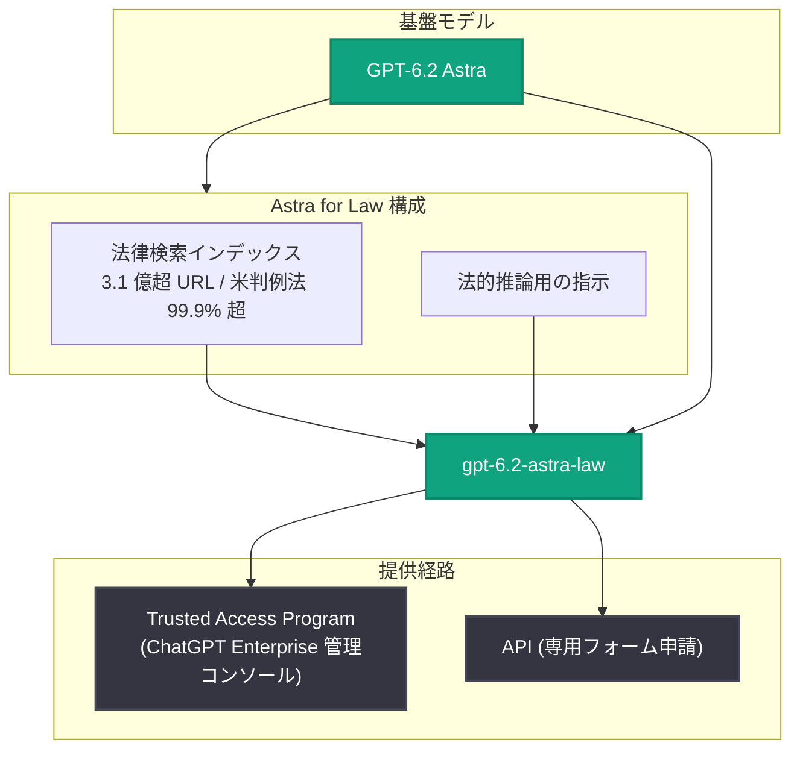

# Astra for Law が法務インテリジェンスでトップに: 24 法分野の評価で 1 位を獲得

## メタデータ

| 項目 | 内容 |
|------|------|
| 発表日 | 2026-11-17 |
| ソース | OpenAI News |
| カテゴリ | Company (法務特化モデル / エンタープライズ向け提供) |
| 公式リンク | https://openai.com/index/astra-law-6-2 |

## 概要

OpenAI は、GPT-6.2 Astra をベースとした法務特化構成モデル「Astra for Law」を発表した。本モデルは法律検索インデックスと法的推論用の指示を組み合わせた構成で、24 の法分野にわたる 120 課題のローンチ評価 (Harvey LAB-AA、Artificial Analysis 版) において満点率 20.8% で 1 位を獲得した。

本発表のもう 1 つの重要なポイントは提供範囲の拡大である。すべての ChatGPT Enterprise 顧客が、管理コンソールの Trusted Access Program 経由でアクセスを申請できるようになった。9 月の初期導入開始から 2 か月未満での一般申請受付開始となる。

## 主な内容

### ベンチマーク結果: Harvey LAB-AA (24 法分野・120 課題)

Artificial Analysis が運用する Harvey LAB-AA 評価における主要結果は以下のとおり。

| モデル | 満点率 | 備考 |
|--------|--------|------|
| Astra for Law | 20.8% | 1 位 |
| GPT-6.2 Astra | 15.0% | ベースモデル |
| Muse Wonder Full | 13.1% | 非 OpenAI モデルで最高 |

出力効率の面でも、Astra for Law の平均出力トークンは約 64,000 であり、Muse Wonder Full の約 139,000 と比較して 54% 少ない出力で上回るスコアを達成している。

### ハルシネーション (幻覚) の低減

法務用途で特に重要となるハルシネーションの発生率も評価されている。

| モデル | 重大ハルシネーション (件/課題) | 軽微ハルシネーション (件/課題) |
|--------|------|------|
| Astra for Law | 0.03 | 0.06 |
| Claude Opus 5.5 | 0.59 | 0.51 |

- Astra for Law の重大ハルシネーション率は GPT-6 と並び評価対象中最低
- OpenAI は Claude Opus 5.5 比で重大ハルシネーションが「95% 少ない」と主張 (約 20 分の 1)
- 全要件を達成した課題においては、重大ハルシネーションの発生はゼロ

### Vals AI Legal Research Bench での改善

第三者評価機関 Vals AI の Legal Research Bench でも改善が確認された。

- 9 月時点: 約 46% → 11 月 16 日評価: 53.8% (約 8 ポイント向上)
- 208 問中 112 問で満点を獲得
- 部分点を含めると獲得可能点の 90.9% に到達

### Harvey 自社 LAB での推移

Harvey 社が自社運用する LAB (LAB-AA とは別の評価) でも世代ごとの改善が示されている。

| モデル | スコア |
|--------|--------|
| GPT-6 Astra | 4.6% |
| GPT-6.2 Astra | 14.6% (約 3 倍) |
| Astra for Law | 16.2% (さらに +11%) |

### 法律検索インデックスの拡充

Astra for Law の中核をなす法律検索インデックスは、9 月比で 34% 拡大した。

- 8,000 万超の URL を新規追加 (英国、オーストラリア、カナダなどの国際法域を含む)
- 現在のインデックス規模は 3 億 1,000 万超の URL
- 米国の判例法の 99.9% 超をカバー

## 技術的な詳細

Astra for Law は、汎用モデル GPT-6.2 Astra を基盤として、以下の 2 要素を組み合わせた法務特化構成である。

1. **法律検索インデックス**: 3 億 1,000 万超の URL からなる大規模な法律文献・判例インデックス
2. **法的推論用の指示**: 法務タスクに最適化された推論指示

### 利用方法

- **ChatGPT Enterprise**: 管理コンソールの Trusted Access Program からアクセスを申請。承認後は ChatGPT 内でモデル `gpt-6.2-astra-law` を選択
- **API**: 専用フォームからの申請制

## アーキテクチャ

## ユースケース

OpenAI 社内の法務チームなどでの活用例として、以下が紹介されている。

- 反対側の立論をシミュレートさせる議論の相手役
- 法案の義務規定の解釈判断 (推奨事項か要件かの判別)
- 新規事業に適用される規制のマッピング
- 規制手続や社内ポリシーのワークフロー化
- 法令の注釈付きガイドサイトの構築

### 初期導入企業

Cooley、Ropes & Gray、Sullivan & Cromwell などの大手法律事務所が初期導入企業として挙げられている。

## 開発者・企業への影響

- ChatGPT Enterprise のすべての顧客が Trusted Access Program 経由で法務特化モデルへのアクセスを申請可能になり、法務部門での AI 活用の敷居が下がる
- ハルシネーション率の大幅な低減 (重大 0.03 件/課題) により、判例引用や法令解釈など正確性が必須の業務での実用性が向上
- 英国・オーストラリア・カナダなど国際法域のカバレッジ拡大により、クロスボーダー案件への適用範囲が拡大
- API 利用は申請制のため、法務系 SaaS やリーガルテック製品への組み込みを検討する開発者は専用フォームからの申請が必要

## 関連リンク

- [Astra for Law leads in legal intelligence (公式発表)](https://openai.com/index/astra-law-6-2)
- [OpenAI News](https://openai.com/news)
- [OpenAI ヘルプ (ChatGPT Enterprise)](https://help.openai.com/)

## まとめ

Astra for Law は、GPT-6.2 Astra に法律検索インデックスと法的推論指示を組み合わせた法務特化構成モデルであり、24 法分野・120 課題のローンチ評価 (Harvey LAB-AA) で満点率 20.8% の 1 位を獲得した。重大ハルシネーションは 1 課題あたり 0.03 件と評価対象中最低水準で、Vals AI Legal Research Bench でも 53.8% (部分点込みで 90.9%) と第三者評価での改善が確認されている。検索インデックスは 3 億 1,000 万超の URL に拡大し米国判例法の 99.9% 超をカバー。すべての ChatGPT Enterprise 顧客が Trusted Access Program 経由で申請可能となり、法務領域での AI 活用が本格的な普及段階に入ったことを示す発表である。
