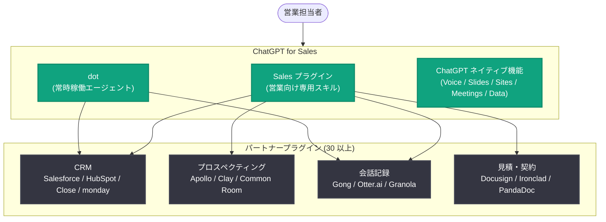

# ChatGPT for Sales 登場: 営業チーム向け Sales プラグインと 30 以上のパートナープラグイン

## メタデータ

| 項目 | 内容 |
|------|------|
| 発表日 | 2026-11-17 |
| ソース | OpenAI News |
| カテゴリ | 新機能 (Product) |
| 公式リンク | https://openai.com/index/introducing-chatgpt-for-sales |

## 概要

OpenAI は、営業チームが顧客をより深く理解し、雑務にかける時間を減らし、より多くの商談を成約させることを支援する「ChatGPT for Sales」を発表した。本機能は、営業担当者向けの専用スキルを備えた新しい Sales プラグインと、30 以上の新規・拡張されたパートナープラグインで構成される。これにより、チームが既に利用しているツールの情報を ChatGPT 上で活用し、商談前の準備、提案のカスタマイズ、迅速なフォローアップが可能になる。

営業活動に必要な情報は、チームメンバー、プロスペクティングツール、顧客との通話記録、CRM など複数の場所に分散しがちである。ChatGPT for Sales はこれらの情報を 1 か所に集約し、アカウント選定から商談準備、フォローアップ作成までの日常的な営業ワークフローを支援する。

## 主な内容

### Sales プラグイン: すべての営業担当者の出発点

OpenAI の新しい Sales プラグインは、日常の営業業務に対してすぐに使えるワークフローを提供する。対象となる業務は以下のとおり。

- 追求すべきアカウントの選定
- 商談 (コール) の準備
- フォローアップの下書き作成
- 商談を前進させるために買い手が必要とする情報の整理
- 注意が必要な商談とその理由の特定

### パートナープラグインによる営業プロセスの接続

ChatGPT for Sales は、既存ツールの顧客コンテキストを ChatGPT が利用できるようにするパートナープラグインへのアクセスを提供する。チームの営業プロセスに合わせてプラグインを選択できる。発表で示されたワークフロー別の対応ツールは以下のとおり。

| ワークフロー | 対応ツール・プラグイン |
|------------|---------------------|
| コンテンツ作成・セールスイネーブルメント | Confluence、Guru、Seismic (プロセス・製品情報の学習)、ChatGPT Voice (ピッチ練習・反論対応の練習)、ChatGPT Slides、Gamma、Figma、Canva (プレゼン作成)、ChatGPT Sites (インタラクティブデモ・ROI 計算ツール作成) |
| アカウント管理・商談推進 | Salesforce、HubSpot、Close CRM、monday CRM |
| 買い手の発見とエンゲージメント | Apollo、Clay、Common Room (アカウントシグナル)、Outreach、Salesloft (アウトリーチ計画) |
| 顧客との会話のアクション化 | ChatGPT の Meetings プラグイン、Gong、Otter.ai、Granola |
| パフォーマンス追跡・商談リスク検知 | Backstory (シグナル検知)、ChatGPT の Data プラグイン、Hex (パイプライン分析) |
| 見積・契約書の準備 | Docusign、Ironclad、PandaDoc、ServiceNow CPQ |

### dot (常時稼働エージェント) との連携

会話をまたいだ作業の継続には、ChatGPT 内の常時稼働エージェントである [dot](https://openai.com/index/introducing-dots/) への委任が可能。dot は同じプラグインと顧客コンテキストを使用して、以下を実行できる。

- ミーティングブリーフの準備
- 商談の更新状況のトラッキング
- 関連する変更と提案された次のステップをプロアクティブに提示し、レビューを依頼

### 営業チーム向けユースケース

**適切なアカウントでパイプラインを構築**: CRM 情報と ZoomInfo や Clay などのツールによるプロスペクト調査から、優先順位付きのアカウントリストを作成。各アカウントが適合する理由の確認、不足情報の特定、チームの優先事項に沿ったリストの調整を行い、同じ会話の中で具体的なエンゲージメント理由を持つアウトリーチへと展開できる。

**各買い手に対してより強力な提案を作成**: 商談前に、アカウント履歴、過去の通話、買い手の優先事項をまとめたブリーフィングを依頼。未解決の論点を検討した上で、Gamma や Canva を使って顧客固有のピッチへと展開できる。

**明確な次のステップで商談を前進**: 通話後に ChatGPT がフォローアップの下書き、合意した次のステップの記録、顧客レコードの更新案を準備。Attio などの接続ツールを使えば、次のステップを ChatGPT から直接 CRM に保存できる。

**パイプラインのリスクを可視化**: CRM 履歴と顧客との会話をもとに、商談の停滞要因を分析。Rox と組み合わせれば、dot に毎朝の商談チェック、注意が必要な変更のフラグ付け、ミーティングブリーフやフォローアップシーケンスの準備を任せられる。

## アーキテクチャ

## 利用開始方法

1. [Sales プラグインをインストール](https://chatgpt.com/plugins/sales)する
2. [ChatGPT for Sales の詳細ページ](https://openai.com/business/solutions/sales/)でパートナープラグインを確認する
3. ChatGPT Business および Enterprise の管理者は、[Admin Console](https://admin.openai.com/) からワークスペースを選択し、「Plugins」で Sales プラグインと関連パートナープラグインをメンバーが利用できるよう有効化、または[デフォルトでインストール](https://help.openai.com/articles/11509118-admin-controls-security-and-compliance-for-plugins-and-apps)する
4. 必要なアプリへのアクセスと、それらが使用できるアクションを確認する
5. ワークスペースメンバーは、プロンプトが表示された際に必要なアカウント接続を完了する

**注意**: パートナープラグインおよび機能の提供状況は、プラン、地域、ワークスペース設定によって異なる。

## 開発者・ビジネスへの影響

- **営業ワークフローの集約**: 複数ツールに分散していた顧客情報 (CRM、通話記録、プロスペクティングデータ) を ChatGPT 上で横断的に活用できるようになり、ツール間の切り替えコストが削減される
- **プラグインエコシステムの拡大**: 30 以上のパートナープラグインが新規追加・拡張され、SaaS ベンダーにとって ChatGPT プラグイン対応が営業向け市場での重要な接点となる
- **エージェントによる自動化**: dot との連携により、商談モニタリングやブリーフ作成などの定型業務をバックグラウンドで自動化できる
- **管理者による統制**: Admin Console を通じたプラグインの有効化・デフォルトインストール・アクション単位のアクセス管理により、企業のセキュリティ要件に沿った展開が可能

## 関連リンク

- [Introducing ChatGPT for Sales (公式発表)](https://openai.com/index/introducing-chatgpt-for-sales)
- [ChatGPT for Sales ソリューションページ](https://openai.com/business/solutions/sales/)
- [Sales プラグインのインストール](https://chatgpt.com/plugins/sales)
- [Introducing dots (常時稼働エージェント)](https://openai.com/index/introducing-dots/)
- [管理者向け: プラグインとアプリのコントロール・セキュリティ・コンプライアンス](https://help.openai.com/articles/11509118-admin-controls-security-and-compliance-for-plugins-and-apps)
- [OpenAI News](https://openai.com/news)

## まとめ

ChatGPT for Sales は、営業向け専用スキルを持つ Sales プラグインと 30 以上のパートナープラグインにより、アカウント調査から商談準備、CRM 更新、フォローアップまでの営業ワークフロー全体を ChatGPT 上に統合するものである。Salesforce や HubSpot などの主要 CRM、Gong や Otter.ai などの会話記録ツール、Docusign などの契約ツールと接続でき、常時稼働エージェント dot への委任によるプロアクティブな商談管理も可能になる。Business および Enterprise プランでは管理者が Admin Console から展開を制御でき、提供状況はプラン・地域・ワークスペース設定により異なる。OpenAI は今後もパートナープラグインエコシステムの拡充を継続するとしている。
