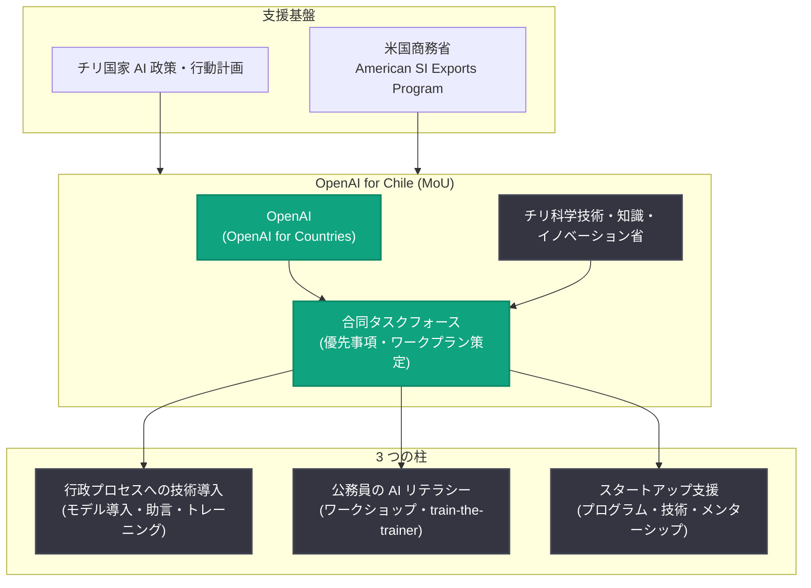

# OpenAI for Chile の発表: チリ政府との AI 活用パートナーシップ

## メタデータ

| 項目 | 内容 |
|------|------|
| 発表日 | 2026-11-17 |
| ソース | OpenAI News |
| カテゴリ | Global Affairs |
| 公式リンク | https://openai.com/index/introducing-openai-for-chile |

## 概要

OpenAI は、チリ政府 (科学技術・知識・イノベーション省が主導) とのパートナーシップ「OpenAI for Chile」を発表した。このパートナーシップは、行政における責任ある AI 導入の支援、公務員のスキル育成、そして地元スタートアップによる有用な AI アプリケーション開発の支援を目的としている。

覚書 (MoU) は、カリフォルニアで開催された Semafor の「Silicon Valley & The World」カンファレンスに合わせて署名され、チリ側は Ximena Lincolao 科学技術・知識・イノベーション大臣が合意を主導した。このパートナーシップはチリの国家 AI 政策および行動計画を基盤とし、米国商務省の American SI Exports Program (OpenAI はアンカーパートナー) の支援を受けている。

## 主な内容

### パートナーシップの背景と枠組み

OpenAI for Chile は、チリの国家 AI 政策と行動計画 (人材育成、研究、責任ある導入を支援する政策) の上に構築されている。覚書の署名には以下の特徴がある。

- **主導省庁**: チリ科学技術・知識・イノベーション省
- **署名の場**: Semafor「Silicon Valley & The World」カンファレンス (カリフォルニア) のサイドライン
- **米国政府の支援**: 米国商務省の American SI Exports Program が支援。OpenAI は同プログラムのアンカーパートナーであり、公共部門のイノベーション、スキル開発、起業家精神を通じてチリ自身の AI への野心の実現を支援する

OpenAI CEO の Sam Altman 氏は「AI は科学的発見の加速から、まだ想像されていないものの構築まで、人々の生活を向上させる最も重要な手段の 1 つになる。公務員によるツール活用、公共サービスの改善、新しい企業を立ち上げる起業家の支援に向けてチリと協力できることを嬉しく思う」と述べた。また、チリの Ximena Lincolao 大臣は「このコラボレーションが、チリ全土の科学的発見、起業家精神、イノベーションにもたらす並外れた機会に大きな期待を寄せている。チリの人々が可能性の限界を押し広げ、新しい技術を生み出し、人々の生活を改善するソリューションを開発できるようにする取り組みだ」とコメントした。

### チリにおける AI の活用 (3 つの柱)

#### 1. 行政プロセスへの技術導入

パートナーシップは、同省の行政プロセスにおける技術導入を模索する。これには、新しいモデルの導入に関する OpenAI からの支援の可能性に加え、省職員への助言とトレーニングが含まれる。

#### 2. 公務員向けの AI リテラシーとスキル育成

公務員に対しては、それぞれの役割に合わせた実践的な AI リテラシー、アップスキリング (スキル向上)、リスキリング (スキル再教育) を模索する。活動には以下が含まれ得る。

- ワークショップの開催と「トレーナー育成 (train-the-trainer)」アプローチ
- AI ツールの効果的な使い方
- 出力内容の確認 (チェック) 方法
- 機密情報の保護
- 人間による監督 (human oversight) の維持

#### 3. スタートアップ・イノベーションエコシステムの支援

チリの AI スタートアップとイノベーションエコシステムを支援するため、両者は以下を模索する。

- 関連する OpenAI のプログラムと技術へのアクセス
- 実践的な学習、技術的ガイダンス、メンターシップ
- 起業家と公共機関・大学・その他の地元パートナーとの連携による、チリの経済発展と公共サービスの優先課題を支援するアプリケーション開発

### 実行体制とセーフガード

- **合同タスクフォース**: 省と OpenAI の代表者による合同タスクフォースが、優先事項と初期ワークプランについて合意する予定。各活動にはリード (責任者)、マイルストーン、成功指標が設定される
- **個別合意**: 具体的な活動、対象資格、リソース、技術へのアクセスは別途合意される
- **投資・購買義務なし**: 本覚書は投資や購買のコミットメントを一切定めていない
- **セーフガード**: 活動はプライバシー、情報セキュリティ、責任ある利用のための適切なセーフガードの対象となる

### OpenAI for Countries について

OpenAI for Chile は、各国が AI を活用して国家的優先課題を前進させ、経済を強化し、機会を拡大することを支援する OpenAI のグローバルイニシアチブ「OpenAI for Countries」の一環である。OpenAI は政府や地元パートナーと協力し、AI の可能性を人々への実用的な利益へと転換することを目指している。

## パートナーシップの構造

## 開発者・関係者への影響

- **チリのスタートアップへの機会**: OpenAI のプログラムや技術へのアクセス、技術的ガイダンス、メンターシップの提供が模索されており、地元の開発者・起業家が AI アプリケーションを開発する環境が整備される可能性がある
- **公共部門との連携機会**: 起業家と公共機関・大学・地元パートナーを結び付ける協力が想定されており、公共サービス分野での AI アプリケーション開発の道が開かれる
- **ラテンアメリカにおける展開事例**: OpenAI for Countries の枠組みがチリに拡大したことで、各国政府との同様のパートナーシップモデルの広がりを示す事例となる
- **責任ある利用の枠組み**: 活動はプライバシー、情報セキュリティ、責任ある利用のセーフガードを前提としており、公共部門への AI 導入における参照モデルとなり得る

## 関連リンク

- [Introducing OpenAI for Chile (公式発表)](https://openai.com/index/introducing-openai-for-chile)
- [OpenAI News](https://openai.com/news)
- [OpenAI Global Affairs](https://openai.com/global-affairs/)

## まとめ

OpenAI for Chile は、チリ政府 (科学技術・知識・イノベーション省) との間で署名された覚書に基づくパートナーシップであり、(1) 行政プロセスへの技術導入、(2) 公務員の AI リテラシーとスキル育成、(3) スタートアップ・イノベーションエコシステムの支援、という 3 つの柱で構成される。チリの国家 AI 政策を基盤とし、米国商務省の American SI Exports Program の支援を受けている点が特徴である。覚書自体は投資や購買の義務を定めておらず、合同タスクフォースが今後の優先事項とワークプランを策定する。すべての活動はプライバシー、情報セキュリティ、責任ある利用のセーフガードの下で実施される。OpenAI for Countries イニシアチブの一環として、AI の可能性を各国の実用的な利益へと転換する取り組みがチリへ拡大した形となる。
